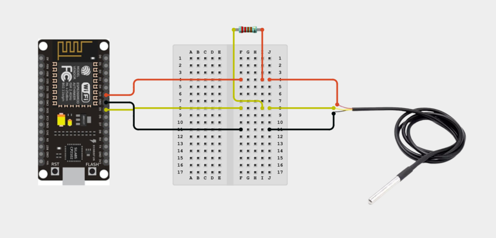
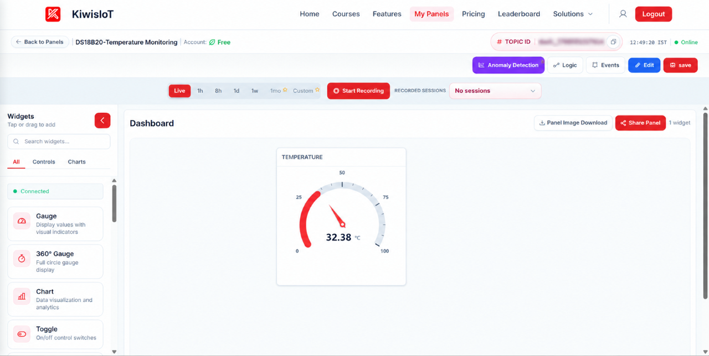
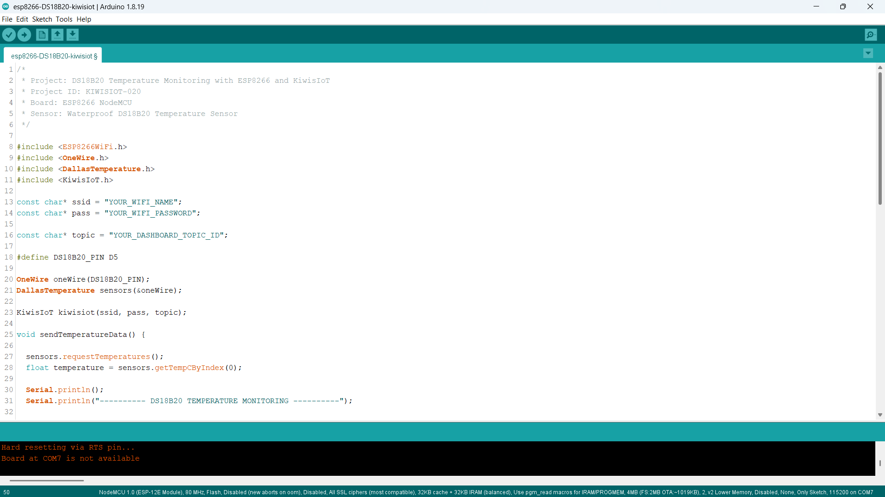
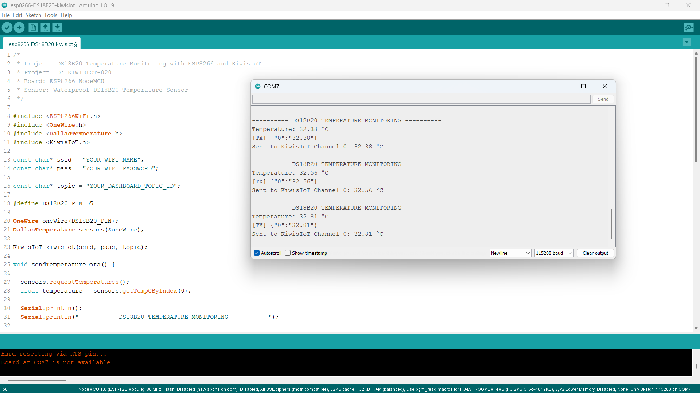

# ESP8266 DS18B20 IoT Project: Monitor Temperature in Real Time with KiwisIoT 🌡️

Build an **ESP8266 DS18B20 IoT project** to monitor temperature using a **waterproof DS18B20 temperature sensor, ESP8266 NodeMCU, Arduino, and KiwisIoT**.

In this project, the DS18B20 sensor measures the surrounding temperature. The ESP8266 reads the temperature through the OneWire communication interface and sends the data to a KiwisIoT IoT dashboard over Wi-Fi.

The dashboard displays the temperature in **degrees Celsius (°C)** using a gauge widget. This project demonstrates how temperature data can be collected, transmitted, and monitored remotely using an IoT platform.

---

## 🚀 Project Highlights

- ESP8266-based temperature monitoring
- Waterproof DS18B20 digital temperature sensor
- OneWire communication using a single data pin
- Temperature measurement in °C
- KiwisIoT Channel 0 for temperature data
- Real-time dashboard visualization using a gauge widget
- Wi-Fi-based remote monitoring
- Serial Monitor output for sensor testing
- Automatic temperature updates approximately every 2.5 seconds
- Sensor error checking for disconnected or invalid readings
- Suitable for electronics, embedded systems, environmental monitoring, and student IoT projects

---

## 🔎 Project Overview

The **DS18B20** is a digital temperature sensor that measures temperature and communicates with a microcontroller through the OneWire protocol. The waterproof version is suitable for temperature-monitoring experiments where a protected sensor probe is useful.

In this project, the DS18B20 sensor is connected to the **ESP8266 NodeMCU** using the D5 digital pin. A 4.7 kΩ pull-up resistor is used between the sensor's DATA line and its power supply.

The ESP8266 reads the temperature using the OneWire and DallasTemperature libraries.

The program performs the following operations:

- Initializes the DS18B20 temperature sensor.
- Requests a temperature measurement.
- Checks whether the sensor reading is valid.
- Displays the temperature in the Serial Monitor.
- Sends the temperature to KiwisIoT Channel 0.
- Updates the dashboard approximately every 2.5 seconds.

The project flow is:

```text
       DS18B20 Sensor
               ↓
      Temperature Reading
               ↓
      OneWire Communication
               ↓
       ESP8266 NodeMCU
               ↓
      Validate Temperature
               ↓
             Wi-Fi
               ↓
           KiwisIoT
               ↓
       Temperature Gauge
```

---

## 💡 Why This Project?

Temperature is an important measurement in environmental monitoring, equipment observation, and many electronics projects.

A digital temperature sensor connected to a microcontroller can collect temperature readings locally. By connecting the ESP8266 to an IoT platform, the measurements can also be displayed on a dashboard for convenient remote monitoring.

This project demonstrates how to combine a digital temperature sensor, an ESP8266, OneWire communication, and cloud-connected visualization in one practical system.

It provides a foundation for applications such as:

- Temperature monitoring
- Environmental data observation
- Equipment temperature tracking
- IoT-based sensor dashboards
- Student electronics projects
- Embedded systems experiments

---

## 📚 What You'll Learn

By building this project, you will learn how to:

- Connect a DS18B20 sensor to an ESP8266 NodeMCU.
- Understand the OneWire communication interface.
- Connect a 4.7 kΩ pull-up resistor.
- Install and use the OneWire and DallasTemperature libraries.
- Read temperature measurements in degrees Celsius.
- Check for disconnected or invalid sensor readings.
- Format temperature values to two decimal places.
- Send sensor data to a KiwisIoT channel.
- Configure a gauge widget for temperature monitoring.
- Monitor sensor measurements over Wi-Fi.
- Troubleshoot common sensor and dashboard connection issues.

---

## 🧰 Components Required

| Component | Quantity |
|---|---:|
| ESP8266 NodeMCU | 1 |
| Waterproof DS18B20 Temperature Sensor | 1 |
| 4.7 kΩ Resistor | 1 |
| Jumper Wires | As required |
| Breadboard | 1 |
| USB Cable | 1 |
| Computer | 1 |

---

## 💻 Software Requirements

- Arduino IDE
- ESP8266 board package
- KiwisIoT Arduino library
- OneWire library
- DallasTemperature library
- KiwisIoT account
- Wi-Fi connection

### Common KiwisIoT Setup

Before starting this project, complete the common **KiwisIoT Arduino Setup Guide**.

The setup guide covers:

- Arduino IDE installation
- ESP8266 board installation and selection
- KiwisIoT Arduino library installation
- KiwisIoT panel setup
- Topic ID configuration
- Dashboard widget setup and configuration

The common setup guide is available in the parent `esp8266` directory:

[Open the KiwisIoT Arduino Setup Guide](../kiwisiot-arduino-setup/)

### DS18B20 Library Setup

Install the **OneWire** and **DallasTemperature** libraries using the Arduino IDE Library Manager.

1. Open Arduino IDE.
2. Navigate to **Sketch → Include Library → Manage Libraries**.
3. Search for `OneWire`.
4. Install the OneWire library.
5. Search for `DallasTemperature`.
6. Install the DallasTemperature library.
7. Confirm that both libraries are available before compiling the project.

The `ESP8266WiFi.h` library provides ESP8266 Wi-Fi functionality, while `KiwisIoT.h` enables communication with the KiwisIoT platform.

---

## 🛠️ Technologies Used

- ESP8266 NodeMCU
- Waterproof DS18B20 Temperature Sensor
- Arduino IDE
- OneWire Library
- DallasTemperature Library
- ESP8266WiFi Library
- KiwisIoT Arduino Library
- KiwisIoT IoT Dashboard
- OneWire Communication
- Wi-Fi
- C++ / Arduino

---

## 🔌 Circuit Connection

Connect the waterproof DS18B20 temperature sensor to the ESP8266 NodeMCU as shown in the circuit diagram.

| DS18B20 Sensor | ESP8266 NodeMCU |
|---|---|
| VCC / Red wire | 3.3V |
| GND / Black wire | GND |
| DATA / Yellow wire* | D5 |

\*Wire colors can vary between sensor models. Verify the labels or datasheet for your particular sensor before connecting it.

Connect a **4.7 kΩ pull-up resistor between DATA and 3.3V**.

The sensor's DATA line is connected to D5, which is defined in the program as:

```cpp
#define DS18B20_PIN D5
```

The OneWire object uses this pin to communicate with the sensor.



> **Note:** The circuit uses a 4.7 kΩ pull-up resistor on the DATA line. Check the sensor's pinout before applying power, and do not connect 5V signals directly to ESP8266 GPIO pins.

---

## 🔬 How the DS18B20 Sensor Works

The DS18B20 is a digital temperature sensor that measures temperature and communicates with a microcontroller using the OneWire protocol.

Unlike sensors that require separate clock and data lines, OneWire communication uses a single data line along with power and ground.

In this project, the OneWire and DallasTemperature libraries provide the functions required to communicate with the DS18B20 sensor.

### 1. Initialize the Sensor

The program creates the OneWire and DallasTemperature objects:

```cpp
OneWire oneWire(DS18B20_PIN);
DallasTemperature sensors(&oneWire);
```

The sensor is initialized in `setup()`:

```cpp
sensors.begin();
```

### 2. Request a Temperature Reading

The program requests a temperature measurement using:

```cpp
sensors.requestTemperatures();
```

It then reads the first detected sensor's temperature in degrees Celsius:

```cpp
float temperature = sensors.getTempCByIndex(0);
```

### 3. Validate the Reading

The program checks whether the sensor is disconnected or the returned temperature is outside the DS18B20's specified operating measurement range.

```cpp
if (temperature == DEVICE_DISCONNECTED_C ||
    temperature < -55.0 || temperature > 125.0) {
  Serial.println("ERROR: DS18B20 sensor not detected!");
  Serial.println("Check DATA wiring and the 4.7k ohm resistor.");
  return;
}
```

If the reading is invalid, the program displays an error and does not send that reading to KiwisIoT.

### 4. Display the Temperature

The program prints the temperature with two decimal places:

```cpp
Serial.print("Temperature: ");
Serial.print(temperature, 2);
Serial.println(" °C");
```

For example, the Serial Monitor may display:

```text
Temperature: 32.38 °C
```

Actual readings depend on the sensor's environment and operating conditions.

---

## 🌡️ Temperature Monitoring

The ESP8266 reads the temperature from the DS18B20 sensor and sends it to KiwisIoT Channel 0.

### Temperature Data Processing

The program requests a temperature reading and retrieves the result:

```cpp
sensors.requestTemperatures();
float temperature = sensors.getTempCByIndex(0);
```

The temperature is converted into a string with two decimal places before transmission:

```cpp
String temperatureData = String(temperature, 2);
```

The program sends the value to Channel 0:

```cpp
kiwisiot.send("0", temperatureData);
```

### Example Temperature Reading

The supplied Serial Monitor screenshot shows temperature readings in this format:

```text
Temperature: 32.38 °C
Sent to KiwisIoT Channel 0: 32.38 °C
```

Other readings in the supplied screenshot include values around `32.56 °C` and `32.81 °C`.

These are examples from the supplied output, not fixed values. Actual readings may change with the surrounding temperature.

---

## ☁️ KiwisIoT Dashboard

This project uses **one KiwisIoT channel** to display the DS18B20 temperature measurement.

| Channel | Data | Unit |
|---|---|---|
| `0` | Temperature | °C |

The temperature value is sent to Channel 0 so the dashboard's gauge widget can display the measurement.

The data flow is:

```text
       DS18B20 Sensor
               ↓
       ESP8266 NodeMCU
               ↓
      Read Temperature
               ↓
       Validate Reading
               ↓
       Format Temperature
               ↓
           Channel 0
               ↓
       Temperature Gauge
```



The supplied dashboard screenshot shows a temperature gauge displaying a reading of approximately **32.38 °C**.

This is an example reading from the screenshot. The gauge will display the latest valid temperature value received by KiwisIoT.

---

## ⚙️ Dashboard Configuration

Create a KiwisIoT panel and add a gauge widget to display the DS18B20 temperature measurement.

### 1. Temperature Gauge

Configure the gauge to receive temperature data from Channel 0.

Use the following settings as a starting point:

```text
Widget Name: TEMPERATURE
Channel ID: 0
Unit: °C
```

Set the minimum and maximum values according to the temperature range you want to monitor. Choose a range appropriate for your application.

### Channel Mapping in Arduino

The program sends temperature using:

```cpp
kiwisiot.send("0", temperatureData);
```

The dashboard gauge must use the same channel ID.

> **Important:** The channel ID configured in the dashboard must match the channel ID used in the Arduino code. This project sends temperature data only to Channel 0.

---

## 💻 Arduino Code

The complete Arduino program is available in the project `code` directory.

The program uses these headers:

```cpp
#include <ESP8266WiFi.h>
#include <OneWire.h>
#include <DallasTemperature.h>
#include <KiwisIoT.h>
```

Their purposes are:

- `ESP8266WiFi.h` — provides ESP8266 Wi-Fi functionality.
- `OneWire.h` — provides OneWire communication with the sensor.
- `DallasTemperature.h` — provides functions for requesting and reading DS18B20 temperature measurements.
- `KiwisIoT.h` — enables communication with the KiwisIoT platform.

The sensor objects are created using:

```cpp
OneWire oneWire(DS18B20_PIN);
DallasTemperature sensors(&oneWire);
```

The ESP8266 initializes the sensor, reads and validates the temperature, and sends valid readings to the dashboard.



---

## 🔐 Configure Wi-Fi and KiwisIoT

Before uploading the program, update these values in the Arduino code:

```cpp
const char* ssid = "YOUR_WIFI_NAME";
const char* pass = "YOUR_WIFI_PASSWORD";

const char* topic = "YOUR_DASHBOARD_TOPIC_ID";
```

Replace `YOUR_WIFI_NAME` with your Wi-Fi network name.

Replace `YOUR_WIFI_PASSWORD` with your Wi-Fi password.

Replace `YOUR_DASHBOARD_TOPIC_ID` with the Topic ID of your KiwisIoT panel.

Make sure the Topic ID corresponds to the panel where you configured the temperature gauge.

> **Security:** Never publish your actual Wi-Fi password or private credentials in a public GitHub repository. Keep placeholders in the public example and configure your credentials locally.

---

## 📝 Complete Arduino Code

```cpp
/*
 * Project: DS18B20 Temperature Monitoring with ESP8266 and KiwisIoT
 * Project ID: KIWISIOT-020
 * Board: ESP8266 NodeMCU
 * Sensor: Waterproof DS18B20 Temperature Sensor
 */

#include <ESP8266WiFi.h>
#include <OneWire.h>
#include <DallasTemperature.h>
#include <KiwisIoT.h>

const char* ssid = "YOUR_WIFI_NAME";
const char* pass = "YOUR_WIFI_PASSWORD";

const char* topic = "YOUR_DASHBOARD_TOPIC_ID";

#define DS18B20_PIN D5

OneWire oneWire(DS18B20_PIN);
DallasTemperature sensors(&oneWire);

KiwisIoT kiwisiot(ssid, pass, topic);

void sendTemperatureData() {

  sensors.requestTemperatures();
  float temperature = sensors.getTempCByIndex(0);

  Serial.println();
  Serial.println("---------- DS18B20 TEMPERATURE MONITORING ----------");

  if (temperature == DEVICE_DISCONNECTED_C ||
      temperature < -55.0 || temperature > 125.0) {
    Serial.println("ERROR: DS18B20 sensor not detected!");
    Serial.println("Check DATA wiring and the 4.7k ohm resistor.");
    return;
  }

  Serial.print("Temperature: ");
  Serial.print(temperature, 2);
  Serial.println(" °C");

  String temperatureData = String(temperature, 2);

  kiwisiot.send("0", temperatureData);

  Serial.print("Sent to KiwisIoT Channel 0: ");
  Serial.print(temperatureData);
  Serial.println(" °C");
}

void setup() {
  Serial.begin(115200);

  Serial.println();
  Serial.println("===== DS18B20 TEMPERATURE MONITORING =====");

  sensors.begin();

  Serial.println("DS18B20 sensor initialized.");
  Serial.println("Connecting to KiwisIoT...");

  kiwisiot.begin();

  Serial.println("KiwisIoT initialized.");
  Serial.println("Starting temperature monitoring...");
}

void loop() {
  kiwisiot.run();

  static unsigned long lastSend = 0;

  if (millis() - lastSend >= 2500) {
    lastSend = millis();
    sendTemperatureData();
  }

  delay(100);
}
```

---

## ⬆️ Upload the Program

Follow these steps to upload the program:

1. Connect the DS18B20 sensor to the ESP8266 NodeMCU according to the circuit diagram.
2. Connect the NodeMCU to your computer using a USB cable.
3. Open `esp8266-DS18B20-kiwisiot.ino` in Arduino IDE.
4. Install the ESP8266 board package if it is not already installed.
5. Install the OneWire, DallasTemperature, and KiwisIoT Arduino libraries.
6. Select the appropriate ESP8266 NodeMCU board.
7. Update the Wi-Fi credentials and KiwisIoT Topic ID.
8. Verify the code.
9. Upload the program.
10. Open the Serial Monitor.
11. Set the baud rate to `115200`.

After startup, the ESP8266 initializes the DS18B20 sensor and initializes KiwisIoT.

The program then requests temperature readings and sends valid measurements to KiwisIoT approximately every 2.5 seconds.

**Important:** The startup message `DS18B20 sensor initialized.` follows the call to `sensors.begin()`. The program checks the returned temperature inside the measurement function, so a disconnected sensor may be reported when the first reading is attempted.

---

## 🖥️ Serial Monitor Output

The Serial Monitor displays the measured temperature and the value sent to KiwisIoT.

Set the baud rate to `115200` to match the program:

```cpp
Serial.begin(115200);
```

### Example Output

The supplied Serial Monitor screenshot shows output in this format:

```text
===== DS18B20 TEMPERATURE MONITORING =====
DS18B20 sensor initialized.
Connecting to KiwisIoT...
KiwisIoT initialized.
Starting temperature monitoring...

---------- DS18B20 TEMPERATURE MONITORING ----------
Temperature: 32.38 °C
Sent to KiwisIoT Channel 0: 32.38 °C

---------- DS18B20 TEMPERATURE MONITORING ----------
Temperature: 32.56 °C
Sent to KiwisIoT Channel 0: 32.56 °C
```

The supplied screenshot also shows a reading around `32.81 °C`.

The exact values may differ during testing. The output above illustrates the format used by the program.



---

## 🔄 Understanding the Data Flow

The project processes the DS18B20 temperature measurement in several stages.

### 1. Initialize the Sensor

The program initializes the OneWire and DallasTemperature objects:

```cpp
OneWire oneWire(DS18B20_PIN);
DallasTemperature sensors(&oneWire);

sensors.begin();
```

### 2. Request a Temperature Measurement

The ESP8266 requests a temperature reading:

```cpp
sensors.requestTemperatures();
```

### 3. Read the Temperature

The program reads the temperature in degrees Celsius:

```cpp
float temperature = sensors.getTempCByIndex(0);
```

### 4. Validate the Reading

The program checks for a disconnected sensor or a temperature outside the checked range:

```cpp
if (temperature == DEVICE_DISCONNECTED_C ||
    temperature < -55.0 || temperature > 125.0) {
  Serial.println("ERROR: DS18B20 sensor not detected!");
  Serial.println("Check DATA wiring and the 4.7k ohm resistor.");
  return;
}
```

If the reading is invalid, the function returns without sending the measurement.

### 5. Format the Temperature

The temperature is converted to a string with two decimal places:

```cpp
String temperatureData = String(temperature, 2);
```

### 6. Send the Measurement to KiwisIoT

The program sends the value through Channel 0:

```cpp
kiwisiot.send("0", temperatureData);
```

### 7. Display the Result

KiwisIoT receives the measurement and displays it on the configured temperature gauge.

The complete data flow is:

```text
       DS18B20 Sensor
               ↓
      OneWire Communication
               ↓
       ESP8266 NodeMCU
               ↓
      Request Temperature
               ↓
       Validate Reading
               ↓
       Format Temperature
               ↓
           Channel 0
               ↓
       Temperature Gauge
```

---

## 🧪 Testing the Project

To test the project:

1. Connect the DS18B20 sensor to the ESP8266 according to the circuit diagram.
2. Check the VCC, GND, and DATA connections.
3. Verify that the 4.7 kΩ pull-up resistor connects DATA to 3.3V.
4. Upload the Arduino program.
5. Open the Serial Monitor at `115200` baud.
6. Confirm that the startup messages appear.
7. Check that temperature readings appear in degrees Celsius.
8. Open the KiwisIoT dashboard.
9. Confirm that the temperature gauge receives Channel 0 data.
10. Observe the readings over several update cycles.

### Test 1: Temperature Reading

Expected output format:

```text
Temperature: 32.38 °C
Sent to KiwisIoT Channel 0: 32.38 °C
```

The numerical value is an example from the supplied screenshot. Your actual reading may differ.

### Test 2: Observe Temperature Changes

Allow the sensor to remain in its environment and observe the Serial Monitor over several update cycles.

The readings may change as the sensor temperature changes. The speed and amount of change depend on the sensor, its surroundings, and how it is used.

### Test 3: Dashboard Monitoring

Verify that:

- The temperature gauge displays data from Channel 0.
- The widget uses °C as its unit.
- The displayed value corresponds to the temperature reported in the Serial Monitor.
- The dashboard receives updated measurements.

The dashboard should update as the ESP8266 sends new valid readings.

> **Note:** The waterproof probe protects the sensing element, but its suitability for a particular liquid or environment depends on the probe's construction and specifications. Avoid immersing cable joints or exposed electrical connections.

---

## ❓ Why Use the DS18B20 Sensor?

The DS18B20 is a digital temperature sensor that communicates through the OneWire protocol. Its single data line makes it useful for learning sensor interfacing with microcontrollers.

In this project, the waterproof DS18B20 probe is connected to an ESP8266 NodeMCU, allowing temperature measurements to be collected and sent to KiwisIoT.

The project sends one measurement to KiwisIoT:

```text
Channel 0 → Temperature (°C)
```

Using a separate channel for temperature allows the dashboard gauge to display the reading with an appropriate unit and range.

The project is useful for learning digital sensor communication, temperature reading, error checking, data transmission, and IoT dashboard configuration.

---

## 🛠️ Troubleshooting

### DS18B20 Sensor Is Not Detected

If the Serial Monitor displays:

```text
ERROR: DS18B20 sensor not detected!
Check DATA wiring and the 4.7k ohm resistor.
```

Check:

- VCC and GND connections.
- DATA connection to D5.
- Whether the 4.7 kΩ pull-up resistor connects DATA to 3.3V.
- Jumper wires and breadboard connections.
- The sensor's pinout and wire colors.
- Whether the OneWire and DallasTemperature libraries are installed correctly.

### Temperature Readings Are Missing or Invalid

Check:

- Whether the sensor is connected properly.
- Whether the DATA line is connected to D5.
- Whether the pull-up resistor is installed correctly.
- Whether the sensor is powered correctly.
- Whether the program compiles and uploads successfully.

### Dashboard Does Not Receive Data

Check:

- Wi-Fi name and password.
- Internet connection.
- KiwisIoT Topic ID.
- KiwisIoT Arduino library installation.
- Whether `kiwisiot.begin()` is called.
- Whether `kiwisiot.run()` continues to execute in `loop()`.
- Whether the dashboard belongs to the configured Topic ID.

### Temperature Gauge Shows No Value

Confirm that the temperature gauge is configured for Channel 0.

The code sends temperature using:

```cpp
kiwisiot.send("0", temperatureData);
```

### Gauge Values Appear Incorrect

Check the gauge's configured unit and minimum and maximum values.

Make sure the widget is configured to display degrees Celsius and that its range is suitable for the temperatures you expect to measure.

The gauge settings affect visualization; they do not change the sensor's measurements.

### Serial Monitor Shows Incorrect Characters

Make sure the baud rate is set to `115200`, matching:

```cpp
Serial.begin(115200);
```

---

## 🔒 Security

Never publish sensitive credentials in a public GitHub repository.

Do not commit:

- Wi-Fi passwords
- API keys
- Access tokens
- Account passwords
- Private credentials
- Private dashboard access information

Use placeholders in the public example:

```text
YOUR_WIFI_NAME
YOUR_WIFI_PASSWORD
YOUR_DASHBOARD_TOPIC_ID
```

Enter your actual credentials only in your local Arduino project.

If you share screenshots publicly, blur your private KiwisIoT Topic ID where appropriate.

---

## 🌱 Possible Applications

An ESP8266 DS18B20 temperature-monitoring system can be used as a starting point for:

- Environmental temperature monitoring
- Equipment temperature observation
- Temperature-monitoring experiments
- IoT-based temperature dashboards
- Student electronics projects
- Embedded systems learning
- Remote sensor data visualization
- Temperature monitoring using a suitable waterproof probe

The project can be extended with additional sensors, data logging, charts, alerts, or other KiwisIoT dashboard features.

For example, combining the DS18B20 with a humidity sensor could provide additional environmental measurements on the same dashboard.

> **Note:** This project provides sensor-based temperature monitoring. It does not independently control temperature or guarantee suitability for safety-critical temperature applications.

---

## 📁 Project Structure

```text
020-DS18B20-kiwisiot/
│
├── README.md
│
├── code/
│   └── esp8266-DS18B20-kiwisiot.ino
│
└── images/
    ├── circuit.png
    ├── code.png
    ├── serial-monitor.png
    └── dashboard-output.png
```

---

## 🔗 Related KiwisIoT ESP8266 Projects

This project is part of the KiwisIoT ESP8266 IoT project collection.

- [ESP8266 LDR Sensor IoT Project](../001-ldr-kiwisiot/)
- [ESP8266 IR Sensor IoT Project](../002-ir-kiwisiot/)
- [ESP8266 Ultrasonic Sensor IoT Project](../003-ultrasonic-kiwisiot/)
- [ESP8266 DHT11 Temperature and Humidity IoT Project](../004-dht11-kiwisiot/)
- [ESP8266 PIR Motion Sensor IoT Project](../005-pir-kiwisiot/)
- [ESP8266 Gas Sensor IoT Project](../006-gas-kiwisiot/)
- [ESP8266 Flame Sensor IoT Project](../007-flame-kiwisiot/)
- [ESP8266 Soil Moisture IoT Project](../008-soil-moisture-kiwisiot/)
- [ESP8266 Water Level Sensor IoT Project](../009-water-level-kiwisiot/)
- [ESP8266 Raindrop Sensor IoT Project](../010-raindrop-kiwisiot/)
- [ESP8266 Sound Sensor IoT Project](../011-sound-kiwisiot/)
- [ESP8266 MPU6050 Motion and Acceleration IoT Project](../012-mpu6050-kiwisiot/)
- [ESP8266 Voltage Sensor IoT Project](../013-voltage-kiwisiot/)
- [ESP8266 Current Sensor IoT Project](../014-current-kiwisiot/)
- [ESP8266 Vibration Sensor IoT Project](../015-vibration-kiwisiot/)
- [ESP8266 Reed Switch IoT Project](../016-reed-switch-kiwisiot/)
- [ESP8266 Hall Effect Sensor IoT Project](../017-hall-effect-kiwisiot/)
- [ESP8266 Touch Sensor IoT Project](../018-touch-sensor-kiwisiot/)
- [ESP8266 BMP180 Temperature and Air Pressure IoT Project](../019-bmp180-kiwisiot/)

For Arduino and KiwisIoT setup, see the [KiwisIoT Arduino Setup Guide](../kiwisiot-arduino-setup/).

---

## ❓ Frequently Asked Questions

### What is the DS18B20 sensor?

The DS18B20 is a digital temperature sensor that measures temperature and communicates with a microcontroller using the OneWire protocol.

### Which ESP8266 board is used?

This project uses the ESP8266 NodeMCU development board.

### Which sensor library is used?

The project uses the OneWire and DallasTemperature libraries.

### Which pin connects the DS18B20 to the ESP8266?

The DATA line connects to D5, as defined in the Arduino code:

```cpp
#define DS18B20_PIN D5
```

### Why is a 4.7 kΩ resistor used?

The resistor acts as a pull-up between the DATA line and 3.3V to support reliable OneWire communication.

### What does the project measure?

It measures temperature in degrees Celsius.

### Which KiwisIoT channel is used?

The project uses Channel 0 for temperature:

```text
Channel 0 → Temperature (°C)
```

### Which dashboard widget is used?

A gauge widget is used to display the temperature measurement.

### How often is the data sent?

The program attempts to read and send a temperature measurement approximately every 2.5 seconds.

### What happens if the sensor reading is invalid?

The program prints an error message and skips sending that reading to KiwisIoT.

### Can the project be extended?

Yes. You can add data logging, charts, alerts, or additional sensors to expand the monitoring system.

---

## 📌 Summary

This project demonstrates an **ESP8266 DS18B20 IoT temperature-monitoring system** using a waterproof DS18B20 sensor and KiwisIoT.

The ESP8266 communicates with the sensor through the OneWire interface, reads and validates the temperature, and sends valid measurements to KiwisIoT Channel 0 over Wi-Fi.

The final dashboard displays:

```text
Channel 0 → Temperature (°C)
```

With a gauge widget, the project provides a practical introduction to digital temperature sensing, OneWire communication, sensor error checking, and IoT-based remote monitoring.

---

## 📄 License

This project is licensed under the MIT License. See the `LICENSE` file for details.
