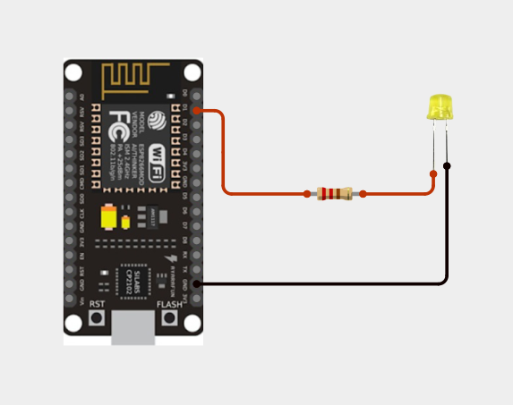
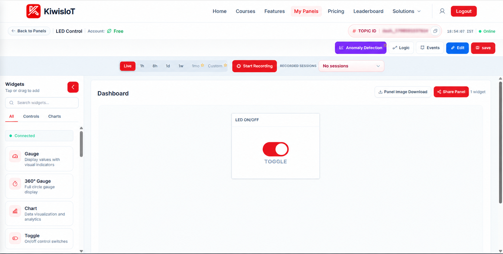
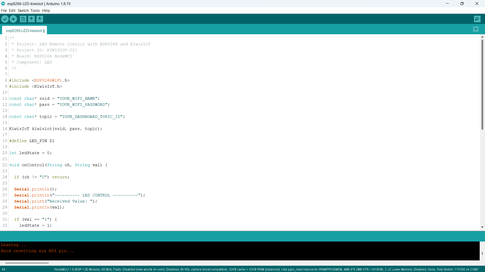
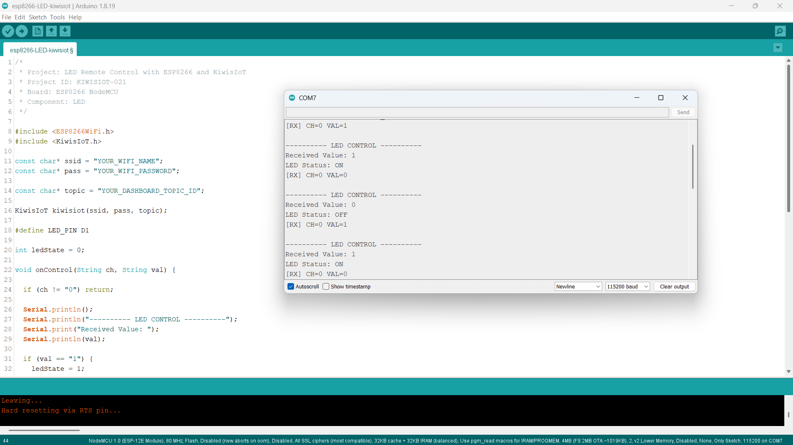

# ESP8266 LED IoT Project: Control an LED Remotely with KiwisIoT 💡

Build an **ESP8266 LED IoT project** to control an LED remotely using an **ESP8266 NodeMCU, an external LED, Arduino IDE, and KiwisIoT**.

In this project, an LED is connected to the ESP8266 NodeMCU through a current-limiting resistor. A Toggle widget on the KiwisIoT dashboard allows you to switch the LED ON or OFF remotely over Wi-Fi.

When you change the Toggle widget, KiwisIoT sends the control value to the ESP8266. The board processes the received value and changes the digital output on pin D1 to control the LED.

This project demonstrates how to build a simple IoT-based device control system using an ESP8266 and a cloud-connected dashboard.

---

## 🚀 Project Highlights

- Remote LED control using KiwisIoT
- ESP8266 NodeMCU development board
- External LED connected to digital pin D1
- Current-limiting resistor for LED protection
- KiwisIoT Toggle widget for ON/OFF control
- Channel 0 for receiving control values
- Wi-Fi-based communication
- Serial Monitor output for debugging
- Callback-based command handling using `kiwisiot.onReceive()`
- Suitable for beginners learning GPIO control and IoT automation

---

## 🔎 Project Overview

The **ESP8266 LED IoT project** demonstrates how to control a physical electronic component using a web-based IoT dashboard.

The ESP8266 NodeMCU connects to KiwisIoT over Wi-Fi. The dashboard contains a Toggle widget configured to send control values through Channel 0.

When the Toggle widget is activated, the ESP8266 receives the value `1` and sets D1 HIGH, turning the external LED ON. When the Toggle widget is deactivated, the ESP8266 receives the value `0` and sets D1 LOW, turning the LED OFF.

The program uses the KiwisIoT receive callback to process incoming control commands.

The project flow is:

```text
       KiwisIoT Dashboard
               |
          Toggle Widget
               |
           Channel 0
               |
             Wi-Fi
               |
       ESP8266 NodeMCU
               |
       Receive Callback
               |
       Process ON/OFF Value
               |
          GPIO D1
               |
          External LED
```

---

## 💡 Why This Project?

Many electronic devices can be controlled by switching a microcontroller's digital output HIGH or LOW. Connecting the ESP8266 to an IoT platform allows this control to be performed remotely through a dashboard.

This project introduces the basic principles of remote device control without requiring a complicated automation system.

It also provides a foundation for expanding the project to control other devices, such as indicators, low-voltage modules, and suitable driver circuits.

The project is useful for learning:

- Digital output control
- Wi-Fi-based communication
- Dashboard-based device control
- Callback functions
- GPIO interfacing
- Basic IoT automation

---

## 📚 What You'll Learn

By building this project, you will learn how to:

- Connect an external LED to an ESP8266 NodeMCU.
- Use a resistor to limit LED current.
- Configure an ESP8266 GPIO pin as an output.
- Connect an ESP8266 to KiwisIoT.
- Configure a Toggle widget for remote control.
- Receive commands through Channel 0.
- Process incoming data using a callback function.
- Control an LED using HIGH and LOW output states.
- Display received commands in the Serial Monitor.
- Troubleshoot common IoT communication and circuit problems.

---

## 🧰 Components Required

| Component | Quantity |
|---|---:|
| ESP8266 NodeMCU | 1 |
| External LED | 1 |
| Current-limiting resistor (e.g., 220 Ω) | 1 |
| Jumper wires | As required |
| Breadboard | 1 |
| USB cable | 1 |
| Computer | 1 |

---

## 💻 Software Requirements

- Arduino IDE
- ESP8266 board package
- KiwisIoT Arduino library
- KiwisIoT account
- Wi-Fi connection

### Common KiwisIoT Setup

Before starting this project, complete the common **KiwisIoT Arduino Setup Guide**.

The setup guide covers:

- Arduino IDE installation
- ESP8266 board installation and selection
- KiwisIoT Arduino library installation
- KiwisIoT panel setup
- Topic ID configuration
- Dashboard widget setup and configuration

The common setup guide is available in the parent `esp8266` directory:

[Open the KiwisIoT Arduino Setup Guide](../kiwisiot-arduino-setup/)

### KiwisIoT Library Setup

Install the KiwisIoT Arduino library through the Arduino IDE Library Manager if it is not already installed.

1. Open Arduino IDE.
2. Navigate to **Sketch → Include Library → Manage Libraries**.
3. Search for the KiwisIoT library.
4. Install the library according to the available library listing or the KiwisIoT setup guide.
5. Confirm that the library is available before compiling the program.

The `ESP8266WiFi.h` header provides ESP8266 Wi-Fi functionality, while `KiwisIoT.h` provides the functions used to communicate with the KiwisIoT platform.

---

## 🛠️ Technologies Used

- ESP8266 NodeMCU
- External LED
- Arduino IDE
- ESP8266WiFi Library
- KiwisIoT Arduino Library
- KiwisIoT IoT Dashboard
- Wi-Fi communication
- Digital GPIO control
- C++ / Arduino

---

## 🔌 Circuit Connection

Connect the external LED to the ESP8266 NodeMCU according to the circuit diagram.

| Component | ESP8266 NodeMCU |
|---|---|
| LED anode (+) through a current-limiting resistor | D1 |
| LED cathode (−) | GND |

The LED anode is the positive side, usually the longer lead on a new LED. The cathode is the negative side, usually the shorter lead.

Connect the current-limiting resistor in series with the LED. The resistor may be placed between D1 and the LED anode, as shown in the circuit diagram.

The LED control pin is defined in the Arduino code as:

```cpp
#define LED_PIN D1
```



> **Note:** The resistor limits current through the LED. Confirm the resistor value and LED connections before powering the circuit. Do not connect an LED directly to a GPIO pin without an appropriate current-limiting resistor.

---

## 🔬 How the LED Control Works

The ESP8266 controls the LED by changing the digital output state of pin D1.

### 1. Configure the LED Pin

The program defines D1 as the LED control pin:

```cpp
#define LED_PIN D1
```

In `setup()`, the pin is configured as an output:

```cpp
pinMode(LED_PIN, OUTPUT);
```

### 2. Initialize the LED as OFF

The program initially sets the output LOW:

```cpp
digitalWrite(LED_PIN, LOW);
```

This initializes the external LED to the OFF state when the program starts.

### 3. Receive a Dashboard Command

The program uses a callback function to process control values received from KiwisIoT:

```cpp
void onControl(String ch, String val)
```

The callback checks whether the received channel is Channel 0:

```cpp
if (ch != "0") return;
```

If the command belongs to another channel, the callback ignores it.

### 4. Turn the LED ON

When the received value is `1`, the program sets D1 HIGH:

```cpp
if (val == "1") {
  ledState = 1;
  digitalWrite(LED_PIN, HIGH);
  Serial.println("LED Status: ON");
}
```

### 5. Turn the LED OFF

When the received value is `0`, the program sets D1 LOW:

```cpp
else if (val == "0") {
  ledState = 0;
  digitalWrite(LED_PIN, LOW);
  Serial.println("LED Status: OFF");
}
```

The LED state is therefore controlled by the value received from the dashboard.

---

## 💡 LED ON/OFF Control

The project uses a single digital output to switch the LED between two states.

| Received value | D1 output | LED state |
|---|---|---|
| `1` | HIGH | ON |
| `0` | LOW | OFF |

The control logic is:

```text
       Receive Channel 0 Value
                  |
          Is value equal to 1?
             /         \
           Yes          No
            |            |
        Set D1 HIGH   Is value 0?
            |          /      \
         LED ON      Yes       No
                      |         |
                  Set D1 LOW  Ignore
                      |
                   LED OFF
```

The program also prints the received value and the resulting LED status in the Serial Monitor.

---

## ☁️ KiwisIoT Dashboard

This project uses a **Toggle widget** on the KiwisIoT dashboard to control the external LED.

The dashboard sends a control value through Channel 0 whenever the Toggle widget changes state.

| Channel | Purpose | Values |
|---|---|---|
| `0` | LED control | `1` = ON, `0` = OFF |

The ESP8266 receives the command and changes the LED output accordingly.



The supplied dashboard screenshot shows the panel named **LED Control** with an **LED ON/OFF** Toggle widget.

Use the Toggle widget to switch the connected LED ON and OFF.

---

## ⚙️ Dashboard Configuration

Create or open a KiwisIoT panel and add a Toggle widget to control the LED.

### 1. Add a Toggle Widget

Open the Widgets section of the KiwisIoT dashboard and select the **Toggle** widget.

### 2. Configure the Widget

Use the following details:

```text
Widget Name: LED ON/OFF
Widget Type: Toggle
Channel ID: 0
```

The exact widget settings available may depend on the KiwisIoT dashboard interface.

### 3. Save the Dashboard

After configuring the widget:

1. Click **Update** if the widget configuration provides that option.
2. Click **Edit** at the top of the dashboard if required.
3. Click **Save** to save the dashboard changes.

### 4. Match the Channel ID

The Arduino code processes incoming commands only when the channel is `0`:

```cpp
if (ch != "0") return;
```

Make sure the dashboard Toggle widget sends its control values through Channel 0.

> **Important:** The dashboard and Arduino code must use the same channel for the control command to work as expected.

---

## 💻 Arduino Code

The complete Arduino program is available in the project `code` directory.

The program uses the following headers:

```cpp
#include <ESP8266WiFi.h>
#include <KiwisIoT.h>
```

Their purposes are:

- `ESP8266WiFi.h` — provides ESP8266 Wi-Fi functionality.
- `KiwisIoT.h` — provides communication with the KiwisIoT platform.

The KiwisIoT object is created using the Wi-Fi credentials and dashboard Topic ID:

```cpp
KiwisIoT kiwisiot(ssid, pass, topic);
```

The program registers the receive callback:

```cpp
kiwisiot.onReceive(onControl);
```

The main loop continuously runs the KiwisIoT processing function:

```cpp
void loop() {
  kiwisiot.run();
}
```

This allows the library to process incoming control commands and invoke the callback when data is received.



---

## 🔐 Configure Wi-Fi and KiwisIoT

Before uploading the program, update the following values in the Arduino code:

```cpp
const char* ssid = "YOUR_WIFI_NAME";
const char* pass = "YOUR_WIFI_PASSWORD";

const char* topic = "YOUR_DASHBOARD_TOPIC_ID";
```

Replace `YOUR_WIFI_NAME` with your Wi-Fi network name.

Replace `YOUR_WIFI_PASSWORD` with your Wi-Fi password.

Replace `YOUR_DASHBOARD_TOPIC_ID` with the Topic ID of your KiwisIoT panel.

Make sure the Topic ID corresponds to the panel containing the LED control Toggle widget.

> **Security:** Keep actual Wi-Fi credentials and private information out of public GitHub repositories. Use placeholders in the published code and enter your credentials locally.

---

## 📝 Complete Arduino Code

```cpp
/*
 * Project: LED Remote Control with ESP8266 and KiwisIoT
 * Project ID: KIWISIOT-021
 * Board: ESP8266 NodeMCU
 * Component: LED
 */

#include <ESP8266WiFi.h>
#include <KiwisIoT.h>

const char* ssid = "YOUR_WIFI_NAME";
const char* pass = "YOUR_WIFI_PASSWORD";

const char* topic = "YOUR_DASHBOARD_TOPIC_ID";

KiwisIoT kiwisiot(ssid, pass, topic);

#define LED_PIN D1

int ledState = 0;

void onControl(String ch, String val) {

  if (ch != "0") return;

  Serial.println();
  Serial.println("---------- LED CONTROL ----------");
  Serial.print("Received Value: ");
  Serial.println(val);

  if (val == "1") {
    ledState = 1;
    digitalWrite(LED_PIN, HIGH);
    Serial.println("LED Status: ON");
  }

  else if (val == "0") {
    ledState = 0;
    digitalWrite(LED_PIN, LOW);
    Serial.println("LED Status: OFF");
  }
}

void setup() {

  Serial.begin(115200);

  pinMode(LED_PIN, OUTPUT);
  digitalWrite(LED_PIN, LOW);

  Serial.println();
  Serial.println("===== ESP8266 LED IOT CONTROL =====");
  Serial.println("LED initialized: OFF");
  Serial.println("Connecting to KiwisIoT...");

  kiwisiot.begin();
  kiwisiot.onReceive(onControl);

  Serial.println("KiwisIoT control initialized.");
  Serial.println("Use the dashboard Toggle widget to control the LED.");
}

void loop() {
  kiwisiot.run();
}
```

---

## ⬆️ Upload the Program

Follow these steps to upload the program:

1. Connect the external LED to the ESP8266 NodeMCU according to the circuit diagram.
2. Connect the NodeMCU to your computer using a USB cable.
3. Open `esp8266-LED-kiwisiot.ino` in Arduino IDE.
4. Install the ESP8266 board package if it is not already installed.
5. Install the KiwisIoT Arduino library.
6. Select the appropriate ESP8266 NodeMCU board.
7. Update the Wi-Fi credentials and KiwisIoT Topic ID.
8. Verify the program.
9. Upload the code.
10. Open the Serial Monitor.
11. Set the baud rate to `115200`.
12. Open the KiwisIoT dashboard and use the Toggle widget to test the LED.

When the program starts, the LED is initialized to the OFF state. The ESP8266 then initializes KiwisIoT and registers the receive callback.

When a control command arrives on Channel 0, the callback processes it and changes the output on D1.

---

## 🖥️ Serial Monitor Output

The Serial Monitor displays the received control value and the resulting LED status.

Set the baud rate to `115200` to match the program:

```cpp
Serial.begin(115200);
```

### Example Output

When the Toggle widget is switched ON, the Serial Monitor displays:

```text
[RX] CH=0 VAL=1

---------- LED CONTROL ----------
Received Value: 1
LED Status: ON
```

When the Toggle widget is switched OFF, the Serial Monitor displays:

```text
[RX] CH=0 VAL=0

---------- LED CONTROL ----------
Received Value: 0
LED Status: OFF
```

The supplied Serial Monitor screenshot shows repeated ON and OFF commands received through Channel 0.



The received value and the LED status messages help verify that the ESP8266 is processing the dashboard commands.

---

## 🔄 Understanding the Data Flow

The project follows these steps to control the LED remotely.

### 1. Initialize the LED

The ESP8266 configures D1 as an output and sets it LOW:

```cpp
pinMode(LED_PIN, OUTPUT);
digitalWrite(LED_PIN, LOW);
```

### 2. Initialize KiwisIoT

The program starts the KiwisIoT library and registers the callback function:

```cpp
kiwisiot.begin();
kiwisiot.onReceive(onControl);
```

### 3. Wait for a Control Command

The main loop continuously processes KiwisIoT:

```cpp
void loop() {
  kiwisiot.run();
}
```

### 4. Check the Received Channel

The callback ignores commands that do not use Channel 0:

```cpp
if (ch != "0") return;
```

### 5. Process the Received Value

If the value is `1`, the program sets D1 HIGH. If the value is `0`, it sets D1 LOW.

### 6. Update the Physical LED

The LED responds to the output state:

```text
Channel 0, Value 1 → D1 HIGH → LED ON
Channel 0, Value 0 → D1 LOW  → LED OFF
```

### 7. Display the Result

The Serial Monitor prints the received value and the LED status.

The complete data flow is:

```text
       KiwisIoT Toggle Widget
                 |
          Channel 0 Command
                 |
                Wi-Fi
                 |
         ESP8266 NodeMCU
                 |
         kiwisiot.run()
                 |
       onControl(ch, val)
                 |
          Check Channel 0
                 |
        Check Received Value
             /       \
          Value 1   Value 0
             |        |
          D1 HIGH  D1 LOW
             |        |
          LED ON   LED OFF
```

---

## 🧪 Testing the Project

To test the project:

1. Check the LED polarity and resistor connections.
2. Confirm that the LED is connected to D1 through the resistor and returns to GND.
3. Upload the Arduino program.
4. Open the Serial Monitor at `115200` baud.
5. Wait for the startup messages.
6. Open the KiwisIoT dashboard.
7. Switch the Toggle widget ON.
8. Check that the LED turns ON.
9. Switch the Toggle widget OFF.
10. Check that the LED turns OFF.
11. Verify the received values and status messages in the Serial Monitor.

### Test 1: LED ON

Set the dashboard Toggle widget to ON.

Expected output:

```text
Received Value: 1
LED Status: ON
```

The ESP8266 sets D1 HIGH, and the external LED should illuminate.

### Test 2: LED OFF

Set the dashboard Toggle widget to OFF.

Expected output:

```text
Received Value: 0
LED Status: OFF
```

The ESP8266 sets D1 LOW, and the external LED should turn off.

### Test 3: Verify the Dashboard Communication

Switch the Toggle widget between ON and OFF several times.

Check that:

- The Serial Monitor displays the received values.
- The LED responds to the commands.
- Channel 0 is used for control.
- The KiwisIoT dashboard is connected.
- The LED status matches the selected Toggle state.

---

## 🛠️ Troubleshooting

### LED Does Not Turn ON

Check:

- Whether the LED is connected to D1.
- Whether the LED polarity is correct.
- Whether the current-limiting resistor is connected in series.
- Whether the LED's cathode is connected to GND.
- Whether the program was uploaded successfully.
- Whether the correct ESP8266 board was selected.

### LED Does Not Turn OFF

Check that the dashboard is sending the value `0` on Channel 0.

The code turns the LED OFF only when the received value matches `"0"`:

```cpp
else if (val == "0") {
  ledState = 0;
  digitalWrite(LED_PIN, LOW);
  Serial.println("LED Status: OFF");
}
```

### Serial Monitor Does Not Show Received Commands

Check:

- Whether the baud rate is set to `115200`.
- Whether the ESP8266 is connected to KiwisIoT.
- Whether the Topic ID is correct.
- Whether the Toggle widget uses Channel 0.
- Whether the program contains `kiwisiot.onReceive(onControl)`.
- Whether `kiwisiot.run()` continues to execute in `loop()`.

### Dashboard Toggle Does Not Control the LED

Confirm that:

- The correct KiwisIoT panel is open.
- The Topic ID matches the configured panel.
- The Toggle widget is configured for Channel 0.
- The ESP8266 has a working Wi-Fi connection.
- The library is processing received commands.

### LED Stays OFF After Startup

The program deliberately initializes the LED to OFF:

```cpp
digitalWrite(LED_PIN, LOW);
```

Use the KiwisIoT Toggle widget to send the ON command after the program starts.

### LED Status Does Not Match the Toggle

Check the received value in the Serial Monitor.

The program expects the string `"1"` for ON and `"0"` for OFF. Other values are not handled by the ON/OFF conditions.

---

## 🔒 Security

Never publish sensitive credentials in a public GitHub repository.

Do not commit:

- Wi-Fi passwords
- API keys
- Access tokens
- Account passwords
- Private credentials
- Private dashboard access information

Use placeholders in the public example:

```text
YOUR_WIFI_NAME
YOUR_WIFI_PASSWORD
YOUR_DASHBOARD_TOPIC_ID
```

Enter your actual credentials only in your local Arduino project.

If you share screenshots publicly, blur your private KiwisIoT Topic ID where appropriate.

---

## 🌱 Possible Applications

An ESP8266 LED remote-control system can be used as a starting point for:

- Remote indicator control
- IoT-based lighting experiments
- Smart home prototypes
- Wireless device-control demonstrations
- Embedded systems learning
- Student electronics projects
- Dashboard-based automation experiments
- GPIO control and callback programming exercises

The project can be extended with additional control channels, multiple LEDs, status indicators, or suitable driver circuits for other devices.

For example, a multi-LED project could use separate dashboard controls to operate different outputs independently.

> **Note:** This project is designed for a low-current LED. Do not connect mains-powered lights or high-current loads directly to an ESP8266 GPIO pin. Use an appropriately rated driver or relay module and suitable electrical safety measures for larger loads.

---

## 📁 Project Structure

```text
021-LED-kiwisiot/
│
├── README.md
│
├── code/
│   └── esp8266-LED-kiwisiot.ino
│
└── images/
    ├── circuit.png
    ├── code.png
    ├── serial-monitor.png
    └── dashboard-output.png
```

Keep the Arduino source code and screenshots in the specified folders so the relative image paths in the README work correctly.

---

## 🔗 Related KiwisIoT ESP8266 Projects

This project is part of the KiwisIoT ESP8266 IoT project collection.

- [ESP8266 LDR Sensor IoT Project](../001-ldr-kiwisiot/)
- [ESP8266 IR Sensor IoT Project](../002-ir-kiwisiot/)
- [ESP8266 Ultrasonic Sensor IoT Project](../003-ultrasonic-kiwisiot/)
- [ESP8266 DHT11 Temperature and Humidity IoT Project](../004-dht11-kiwisiot/)
- [ESP8266 PIR Motion Sensor IoT Project](../005-pir-kiwisiot/)
- [ESP8266 Gas Sensor IoT Project](../006-gas-kiwisiot/)
- [ESP8266 Flame Sensor IoT Project](../007-flame-kiwisiot/)
- [ESP8266 Soil Moisture IoT Project](../008-soil-moisture-kiwisiot/)
- [ESP8266 Water Level Sensor IoT Project](../009-water-level-kiwisiot/)
- [ESP8266 Raindrop Sensor IoT Project](../010-raindrop-kiwisiot/)
- [ESP8266 Sound Sensor IoT Project](../011-sound-kiwisiot/)
- [ESP8266 MPU6050 Motion and Acceleration IoT Project](../012-mpu6050-kiwisiot/)
- [ESP8266 Voltage Sensor IoT Project](../013-voltage-kiwisiot/)
- [ESP8266 Current Sensor IoT Project](../014-current-kiwisiot/)
- [ESP8266 Vibration Sensor IoT Project](../015-vibration-kiwisiot/)
- [ESP8266 Reed Switch IoT Project](../016-reed-switch-kiwisiot/)
- [ESP8266 Hall Effect Sensor IoT Project](../017-hall-effect-kiwisiot/)
- [ESP8266 Touch Sensor IoT Project](../018-touch-sensor-kiwisiot/)
- [ESP8266 BMP180 Temperature and Air Pressure IoT Project](../019-bmp180-kiwisiot/)
- [ESP8266 DS18B20 Temperature Monitoring IoT Project](../020-ds18b20-kiwisiot/)

For Arduino and KiwisIoT setup, see the [KiwisIoT Arduino Setup Guide](../kiwisiot-arduino-setup/).

---

## ❓ Frequently Asked Questions

### What is the purpose of this project?

This project demonstrates how to control an external LED remotely using an ESP8266 NodeMCU and a KiwisIoT Toggle widget.

### Which ESP8266 board is used?

This project uses the ESP8266 NodeMCU development board.

### Which pin controls the LED?

The LED is controlled using digital pin D1.

### Which KiwisIoT widget is used?

A Toggle widget is used to switch the LED ON and OFF.

### Which KiwisIoT channel is used?

The project uses Channel 0 for the control commands.

```text
Channel 0 → LED Control
```

### What does value 1 mean?

The value `1` sets D1 HIGH and turns the LED ON.

### What does value 0 mean?

The value `0` sets D1 LOW and turns the LED OFF.

### Why is a resistor connected to the LED?

The resistor limits current through the LED and helps protect both the LED and the ESP8266 GPIO output.

### How does the ESP8266 receive the command?

The program registers `onControl()` using `kiwisiot.onReceive(onControl)`. The callback processes incoming channel and value strings.

### Does the project require continuous sensor readings?

No. This is a device-control project, not a sensor-monitoring project. The ESP8266 processes incoming commands using `kiwisiot.run()`.

### Can the project control multiple LEDs?

Yes. The project can be extended with additional GPIO pins and dashboard controls, provided the circuit and control logic are configured appropriately.

---

## 📌 Summary

This project demonstrates an **ESP8266 LED remote-control system** using an external LED and KiwisIoT.

The ESP8266 connects to KiwisIoT over Wi-Fi, receives control commands through Channel 0, and changes the output on D1 to switch the LED ON or OFF.

The final control mapping is:

```text
Channel 0, Value 1 → LED ON
Channel 0, Value 0 → LED OFF
```

With a Toggle widget on the dashboard, the project provides a practical introduction to GPIO output control, callback-based communication, and IoT-based remote device operation.

---

## 📄 License

This project is licensed under the MIT License. See the `LICENSE` file for details.
