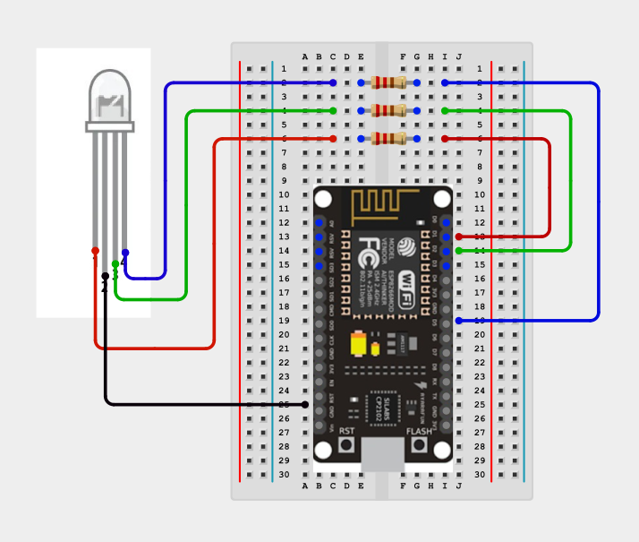
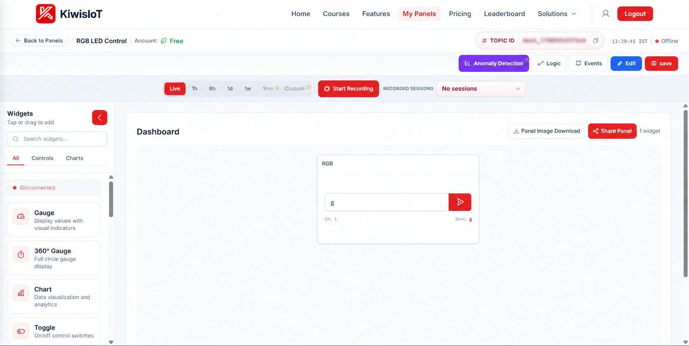
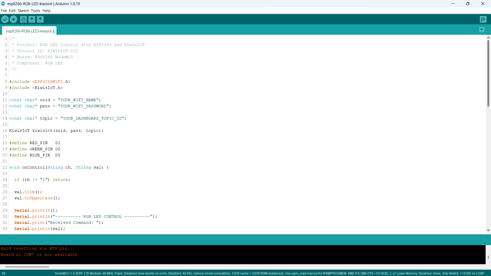
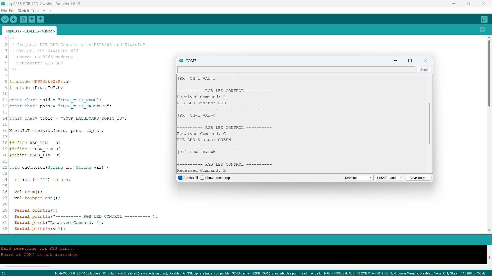

# ESP8266 RGB LED IoT Project: Control LED Colors with KiwisIoT 🌈

Build an **ESP8266 RGB LED IoT project** to control LED colors remotely using an **ESP8266 NodeMCU, an RGB LED, Arduino IDE, and KiwisIoT**.

In this project, an RGB LED is connected to the ESP8266 NodeMCU through current-limiting resistors. An Input widget on the KiwisIoT dashboard allows you to select a color by entering a command.

Send `R` for red, `G` for green, `B` for blue, or `OFF` to switch off all colors. The project also accepts lowercase commands such as `r`, `g`, and `b`.

When you submit a command through the dashboard, KiwisIoT sends the value to the ESP8266 over Wi-Fi. The ESP8266 processes the received command and controls the RGB LED using digital pins D1, D2, and D5.

This project demonstrates how to build a simple IoT-based color control system using an ESP8266 and a cloud-connected dashboard.

---

## 🚀 Project Highlights

- Remote RGB LED color control using KiwisIoT
- ESP8266 NodeMCU development board
- RGB LED with separate red, green, and blue control pins
- Current-limiting resistors for LED protection
- KiwisIoT Input widget for sending color commands
- Channel 1 for receiving control values
- Support for uppercase and lowercase color commands
- `OFF` command to turn off all colors
- Wi-Fi-based communication
- Serial Monitor output for debugging
- Callback-based command handling using `kiwisiot.onReceive()`
- Suitable for beginners learning GPIO control and IoT automation

---

## 🔎 Project Overview

The **ESP8266 RGB LED IoT project** demonstrates how to control the colors of an RGB LED using a web-based IoT dashboard.

The ESP8266 NodeMCU connects to KiwisIoT over Wi-Fi. The dashboard contains an Input widget configured to send commands through Channel 1.

When a command is received, the ESP8266 converts it to uppercase and checks which color or operation was requested.

The controller then switches off all three color outputs before activating the selected color.

| Input command | RGB LED output |
|---|---|
| `R` or `r` | Red ON |
| `G` or `g` | Green ON |
| `B` or `b` | Blue ON |
| `OFF` | All colors OFF |

The project uses the KiwisIoT receive callback to process incoming commands.

The project flow is:

```text
        KiwisIoT Dashboard
                |
           Input Widget
                |
             Channel 1
                |
               Wi-Fi
                |
         ESP8266 NodeMCU
                |
         Receive Callback
                |
        Convert to Uppercase
                |
         Process the Command
                |
       +--------+--------+
       |        |        |
      RED     GREEN     BLUE
       D1       D2        D5
       |        |         |
       +--------+---------+
                |
             RGB LED
```

---

## 💡 Why This Project?

RGB LEDs combine red, green, and blue light sources in a single component. By controlling the individual color channels, a microcontroller can produce different colors and lighting effects.

Connecting the ESP8266 to an IoT platform makes it possible to control these outputs remotely through a dashboard.

This project introduces dashboard-based device control without requiring a complicated automation system.

It also provides a foundation for expanding the project with additional colors, blinking patterns, and other lighting effects.

The project is useful for learning:

- Digital output control
- RGB LED interfacing
- Wi-Fi-based communication
- Dashboard-based device control
- Callback functions
- String processing in Arduino
- Basic IoT automation

---

## 📚 What You'll Learn

By building this project, you will learn how to:

- Connect an RGB LED to an ESP8266 NodeMCU.
- Use current-limiting resistors for LED protection.
- Configure ESP8266 GPIO pins as outputs.
- Connect an ESP8266 to KiwisIoT.
- Configure an Input widget for remote control.
- Receive commands through Channel 1.
- Process incoming strings using a callback function.
- Accept both uppercase and lowercase commands.
- Control red, green, and blue LED outputs independently.
- Switch off all RGB LED colors using an `OFF` command.
- Display received commands in the Serial Monitor.
- Troubleshoot common IoT communication and circuit problems.

---

## 🧰 Components Required

| Component | Quantity |
|---|---:|
| ESP8266 NodeMCU | 1 |
| RGB LED, common-cathode type | 1 |
| Current-limiting resistors, e.g. 220 Ω | 3 |
| Breadboard | 1 |
| Jumper wires | As required |
| USB cable | 1 |
| Computer | 1 |

**Note:** This circuit and code assume a common-cathode RGB LED. If you use a common-anode RGB LED, the output logic must be inverted. Confirm the LED pinout before connecting the circuit.

---

## 💻 Software Requirements

- Arduino IDE
- ESP8266 board package
- KiwisIoT Arduino library
- KiwisIoT account
- Wi-Fi connection

### Common KiwisIoT Setup

Before starting this project, complete the common **KiwisIoT Arduino Setup Guide**.

The setup guide covers:

- Arduino IDE installation
- ESP8266 board installation and selection
- KiwisIoT Arduino library installation
- KiwisIoT panel setup
- Topic ID configuration
- Dashboard widget setup and configuration

The common setup guide is available in the parent `esp8266` directory:

[Open the KiwisIoT Arduino Setup Guide](../kiwisiot-arduino-setup/)

### KiwisIoT Library Setup

Install the KiwisIoT Arduino library through the Arduino IDE Library Manager if it is not already installed.

1. Open Arduino IDE.
2. Navigate to **Sketch → Include Library → Manage Libraries**.
3. Search for the KiwisIoT library.
4. Install the library according to the available library listing or the KiwisIoT setup guide.
5. Confirm that the library is available before compiling the program.

The `ESP8266WiFi.h` header provides ESP8266 Wi-Fi functionality, while `KiwisIoT.h` provides the functions used to communicate with the KiwisIoT platform.

---

## 🛠️ Technologies Used

- ESP8266 NodeMCU
- RGB LED
- Arduino IDE
- ESP8266WiFi Library
- KiwisIoT Arduino Library
- KiwisIoT IoT Dashboard
- Wi-Fi communication
- Digital GPIO control
- C++ / Arduino

---

## 🔌 Circuit Connection

Connect the RGB LED to the ESP8266 NodeMCU according to the circuit diagram.

### Pin Connections

| RGB LED connection | ESP8266 NodeMCU |
|---|---|
| Red channel through a current-limiting resistor | D1 |
| Green channel through a current-limiting resistor | D2 |
| Blue channel through a current-limiting resistor | D5 |
| Common cathode | GND |

The three color channels must be connected through appropriate current-limiting resistors.

For a common-cathode RGB LED, the common pin connects to GND. The ESP8266 activates an individual color by setting its corresponding GPIO output HIGH.

The LED control pins are defined in the Arduino code as:

```cpp
#define RED_PIN   D1
#define GREEN_PIN D2
#define BLUE_PIN  D5
```

### Circuit Diagram



**Important:** The diagram and code assume a common-cathode RGB LED. RGB LED pin arrangements vary by component, so identify the common pin and the individual color pins using the LED datasheet or component documentation.

Do not connect the LED channels directly to GPIO pins without appropriate current-limiting resistors.

---

## 🔬 How RGB LED Color Control Works

The ESP8266 controls the RGB LED by changing the digital output states of pins D1, D2, and D5.

### 1. Configure the RGB LED Pins

The program defines three GPIO pins:

```cpp
#define RED_PIN   D1
#define GREEN_PIN D2
#define BLUE_PIN  D5
```

These pins independently control the red, green, and blue channels.

### 2. Configure the Pins as Outputs

In `setup()`, each pin is configured as an output:

```cpp
pinMode(RED_PIN, OUTPUT);
pinMode(GREEN_PIN, OUTPUT);
pinMode(BLUE_PIN, OUTPUT);
```

This allows the ESP8266 to control the individual RGB LED channels.

### 3. Initialize All Colors as OFF

The program sets all three outputs LOW:

```cpp
digitalWrite(RED_PIN, LOW);
digitalWrite(GREEN_PIN, LOW);
digitalWrite(BLUE_PIN, LOW);
```

For the assumed common-cathode RGB LED, this initializes the LED with all colors switched off.

### 4. Receive a Dashboard Command

The program uses a callback function to process commands received from KiwisIoT:

```cpp
void onControl(String ch, String val)
```

The callback checks whether the received command belongs to Channel 1:

```cpp
if (ch != "1") return;
```

If the command belongs to another channel, the callback ignores it.

### 5. Normalize the Received Command

The program removes leading and trailing whitespace and converts the command to uppercase:

```cpp
val.trim();
val.toUpperCase();
```

For example:

- `r` becomes `R`
- `g` becomes `G`
- `b` becomes `B`
- `off` becomes `OFF`

This allows the project to accept uppercase and lowercase commands.

### 6. Switch Off All Colors Before Selecting a Color

Before processing the requested color, the program sets all three outputs LOW:

```cpp
digitalWrite(RED_PIN, LOW);
digitalWrite(GREEN_PIN, LOW);
digitalWrite(BLUE_PIN, LOW);
```

This prevents the previous color from remaining active when another color is selected.

### 7. Activate the Selected Color

For the red command:

```cpp
if (val == "R") {
  digitalWrite(RED_PIN, HIGH);
  Serial.println("RGB LED Status: RED");
}
```

For green:

```cpp
else if (val == "G") {
  digitalWrite(GREEN_PIN, HIGH);
  Serial.println("RGB LED Status: GREEN");
}
```

For blue:

```cpp
else if (val == "B") {
  digitalWrite(BLUE_PIN, HIGH);
  Serial.println("RGB LED Status: BLUE");
}
```

For the OFF command, all outputs remain LOW:

```cpp
else if (val == "OFF") {
  Serial.println("RGB LED Status: ALL COLORS OFF");
}
```

The program also prints an error message if the command is not recognized.

---

## 🌈 RGB LED Color Control

The project uses three digital outputs to control the individual RGB LED channels.

| Command | D1 (Red) | D2 (Green) | D5 (Blue) | Result |
|---|---|---|---|---|
| `R` or `r` | HIGH | LOW | LOW | Red |
| `G` or `g` | LOW | HIGH | LOW | Green |
| `B` or `b` | LOW | LOW | HIGH | Blue |
| `OFF` | LOW | LOW | LOW | All colors OFF |

The control logic is:

```text
       Receive Channel 1 Command
                  |
          Convert to Uppercase
                  |
          Turn All Colors OFF
                  |
          Check Received Command
             /    |    |    \
            R     G    B    OFF
            |     |    |     |
           D1    D2   D5   All LOW
            |     |    |
           RED  GREEN BLUE
```

The Serial Monitor displays the received command and the resulting RGB LED status.

---

## ☁️ KiwisIoT Dashboard

This project uses an **Input widget** on the KiwisIoT dashboard to control the RGB LED.

The dashboard sends a command through Channel 1 when you enter a value and submit it.



The dashboard panel is named **RGB LED Control** and contains an Input widget named **RGB**.

The Input widget allows you to enter a color command. For example, entering `g` sends the lowercase green command, which the ESP8266 converts to uppercase and processes as `G`.

### Command Reference

| Input value | Function |
|---|---|
| `R` / `r` | Turn on red |
| `G` / `g` | Turn on green |
| `B` / `b` | Turn on blue |
| `OFF` | Turn off all colors |

The Input widget should be configured to use Channel 1.

---

## ⚙️ Dashboard Configuration

Create or open a KiwisIoT panel and add an Input widget to control the RGB LED.

### 1. Add an Input Widget

Open the Widgets section of the KiwisIoT dashboard and select the **Input** widget.

### 2. Configure the Widget

Use the following details:

```text
Widget Name: RGB
Widget Type: Input
Channel ID: 1
```

The exact widget settings available may depend on the KiwisIoT dashboard interface.

### 3. Save the Dashboard

After configuring the widget:

1. Click **Update** if the widget configuration provides that option.
2. Click **Edit** at the top of the dashboard if required.
3. Click **Save** to save the dashboard changes.

### 4. Match the Channel ID

The Arduino code processes incoming commands only when the channel is `1`:

```cpp
if (ch != "1") return;
```

Make sure the dashboard Input widget sends its commands through Channel 1.

**Important:** The dashboard and Arduino code must use the same channel for the control command to work as expected.

---

## 💻 Arduino Code

The complete Arduino program is available in the project `code` directory.

The program uses the following headers:

```cpp
#include <ESP8266WiFi.h>
#include <KiwisIoT.h>
```

Their purposes are:

- `ESP8266WiFi.h` — provides ESP8266 Wi-Fi functionality.
- `KiwisIoT.h` — provides communication with the KiwisIoT platform.

The KiwisIoT object is created using the Wi-Fi credentials and dashboard Topic ID:

```cpp
KiwisIoT kiwisiot(ssid, pass, topic);
```

The program registers the receive callback:

```cpp
kiwisiot.onReceive(onControl);
```

The main loop continuously runs the KiwisIoT processing function:

```cpp
void loop() {
  kiwisiot.run();
}
```

This allows the library to process incoming commands and invoke the callback when data is received.



---

## 🔐 Configure Wi-Fi and KiwisIoT

Before uploading the program, update the following values in the Arduino code:

```cpp
const char* ssid = "YOUR_WIFI_NAME";
const char* pass = "YOUR_WIFI_PASSWORD";

const char* topic = "YOUR_DASHBOARD_TOPIC_ID";
```

Replace `YOUR_WIFI_NAME` with your Wi-Fi network name.

Replace `YOUR_WIFI_PASSWORD` with your Wi-Fi password.

Replace `YOUR_DASHBOARD_TOPIC_ID` with the Topic ID of your KiwisIoT panel.

Make sure the Topic ID corresponds to the panel containing the RGB Input widget.

**Security:** Keep actual Wi-Fi credentials and private information out of public GitHub repositories. Use placeholders in the published code and enter your credentials locally.

---

## 📝 Complete Arduino Code

The following code implements the RGB LED control logic using the ESP8266 NodeMCU and KiwisIoT.

```cpp
/*
 * Project: RGB LED Control with ESP8266 and KiwisIoT
 * Project ID: KIWISIOT-022
 * Board: ESP8266 NodeMCU
 * Component: RGB LED
 */

#include <ESP8266WiFi.h>
#include <KiwisIoT.h>

const char* ssid = "YOUR_WIFI_NAME";
const char* pass = "YOUR_WIFI_PASSWORD";

const char* topic = "YOUR_DASHBOARD_TOPIC_ID";

KiwisIoT kiwisiot(ssid, pass, topic);

#define RED_PIN   D1
#define GREEN_PIN D2
#define BLUE_PIN  D5

void onControl(String ch, String val) {

  if (ch != "1") return;

  val.trim();
  val.toUpperCase();

  Serial.println();
  Serial.println("---------- RGB LED CONTROL ----------");
  Serial.print("Received Command: ");
  Serial.println(val);

  digitalWrite(RED_PIN, LOW);
  digitalWrite(GREEN_PIN, LOW);
  digitalWrite(BLUE_PIN, LOW);

  if (val == "R") {
    digitalWrite(RED_PIN, HIGH);
    Serial.println("RGB LED Status: RED");
  }
  else if (val == "G") {
    digitalWrite(GREEN_PIN, HIGH);
    Serial.println("RGB LED Status: GREEN");
  }
  else if (val == "B") {
    digitalWrite(BLUE_PIN, HIGH);
    Serial.println("RGB LED Status: BLUE");
  }
  else if (val == "OFF") {
    Serial.println("RGB LED Status: ALL COLORS OFF");
  }
  else {
    Serial.println("Invalid input!");
    Serial.println("Enter R, G, B or OFF.");
  }

  Serial.println("-------------------------------------");
}

void setup() {

  Serial.begin(115200);

  pinMode(RED_PIN, OUTPUT);
  pinMode(GREEN_PIN, OUTPUT);
  pinMode(BLUE_PIN, OUTPUT);

  digitalWrite(RED_PIN, LOW);
  digitalWrite(GREEN_PIN, LOW);
  digitalWrite(BLUE_PIN, LOW);

  Serial.println();
  Serial.println("===== ESP8266 RGB LED CONTROL =====");
  Serial.println("RGB LED initialized: OFF");
  Serial.println("Connecting to KiwisIoT...");

  kiwisiot.begin();
  kiwisiot.onReceive(onControl);

  Serial.println("KiwisIoT control initialized.");
  Serial.println("Input R = Red");
  Serial.println("Input G = Green");
  Serial.println("Input B = Blue");
  Serial.println("Input OFF = Turn all colors OFF");
}

void loop() {
  kiwisiot.run();
}
```

---

## ⬆️ Upload the Program

Follow these steps to upload the program:

1. Connect the RGB LED to the ESP8266 NodeMCU according to the circuit diagram.
2. Connect the NodeMCU to your computer using a USB cable.
3. Open `esp8266-RGB-LED-kiwisiot.ino` in Arduino IDE.
4. Install the ESP8266 board package if it is not already installed.
5. Install the KiwisIoT Arduino library.
6. Select the appropriate ESP8266 NodeMCU board.
7. Update the Wi-Fi credentials and KiwisIoT Topic ID.
8. Verify the program.
9. Upload the code.
10. Open the Serial Monitor.
11. Set the baud rate to `115200`.
12. Open the KiwisIoT dashboard and test the Input widget.

When the program starts, all RGB LED channels are initialized to OFF. The ESP8266 then initializes KiwisIoT and registers the receive callback.

When a command arrives on Channel 1, the callback processes it and changes the corresponding output.

---

## 🖥️ Serial Monitor Output

The Serial Monitor displays the received command and the resulting RGB LED status.

Set the baud rate to `115200` to match the program:

```cpp
Serial.begin(115200);
```

### Example Output: Red

When you enter `r` in the dashboard, the program converts it to uppercase and processes the command as `R`.

```text
---------- RGB LED CONTROL ----------
Received Command: R
RGB LED Status: RED
-------------------------------------
```

### Example Output: Green

When you enter `g` in the dashboard:

```text
---------- RGB LED CONTROL ----------
Received Command: G
RGB LED Status: GREEN
-------------------------------------
```

### Example Output: Blue

When you enter `b` in the dashboard:

```text
---------- RGB LED CONTROL ----------
Received Command: B
RGB LED Status: BLUE
-------------------------------------
```

### Example Output: All Colors OFF

When you enter `OFF`:

```text
---------- RGB LED CONTROL ----------
Received Command: OFF
RGB LED Status: ALL COLORS OFF
-------------------------------------
```

### Example Output: Invalid Command

If you enter an unsupported command, such as `Y`, the program displays:

```text
---------- RGB LED CONTROL ----------
Received Command: Y
Invalid input!
Enter R, G, B or OFF.
-------------------------------------
```

The supplied Serial Monitor screenshot shows the received lowercase commands and the corresponding uppercase processing for red and green.



The received command and status messages help verify that the ESP8266 is processing dashboard commands.

---

## 🔄 Understanding the Data Flow

The project follows these steps to control the RGB LED remotely.

### 1. Initialize the RGB LED

The ESP8266 configures D1, D2, and D5 as outputs and sets them LOW:

```cpp
pinMode(RED_PIN, OUTPUT);
pinMode(GREEN_PIN, OUTPUT);
pinMode(BLUE_PIN, OUTPUT);

digitalWrite(RED_PIN, LOW);
digitalWrite(GREEN_PIN, LOW);
digitalWrite(BLUE_PIN, LOW);
```

### 2. Initialize KiwisIoT

The program starts the KiwisIoT library and registers the callback function:

```cpp
kiwisiot.begin();
kiwisiot.onReceive(onControl);
```

### 3. Wait for a Control Command

The main loop continuously processes KiwisIoT:

```cpp
void loop() {
  kiwisiot.run();
}
```

### 4. Check the Received Channel

The callback ignores commands that do not use Channel 1:

```cpp
if (ch != "1") return;
```

### 5. Normalize the Command

The received command is trimmed and converted to uppercase:

```cpp
val.trim();
val.toUpperCase();
```

### 6. Process the Command

The program compares the normalized command with `R`, `G`, `B`, and `OFF`.

### 7. Update the RGB LED

The corresponding output is activated:

```text
Channel 1, R   → D1 HIGH → Red ON
Channel 1, G   → D2 HIGH → Green ON
Channel 1, B   → D5 HIGH → Blue ON
Channel 1, OFF → All LOW → All colors OFF
```

### 8. Display the Result

The Serial Monitor prints the received command and the resulting LED status.

The complete data flow is:

```text
        KiwisIoT Input Widget
                 |
           Channel 1 Command
                 |
                Wi-Fi
                 |
          ESP8266 NodeMCU
                 |
           kiwisiot.run()
                 |
         onControl(ch, val)
                 |
          Check Channel 1
                 |
       Convert Command to Uppercase
                 |
          Check Command Value
          /       |       |       \
         R        G       B        OFF
         |        |       |         |
        D1       D2      D5      All LOW
         |        |       |
        RED     GREEN    BLUE
```

---

## 🧪 Testing the Project

To test the project:

1. Check the RGB LED pinout and resistor connections.
2. Confirm that the common-cathode pin is connected to GND.
3. Verify the red, green, and blue connections to D1, D2, and D5.
4. Upload the Arduino program.
5. Open the Serial Monitor at `115200` baud.
6. Wait for the startup messages.
7. Open the KiwisIoT dashboard.
8. Enter `R` and submit the command.
9. Check that the red color turns ON.
10. Enter `G` and submit the command.
11. Check that the green color turns ON.
12. Enter `B` and submit the command.
13. Check that the blue color turns ON.
14. Enter `OFF` and submit the command.
15. Confirm that all colors turn OFF.
16. Repeat the tests using lowercase `r`, `g`, and `b`.

### Test 1: Red

Enter `R` or `r` in the dashboard Input widget.

Expected status:

```text
Received Command: R
RGB LED Status: RED
```

The ESP8266 sets D1 HIGH, and the red channel should illuminate.

### Test 2: Green

Enter `G` or `g`.

Expected status:

```text
Received Command: G
RGB LED Status: GREEN
```

The ESP8266 sets D2 HIGH, and the green channel should illuminate.

### Test 3: Blue

Enter `B` or `b`.

Expected status:

```text
Received Command: B
RGB LED Status: BLUE
```

The ESP8266 sets D5 HIGH, and the blue channel should illuminate.

### Test 4: Turn All Colors OFF

Enter `OFF`.

Expected status:

```text
Received Command: OFF
RGB LED Status: ALL COLORS OFF
```

All three GPIO outputs remain LOW, and the RGB LED should turn off.

### Test 5: Verify Lowercase Commands

Enter `r`, `g`, and `b` separately.

Confirm that each lowercase command activates the corresponding color. This works because `val.toUpperCase()` converts the received string before the command comparisons.

### Test 6: Verify Dashboard Communication

Switch between the commands several times.

Check that:

- The Serial Monitor displays the received commands.
- The correct RGB LED channel responds.
- Channel 1 is used for control.
- The KiwisIoT dashboard is connected.
- The previous color switches off when another color is selected.
- The LED remains off after the `OFF` command.

---

## 🛠️ Troubleshooting

### RGB LED Does Not Turn ON

Check:

- Whether the RGB LED is connected to the correct GPIO pins.
- Whether the common-cathode pin is connected to GND.
- Whether the individual color pins are correctly identified.
- Whether current-limiting resistors are connected in series.
- Whether the program was uploaded successfully.
- Whether the correct ESP8266 board was selected.

### The Wrong Color Turns ON

The RGB LED pinout can vary between components.

Check the LED datasheet and confirm that:

- Red is connected to D1.
- Green is connected to D2.
- Blue is connected to D5.

If the physical pin mapping differs from the diagram, correct the wiring or update the pin definitions.

### All Colors Remain OFF

Check that:

- The ESP8266 is connected to KiwisIoT.
- The correct Topic ID is configured.
- The Input widget uses Channel 1.
- The submitted command is `R`, `G`, `B`, or `OFF`.
- The common-cathode pin is connected to GND.
- The correct RGB LED type is being used.

### Serial Monitor Does Not Show Received Commands

Check:

- Whether the baud rate is set to `115200`.
- Whether the ESP8266 has a working Wi-Fi connection.
- Whether the Topic ID is correct.
- Whether the Input widget uses Channel 1.
- Whether the program contains `kiwisiot.onReceive(onControl)`.
- Whether `kiwisiot.run()` continues to execute in `loop()`.

### Dashboard Input Does Not Control the RGB LED

Confirm that:

- The correct KiwisIoT panel is open.
- The Topic ID matches the configured panel.
- The Input widget is configured for Channel 1.
- The command is submitted using the widget's send control.
- The ESP8266 has a working Wi-Fi connection.
- The library is processing incoming commands.

### Lowercase Commands Do Not Work

The program includes:

```cpp
val.trim();
val.toUpperCase();
```

These statements remove surrounding whitespace and convert the received command to uppercase.

If lowercase commands do not work, verify that the uploaded program includes these statements and that the dashboard is sending the command through Channel 1.

### The RGB LED Does Not Turn OFF

The program expects the command `OFF` to turn off all colors.

The command comparison is:

```cpp
else if (val == "OFF") {
  Serial.println("RGB LED Status: ALL COLORS OFF");
}
```

All three output pins are set LOW before this comparison, so the LED should already be off when the `OFF` command is processed.

### The RGB LED Shows More Than One Color

The program switches all three outputs LOW before activating the selected channel.

If multiple colors remain illuminated, check the wiring, the common pin, the resistor connections, and whether the physical LED matches the assumed common-cathode configuration.

---

## 🔒 Security

Never publish sensitive credentials in a public GitHub repository.

Do not commit:

- Wi-Fi passwords
- API keys
- Access tokens
- Account passwords
- Private credentials
- Private dashboard access information

Use placeholders in the public example:

```text
YOUR_WIFI_NAME
YOUR_WIFI_PASSWORD
YOUR_DASHBOARD_TOPIC_ID
```

Enter your actual credentials only in your local Arduino project.

If you share screenshots publicly, blur your private KiwisIoT Topic ID where appropriate.

---

## 🌱 Possible Applications

An ESP8266 RGB LED remote-control system can be used as a starting point for:

- IoT-based lighting experiments
- Remote status indicators
- Smart home lighting prototypes
- Wireless color selection
- Dashboard-controlled visual alerts
- Embedded systems learning
- Student electronics projects
- GPIO control and callback programming exercises

The project can be extended with additional features such as color combinations, blinking patterns, automatic color sequences, and sensor-based lighting.

For example, the RGB LED could display different colors to indicate the status of a sensor-monitoring system.

**Note:** This project is designed for a low-current RGB LED. Do not connect mains-powered lights or high-current loads directly to ESP8266 GPIO pins. Use an appropriately rated driver circuit and suitable electrical safety measures for larger loads.

---

## 📁 Project Structure

```text
022-RGB-LED-kiwisiot/
│
├── README.md
│
├── code/
│   └── esp8266-RGB-LED-kiwisiot.ino
│
└── images/
    ├── circuit.png
    ├── code.png
    ├── serial-monitor.png
    └── dashboard-output.png
```

Keep the Arduino source code and screenshots in the specified folders so the relative image paths in the README work correctly.

---

## 🔗 Related KiwisIoT ESP8266 Projects

This project is part of the KiwisIoT ESP8266 IoT project collection.

- [ESP8266 LDR Sensor IoT Project](../001-ldr-kiwisiot/)
- [ESP8266 IR Sensor IoT Project](../002-ir-kiwisiot/)
- [ESP8266 Ultrasonic Sensor IoT Project](../003-ultrasonic-kiwisiot/)
- [ESP8266 DHT11 Temperature and Humidity IoT Project](../004-dht11-kiwisiot/)
- [ESP8266 PIR Motion Sensor IoT Project](../005-pir-kiwisiot/)
- [ESP8266 Gas Sensor IoT Project](../006-gas-kiwisiot/)
- [ESP8266 Flame Sensor IoT Project](../007-flame-kiwisiot/)
- [ESP8266 Soil Moisture Sensor IoT Project](../008-soil-moisture-kiwisiot/)
- [ESP8266 Water Level Sensor IoT Project](../009-water-level-kiwisiot/)
- [ESP8266 Raindrop Sensor IoT Project](../010-raindrop-kiwisiot/)
- [ESP8266 Sound Sensor IoT Project](../011-sound-kiwisiot/)
- [ESP8266 MPU6050 Motion and Acceleration IoT Project](../012-mpu6050-kiwisiot/)
- [ESP8266 Voltage Sensor IoT Project](../013-voltage-kiwisiot/)
- [ESP8266 Current Sensor IoT Project](../014-current-kiwisiot/)
- [ESP8266 Vibration Sensor IoT Project](../015-vibration-kiwisiot/)
- [ESP8266 Reed Switch IoT Project](../016-reed-switch-kiwisiot/)
- [ESP8266 Hall Effect Sensor IoT Project](../017-hall-effect-kiwisiot/)
- [ESP8266 Touch Sensor IoT Project](../018-touch-sensor-kiwisiot/)
- [ESP8266 BMP180 Temperature and Air Pressure IoT Project](../019-bmp180-kiwisiot/)
- [ESP8266 DS18B20 Temperature Monitoring IoT Project](../020-ds18b20-kiwisiot/)
- [ESP8266 LED Remote Control IoT Project](../021-LED-kiwisiot/)

For Arduino and KiwisIoT setup, see the [KiwisIoT Arduino Setup Guide](../kiwisiot-arduino-setup/).

---

## ❓ Frequently Asked Questions

### What is the purpose of this project?

This project demonstrates how to control an RGB LED remotely using an ESP8266 NodeMCU and a KiwisIoT Input widget.

### Which ESP8266 board is used?

This project uses the ESP8266 NodeMCU development board.

### Which RGB LED type is used?

The circuit and code assume a common-cathode RGB LED.

### Which pins control the RGB LED?

The project uses D1 for red, D2 for green, and D5 for blue.

### Which KiwisIoT widget is used?

An Input widget is used to send commands to the RGB LED.

### Which KiwisIoT channel is used?

The project uses Channel 1 for control commands.

```text
Channel 1 → RGB LED Control
```

### Which command turns on the red color?

Enter `R` or `r` in the dashboard Input widget.

### Which command turns on the green color?

Enter `G` or `g` in the dashboard Input widget.

### Which command turns on the blue color?

Enter `B` or `b` in the dashboard Input widget.

### How can I turn off all colors?

Enter `OFF` in the dashboard Input widget.

### Do lowercase commands work?

Yes. The program converts received commands to uppercase using `val.toUpperCase()`, so `r`, `g`, and `b` are accepted.

### Why are resistors connected to the RGB LED?

The resistors limit the current through the individual LED channels and help protect the LED and ESP8266 GPIO outputs.

### How does the ESP8266 receive the command?

The program registers `onControl()` using `kiwisiot.onReceive(onControl)`. The callback processes incoming channel and value strings.

### Can this project display other colors?

Yes. The RGB LED can display additional colors by activating multiple channels together. This would require extending the current command logic, which presently activates only one color at a time.

### Can I use a common-anode RGB LED?

Yes, but the output logic must be changed because a common-anode RGB LED generally turns a channel on when its GPIO output is LOW and off when it is HIGH. The supplied code is intended for a common-cathode LED.

---

## 📌 Summary

This project demonstrates an **ESP8266 RGB LED remote-control system** using an RGB LED and KiwisIoT.

The ESP8266 connects to KiwisIoT over Wi-Fi, receives commands through Channel 1, and controls the red, green, and blue channels using D1, D2, and D5.

The final control mapping is:

```text
Channel 1, R / r → Red ON
Channel 1, G / g → Green ON
Channel 1, B / b → Blue ON
Channel 1, OFF   → All Colors OFF
```

With an Input widget on the dashboard, the project provides a practical introduction to RGB LED interfacing, GPIO output control, string processing, callback-based communication, and IoT-based remote device operation.

---

## 📄 License

This project is licensed under the MIT License. See the `LICENSE` file for details.
