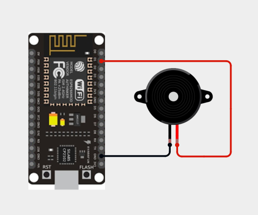
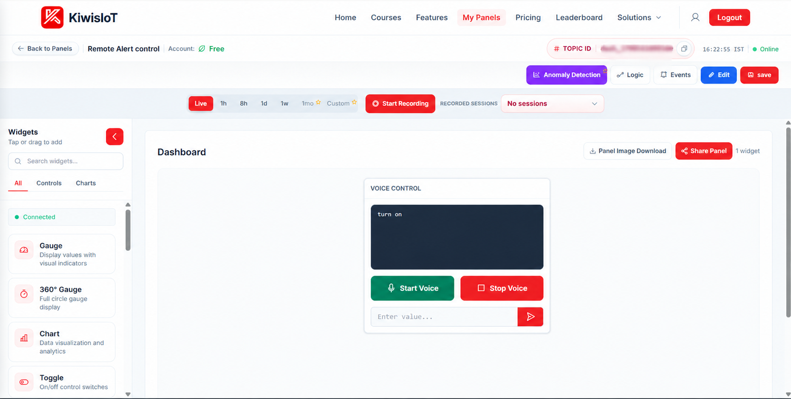
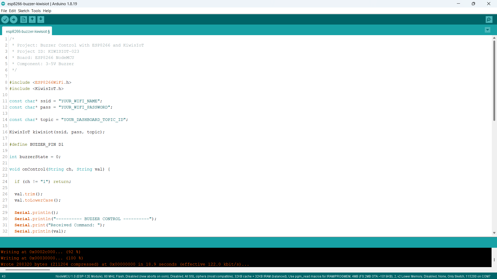
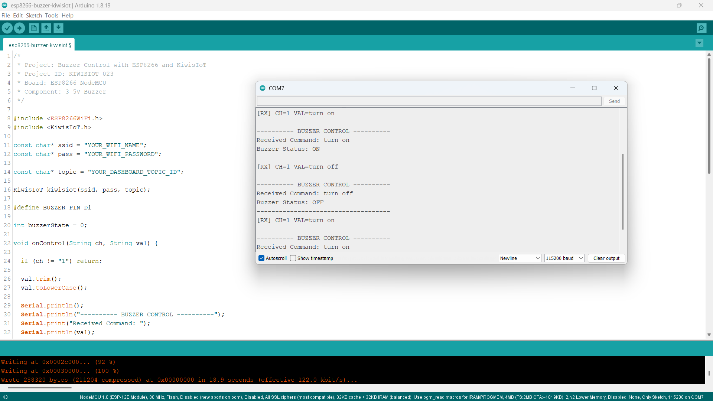

# ESP8266 Buzzer IoT Project: Create Remote Alerts with KiwisIoT 🔔

Build an **ESP8266 Buzzer IoT project** to control a buzzer remotely using an **ESP8266 NodeMCU, a 3–5 V buzzer, Arduino IDE, and KiwisIoT**.

In this project, a two-pin buzzer is connected to the ESP8266 NodeMCU. A Voice Control widget on the KiwisIoT dashboard allows you to turn the buzzer ON or OFF using voice commands.

Say **"Turn on"** to activate the buzzer and **"Turn off"** to stop it. The project also accepts the shorter commands `on` and `off`.

When a command is received through the KiwisIoT dashboard, the ESP8266 processes the value over Wi-Fi and controls the buzzer connected to digital pin D1.

This project demonstrates how to build a simple IoT-based remote alert system using an ESP8266 and a voice-enabled dashboard.

---

## 🚀 Project Highlights

- Remote buzzer control using KiwisIoT
- ESP8266 NodeMCU development board
- Two-pin 3–5 V buzzer
- KiwisIoT Voice Control widget
- Channel 1 for receiving voice commands
- Voice commands to turn the buzzer ON and OFF
- Support for `turn on`, `turn off`, `on`, and `off`
- Wi-Fi-based communication
- Serial Monitor output for debugging
- Callback-based command handling using `kiwisiot.onReceive()`
- Suitable for beginners learning GPIO control and IoT automation

---

## 🔎 Project Overview

The **ESP8266 Buzzer IoT project** demonstrates how to control a buzzer using voice commands from a web-based IoT dashboard.

The ESP8266 NodeMCU connects to KiwisIoT over Wi-Fi. The dashboard contains a Voice Control widget configured to send commands through Channel 1.

When a command is received, the ESP8266 converts the command to lowercase and checks whether it requests the buzzer to turn ON or OFF.

The controller then updates the buzzer output according to the received command.

| Voice command | Buzzer output |
|---|---|
| `Turn on` | Buzzer ON |
| `on` | Buzzer ON |
| `Turn off` | Buzzer OFF |
| `off` | Buzzer OFF |

The project uses the KiwisIoT receive callback to process incoming commands.

The project flow is:

```text
       KiwisIoT Dashboard
               |
       Voice Control Widget
               |
           Channel 1
               |
             Wi-Fi
               |
       ESP8266 NodeMCU
               |
        Receive Callback
               |
      Convert to Lowercase
               |
       Process the Command
               |
          Digital Pin D1
               |
             Buzzer
```

---

## 💡 Why This Project?

Buzzers are commonly used to generate audible alerts in electronic systems. They can indicate warnings, notifications, operating conditions, and other events.

Connecting a buzzer to an IoT platform makes it possible to control the alert remotely through a dashboard.

This project introduces voice-based device control without requiring a complicated automation system.

It also provides a foundation for expanding the project with sensor-triggered alerts, warning systems, and remote notification experiments.

The project is useful for learning:

- Digital output control
- Buzzer interfacing
- Wi-Fi-based communication
- Voice-controlled IoT applications
- Callback functions
- String processing in Arduino
- Basic IoT automation

---

## 📚 What You'll Learn

By building this project, you will learn how to:

- Connect a two-pin buzzer to an ESP8266 NodeMCU.
- Configure an ESP8266 GPIO pin as an output.
- Connect an ESP8266 to KiwisIoT.
- Configure a Voice Control widget for remote control.
- Receive commands through Channel 1.
- Process incoming strings using a callback function.
- Accept voice commands for turning a buzzer ON and OFF.
- Control a buzzer using digital output signals.
- Display received commands in the Serial Monitor.
- Troubleshoot common IoT communication and circuit problems.

---

## 🧰 Components Required

| Component | Quantity |
|---|---:|
| ESP8266 NodeMCU | 1 |
| Two-pin 3–5 V buzzer | 1 |
| Breadboard | 1 |
| Jumper wires | As required |
| USB cable | 1 |
| Computer | 1 |

**Note:** This project uses the two-pin buzzer shown in the circuit diagram. Confirm whether your buzzer is an active or passive type. The supplied ON/OFF code is intended for a buzzer that produces sound when powered with the appropriate DC voltage.

Check the buzzer's current requirements before connecting it directly to the ESP8266 GPIO. If the buzzer draws more current than the GPIO can safely supply, use a suitable transistor driver and an appropriate power supply.

---

## 💻 Software Requirements

- Arduino IDE
- ESP8266 board package
- KiwisIoT Arduino library
- KiwisIoT account
- Wi-Fi connection

### Common KiwisIoT Setup

Before starting this project, complete the common **KiwisIoT Arduino Setup Guide**.

The setup guide covers:

- Arduino IDE installation
- ESP8266 board installation and selection
- KiwisIoT Arduino library installation
- KiwisIoT panel setup
- Topic ID configuration
- Dashboard widget setup and configuration

The common setup guide is available in the parent `esp8266` directory:

[Open the KiwisIoT Arduino Setup Guide](../kiwisiot-arduino-setup/)

### KiwisIoT Library Setup

Install the KiwisIoT Arduino library through the Arduino IDE Library Manager if it is not already installed.

1. Open Arduino IDE.
2. Navigate to **Sketch → Include Library → Manage Libraries**.
3. Search for the KiwisIoT library.
4. Install the library according to the available library listing or the KiwisIoT setup guide.
5. Confirm that the library is available before compiling the program.

The `ESP8266WiFi.h` header provides ESP8266 Wi-Fi functionality, while `KiwisIoT.h` provides the functions used to communicate with the KiwisIoT platform.

---

## 🛠️ Technologies Used

- ESP8266 NodeMCU
- Two-pin 3–5 V buzzer
- Arduino IDE
- ESP8266WiFi Library
- KiwisIoT Arduino Library
- KiwisIoT IoT Dashboard
- Voice Control widget
- Wi-Fi communication
- Digital GPIO control
- C++ / Arduino

---

## 🔌 Circuit Connection

Connect the two-pin buzzer to the ESP8266 NodeMCU according to the circuit diagram.

### Pin Connections

| Buzzer connection | ESP8266 NodeMCU |
|---|---|
| Positive (+) | D1 |
| Negative (−) | GND |

The Arduino code defines the buzzer control pin as:

```cpp
#define BUZZER_PIN D1
```

The ESP8266 uses D1 to control the buzzer output.

When D1 is set HIGH, the buzzer is activated. When D1 is set LOW, the buzzer is switched off.

### Circuit Diagram



**Important:** The direct connection shown assumes that the buzzer's electrical characteristics are suitable for the ESP8266 output. Verify the buzzer's rated voltage and current before powering it. Use a suitable driver circuit if required.

---

## 🔬 How Buzzer Control Works

The ESP8266 controls the buzzer by changing the digital output state of pin D1.

### 1. Configure the Buzzer Pin

The program defines the buzzer pin:

```cpp
#define BUZZER_PIN D1
```

This identifies D1 as the output used to control the buzzer.

### 2. Configure the Pin as an Output

In `setup()`, the pin is configured as an output:

```cpp
pinMode(BUZZER_PIN, OUTPUT);
```

This allows the ESP8266 to control the buzzer.

### 3. Initialize the Buzzer as OFF

The program initially switches off the buzzer:

```cpp
digitalWrite(BUZZER_PIN, LOW);
```

This prevents the buzzer from being intentionally activated when the program starts.

### 4. Receive a Dashboard Command

The program uses a callback function to process commands received from KiwisIoT:

```cpp
void onControl(String ch, String val)
```

The callback checks whether the received command belongs to Channel 1:

```cpp
if (ch != "1") return;
```

If the command belongs to another channel, the callback ignores it.

### 5. Normalize the Received Command

The program removes leading and trailing whitespace and converts the command to lowercase:

```cpp
val.trim();
val.toLowerCase();
```

For example:

- `TURN ON` becomes `turn on`
- `Turn On` becomes `turn on`
- `ON` becomes `on`
- `Turn OFF` becomes `turn off`

This allows the program to accept different letter cases.

### 6. Activate the Buzzer

When the received command is `turn on` or `on`, the program sets the buzzer output HIGH:

```cpp
if (val == "turn on" || val == "on") {
  buzzerState = 1;
  digitalWrite(BUZZER_PIN, HIGH);
  Serial.println("Buzzer Status: ON");
}
```

The buzzer should produce sound when the connected buzzer type and circuit support this operation.

### 7. Switch OFF the Buzzer

When the received command is `turn off` or `off`, the program sets the output LOW:

```cpp
else if (val == "turn off" || val == "off") {
  buzzerState = 0;
  digitalWrite(BUZZER_PIN, LOW);
  Serial.println("Buzzer Status: OFF");
}
```

The buzzer should stop producing sound.

### 8. Handle Invalid Commands

If the received command does not match the supported values, the program displays an error message:

```cpp
else {
  Serial.println("Invalid command!");
  Serial.println("Say: Turn on or Turn off");
}
```

---

## 🔔 Buzzer Control Logic

The project uses one digital output to control the buzzer.

| Command | D1 output | Result |
|---|---|---|
| `Turn on` | HIGH | Buzzer ON |
| `on` | HIGH | Buzzer ON |
| `Turn off` | LOW | Buzzer OFF |
| `off` | LOW | Buzzer OFF |
| Invalid command | No change | Previous state retained |

The control logic is:

```text
       Receive Channel 1 Command
                  |
        Convert to Lowercase
                  |
         Check Command Value
             /         \
         Turn on      Turn off
          or on        or off
             |            |
           D1 HIGH      D1 LOW
             |            |
         Buzzer ON    Buzzer OFF
```

The Serial Monitor displays the received command and the resulting buzzer status.

---

## ☁️ KiwisIoT Dashboard

This project uses a **Voice Control widget** on the KiwisIoT dashboard to operate the buzzer.

The widget allows you to speak a command or enter a value, depending on the available controls in the dashboard.



The dashboard panel is named **Remote Alert Control** and contains a Voice Control widget.

When the command is submitted through the dashboard, KiwisIoT sends the value through Channel 1 to the ESP8266.

### Command Reference

| Voice command | Function |
|---|---|
| `Turn on` | Activate the buzzer |
| `Turn off` | Stop the buzzer |
| `on` | Activate the buzzer |
| `off` | Stop the buzzer |

The Voice Control widget should be configured to use Channel 1.

---

## ⚙️ Dashboard Configuration

Create or open a KiwisIoT panel and add a Voice Control widget to control the buzzer.

### 1. Open the KiwisIoT Panel

Log in to KiwisIoT and open the dashboard you want to use for remote buzzer control.

### 2. Add a Voice Control Widget

Open the Widgets section and add the **Voice Control** widget.

### 3. Configure the Widget

Use the following details:

```text
Panel Name: Remote Alert Control
Widget Type: Voice Control
Channel ID: 1
```

The exact widget settings available may depend on the KiwisIoT dashboard interface.

### 4. Save the Dashboard

After configuring the widget:

1. Click **Update** if the widget configuration provides that option.
2. Click **Edit** at the top of the dashboard if required.
3. Click **Save** to save the dashboard changes.

### 5. Match the Channel ID

The Arduino code processes incoming commands only when the channel is `1`:

```cpp
if (ch != "1") return;
```

Make sure the Voice Control widget sends its commands through Channel 1.

**Important:** The dashboard widget and Arduino code must use the same channel for the control command to work as expected.

---

## 💻 Arduino Code

The complete Arduino program is available in the project `code` directory.

The program uses the following headers:

```cpp
#include <ESP8266WiFi.h>
#include <KiwisIoT.h>
```

Their purposes are:

- `ESP8266WiFi.h` — provides ESP8266 Wi-Fi functionality.
- `KiwisIoT.h` — provides communication with the KiwisIoT platform.

The KiwisIoT object is created using the Wi-Fi credentials and dashboard Topic ID:

```cpp
KiwisIoT kiwisiot(ssid, pass, topic);
```

The program registers the receive callback:

```cpp
kiwisiot.onReceive(onControl);
```

The main loop continuously runs the KiwisIoT processing function:

```cpp
void loop() {
  kiwisiot.run();
}
```

This allows the library to process incoming commands and invoke the callback when data is received.



---

## 🔐 Configure Wi-Fi and KiwisIoT

Before uploading the program, update the following values in the Arduino code:

```cpp
const char* ssid = "YOUR_WIFI_NAME";
const char* pass = "YOUR_WIFI_PASSWORD";

const char* topic = "YOUR_DASHBOARD_TOPIC_ID";
```

Replace `YOUR_WIFI_NAME` with your Wi-Fi network name.

Replace `YOUR_WIFI_PASSWORD` with your Wi-Fi password.

Replace `YOUR_DASHBOARD_TOPIC_ID` with the Topic ID of your KiwisIoT panel.

Make sure the Topic ID corresponds to the panel containing the Voice Control widget.

**Security:** Keep actual Wi-Fi credentials and private information out of public GitHub repositories. Use placeholders in the published code and enter your credentials locally.

---

## 📝 Complete Arduino Code

The following code implements buzzer control using the ESP8266 NodeMCU and KiwisIoT.

```cpp
/*
 * Project: Buzzer Control with ESP8266 and KiwisIoT
 * Project ID: KIWISIOT-023
 * Board: ESP8266 NodeMCU
 * Component: 3-5V Buzzer
 */

#include <ESP8266WiFi.h>
#include <KiwisIoT.h>

const char* ssid = "YOUR_WIFI_NAME";
const char* pass = "YOUR_WIFI_PASSWORD";

const char* topic = "YOUR_DASHBOARD_TOPIC_ID";

KiwisIoT kiwisiot(ssid, pass, topic);

#define BUZZER_PIN D1

int buzzerState = 0;

void onControl(String ch, String val) {

  if (ch != "1") return;

  val.trim();
  val.toLowerCase();

  Serial.println();
  Serial.println("---------- BUZZER CONTROL ----------");
  Serial.print("Received Command: ");
  Serial.println(val);

  if (val == "turn on" || val == "on") {
    buzzerState = 1;
    digitalWrite(BUZZER_PIN, HIGH);
    Serial.println("Buzzer Status: ON");
  }
  else if (val == "turn off" || val == "off") {
    buzzerState = 0;
    digitalWrite(BUZZER_PIN, LOW);
    Serial.println("Buzzer Status: OFF");
  }
  else {
    Serial.println("Invalid command!");
    Serial.println("Say: Turn on or Turn off");
  }

  Serial.println("------------------------------------");
}

void setup() {

  Serial.begin(115200);

  pinMode(BUZZER_PIN, OUTPUT);
  digitalWrite(BUZZER_PIN, LOW);

  Serial.println();
  Serial.println("===== ESP8266 BUZZER IOT CONTROL =====");
  Serial.println("Buzzer initialized: OFF");
  Serial.println("Connecting to KiwisIoT...");

  kiwisiot.begin();
  kiwisiot.onReceive(onControl);

  Serial.println("KiwisIoT voice control initialized.");
  Serial.println("Channel ID: 1");
  Serial.println("Say 'Turn on' to activate the buzzer.");
  Serial.println("Say 'Turn off' to stop the buzzer.");
}

void loop() {
  kiwisiot.run();
}
```

---

## ⬆️ Upload the Program

Follow these steps to upload the program:

1. Connect the buzzer to the ESP8266 NodeMCU according to the circuit diagram.
2. Connect the NodeMCU to your computer using a USB cable.
3. Open `esp8266-buzzer-kiwisiot.ino` in Arduino IDE.
4. Install the ESP8266 board package if it is not already installed.
5. Install the KiwisIoT Arduino library.
6. Select the appropriate ESP8266 NodeMCU board.
7. Update the Wi-Fi credentials and KiwisIoT Topic ID.
8. Verify the program.
9. Upload the code.
10. Open the Serial Monitor.
11. Set the baud rate to `115200`.
12. Open the KiwisIoT dashboard and test the Voice Control widget.

When the program starts, the buzzer output is initialized to LOW. The ESP8266 then initializes KiwisIoT and registers the receive callback.

When a command arrives on Channel 1, the callback processes it and changes the buzzer output.

---

## 🖥️ Serial Monitor Output

The Serial Monitor displays the received command and the resulting buzzer status.

Set the baud rate to `115200` to match the program:

```cpp
Serial.begin(115200);
```

### Example Output: Turn ON

When you say `Turn on` in the dashboard:

```text
---------- BUZZER CONTROL ----------
Received Command: turn on
Buzzer Status: ON
------------------------------------
```

### Example Output: Turn OFF

When you say `Turn off`:

```text
---------- BUZZER CONTROL ----------
Received Command: turn off
Buzzer Status: OFF
------------------------------------
```

### Example Output: Invalid Command

If you submit an unsupported command:

```text
---------- BUZZER CONTROL ----------
Received Command: start
Invalid command!
Say: Turn on or Turn off
------------------------------------
```



The received command and status messages help verify that the ESP8266 is processing dashboard commands.

---

## 🔄 Understanding the Data Flow

The project follows these steps to control the buzzer remotely.

### 1. Initialize the Buzzer

The ESP8266 configures D1 as an output and switches it LOW:

```cpp
pinMode(BUZZER_PIN, OUTPUT);
digitalWrite(BUZZER_PIN, LOW);
```

### 2. Initialize KiwisIoT

The program starts the KiwisIoT library and registers the callback function:

```cpp
kiwisiot.begin();
kiwisiot.onReceive(onControl);
```

### 3. Wait for a Control Command

The main loop continuously processes KiwisIoT:

```cpp
void loop() {
  kiwisiot.run();
}
```

### 4. Check the Received Channel

The callback ignores commands that do not use Channel 1:

```cpp
if (ch != "1") return;
```

### 5. Normalize the Command

The received command is trimmed and converted to lowercase:

```cpp
val.trim();
val.toLowerCase();
```

### 6. Process the Command

The program checks for `turn on`, `on`, `turn off`, or `off`.

### 7. Update the Buzzer

The corresponding output is activated or deactivated:

```text
Channel 1, Turn on  → D1 HIGH → Buzzer ON
Channel 1, Turn off → D1 LOW  → Buzzer OFF
```

### 8. Display the Result

The Serial Monitor prints the received command and the resulting buzzer status.

The complete data flow is:

```text
       KiwisIoT Voice Control
                 |
          Channel 1 Command
                 |
                Wi-Fi
                 |
         ESP8266 NodeMCU
                 |
          kiwisiot.run()
                 |
        onControl(ch, val)
                 |
          Check Channel 1
                 |
       Convert to Lowercase
                 |
         Check Command Value
             /         \
         Turn on      Turn off
          or on        or off
             |            |
           D1 HIGH      D1 LOW
             |            |
         Buzzer ON    Buzzer OFF
```

---

## 🧪 Testing the Project

To test the project:

1. Check the buzzer polarity and circuit connections.
2. Confirm that the positive terminal is connected to D1 and the negative terminal to GND, as shown in the circuit diagram.
3. Upload the Arduino program.
4. Open the Serial Monitor at `115200` baud.
5. Wait for the startup messages.
6. Open the KiwisIoT dashboard.
7. Start the Voice Control widget.
8. Say `Turn on`.
9. Confirm that the buzzer produces sound.
10. Say `Turn off`.
11. Confirm that the buzzer stops.
12. Repeat the test using `on` and `off`.

### Test 1: Turn ON the Buzzer

Say `Turn on` in the dashboard.

Expected status:

```text
Received Command: turn on
Buzzer Status: ON
```

The ESP8266 sets D1 HIGH, and the buzzer should sound if the circuit and buzzer type support direct ON/OFF operation.

### Test 2: Turn OFF the Buzzer

Say `Turn off`.

Expected status:

```text
Received Command: turn off
Buzzer Status: OFF
```

The ESP8266 sets D1 LOW, and the buzzer should stop sounding.

### Test 3: Verify Short Commands

Submit `on` and `off` separately.

Confirm that each command produces the expected result.

### Test 4: Verify Dashboard Communication

Switch between the commands several times.

Check that:

- The Serial Monitor displays the received commands.
- The buzzer responds to the commands.
- Channel 1 is used for control.
- The KiwisIoT dashboard is connected.
- The correct Topic ID is configured.

---

## 🛠️ Troubleshooting

### Buzzer Does Not Produce Sound

Check:

- Whether the buzzer is connected to the correct pins.
- Whether the positive and negative terminals are correctly identified.
- Whether the buzzer's rated voltage is appropriate.
- Whether the buzzer requires more current than the GPIO can provide.
- Whether the program was uploaded successfully.
- Whether the correct ESP8266 board was selected.

If the buzzer requires more current than the GPIO can safely provide, use a suitable driver circuit.

### Buzzer Does Not Turn OFF

Check that:

- The ESP8266 receives the `turn off` or `off` command.
- The Voice Control widget uses Channel 1.
- The correct Topic ID is configured.
- The code sets `BUZZER_PIN` LOW when the OFF command is received.

### Serial Monitor Does Not Show Received Commands

Check:

- Whether the baud rate is set to `115200`.
- Whether the ESP8266 has a working Wi-Fi connection.
- Whether the Topic ID is correct.
- Whether the Voice Control widget uses Channel 1.
- Whether the program contains `kiwisiot.onReceive(onControl)`.
- Whether `kiwisiot.run()` continues to execute in `loop()`.

### Voice Commands Do Not Control the Buzzer

Confirm that:

- The correct KiwisIoT panel is open.
- The Topic ID matches the configured panel.
- The Voice Control widget sends commands through Channel 1.
- The command is submitted successfully.
- The ESP8266 has a working Wi-Fi connection.
- The received command matches one of the supported values.

The program accepts `turn on`, `on`, `turn off`, and `off`, ignoring letter case.

### Buzzer Does Not Respond to HIGH and LOW

Some buzzers behave differently depending on their type and driver circuit.

Confirm whether your component is an active buzzer or a passive buzzer. A passive buzzer generally needs an oscillating signal to generate a tone, so simply setting a GPIO HIGH may not produce continuous sound. Adapt the control method to the buzzer type if necessary.

---

## 🔒 Security

Never publish sensitive credentials in a public GitHub repository.

Do not commit:

- Wi-Fi passwords
- API keys
- Access tokens
- Account passwords
- Private dashboard access information

Use placeholders in the public example:

```text
YOUR_WIFI_NAME
YOUR_WIFI_PASSWORD
YOUR_DASHBOARD_TOPIC_ID
```

Enter your actual credentials only in your local Arduino project.

If you share screenshots publicly, blur your private KiwisIoT Topic ID where appropriate.

---

## 🌱 Possible Applications

An ESP8266 buzzer remote-control system can be used as a starting point for:

- IoT-based audible alerts
- Remote notification systems
- Smart home warning prototypes
- Voice-controlled electronic devices
- Sensor-triggered alarms
- Laboratory and classroom experiments
- Embedded systems learning
- Student IoT projects

The project can be extended with additional features such as sensor-based alarms, timed alerts, and automated warning systems.

For example, a motion sensor or temperature sensor could trigger an audible warning when a specified condition is detected.

**Note:** This project is intended for a low-voltage buzzer. Do not connect mains-powered devices or high-current loads directly to ESP8266 GPIO pins. Use a suitable driver circuit and appropriate electrical safety measures for larger loads.

---

## 📁 Project Structure

```text
023-buzzer-kiwisiot/
│
├── README.md
│
├── code/
│   └── esp8266-buzzer-kiwisiot.ino
│
└── images/
    ├── circuit.png
    ├── code.png
    ├── serial-monitor.png
    └── dashboard-output.png
```

---

## 🔗 Related KiwisIoT ESP8266 Projects

This project is part of the KiwisIoT ESP8266 IoT project collection.

- [ESP8266 LDR Sensor IoT Project](../001-ldr-kiwisiot/)
- [ESP8266 IR Sensor IoT Project](../002-ir-kiwisiot/)
- [ESP8266 Ultrasonic Sensor IoT Project](../003-ultrasonic-kiwisiot/)
- [ESP8266 DHT11 Temperature and Humidity IoT Project](../004-dht11-kiwisiot/)
- [ESP8266 PIR Motion Sensor IoT Project](../005-pir-kiwisiot/)
- [ESP8266 Gas Sensor IoT Project](../006-gas-kiwisiot/)
- [ESP8266 Flame Sensor IoT Project](../007-flame-kiwisiot/)
- [ESP8266 Soil Moisture Sensor IoT Project](../008-soil-moisture-kiwisiot/)
- [ESP8266 Water Level Sensor IoT Project](../009-water-level-kiwisiot/)
- [ESP8266 Raindrop Sensor IoT Project](../010-raindrop-kiwisiot/)
- [ESP8266 Sound Sensor IoT Project](../011-sound-kiwisiot/)
- [ESP8266 MPU6050 Motion and Acceleration IoT Project](../012-mpu6050-kiwisiot/)
- [ESP8266 Voltage Sensor IoT Project](../013-voltage-kiwisiot/)
- [ESP8266 Current Sensor IoT Project](../014-current-kiwisiot/)
- [ESP8266 Vibration Sensor IoT Project](../015-vibration-kiwisiot/)
- [ESP8266 Reed Switch IoT Project](../016-reed-switch-kiwisiot/)
- [ESP8266 Hall Effect Sensor IoT Project](../017-hall-effect-kiwisiot/)
- [ESP8266 Touch Sensor IoT Project](../018-touch-sensor-kiwisiot/)
- [ESP8266 BMP180 Temperature and Air Pressure IoT Project](../019-bmp180-kiwisiot/)
- [ESP8266 DS18B20 Temperature Monitoring IoT Project](../020-ds18b20-kiwisiot/)
- [ESP8266 LED Remote Control IoT Project](../021-LED-kiwisiot/)
- [ESP8266 RGB LED IoT Project](../022-RGB-LED-kiwisiot/)

For Arduino and KiwisIoT setup, see the [KiwisIoT Arduino Setup Guide](../kiwisiot-arduino-setup/).

---

## ❓ Frequently Asked Questions

### What is the purpose of this project?

This project demonstrates how to control a buzzer remotely using an ESP8266 NodeMCU and a KiwisIoT Voice Control widget.

### Which ESP8266 board is used?

This project uses the ESP8266 NodeMCU development board.

### Which buzzer is used?

A two-pin 3–5 V buzzer is used.

### Which pin controls the buzzer?

The buzzer is controlled using digital pin D1.

### Which KiwisIoT widget is used?

The project uses a Voice Control widget to send commands to the buzzer.

### Which KiwisIoT channel is used?

The project uses Channel 1 for control commands.

```text
Channel 1 → Buzzer Control
```

### Which command turns ON the buzzer?

Say `Turn on` or submit `on` through the dashboard.

### Which command turns OFF the buzzer?

Say `Turn off` or submit `off` through the dashboard.

### Does the project accept uppercase and lowercase commands?

Yes. The program uses `val.toLowerCase()` to normalize the received command before checking it.

### How does the ESP8266 receive the command?

The program registers `onControl()` using `kiwisiot.onReceive(onControl)`. The callback processes incoming channel and value strings.

### Can this project be used for an alarm system?

Yes. It can be extended with sensors to activate audible alerts when specified conditions are detected.

### Can I use a passive buzzer?

A passive buzzer may require a changing signal to produce sound. The supplied code uses digital HIGH and LOW states, so verify the buzzer type and adapt the signal generation if necessary.

---

## 📌 Summary

This project demonstrates an **ESP8266 Buzzer IoT control system** using a two-pin buzzer and KiwisIoT.

The ESP8266 connects to KiwisIoT over Wi-Fi, receives voice commands through Channel 1, and controls the buzzer using digital pin D1.

The final control mapping is:

```text
Channel 1, Turn on  → Buzzer ON
Channel 1, on       → Buzzer ON
Channel 1, Turn off → Buzzer OFF
Channel 1, off      → Buzzer OFF
```

With a Voice Control widget on the dashboard, the project provides a practical introduction to buzzer interfacing, GPIO output control, string processing, callback-based communication, and voice-controlled IoT applications.

---

## 📄 License

This project is licensed under the MIT License. See the [LICENSE](../../LICENSE) file for details.

