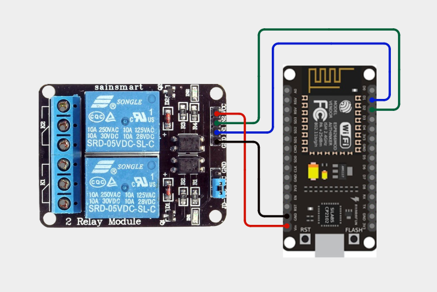
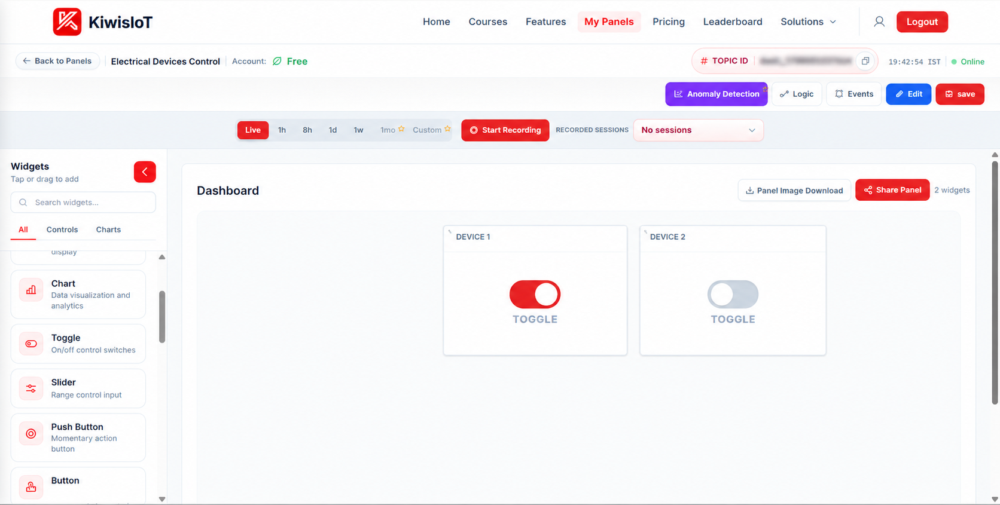
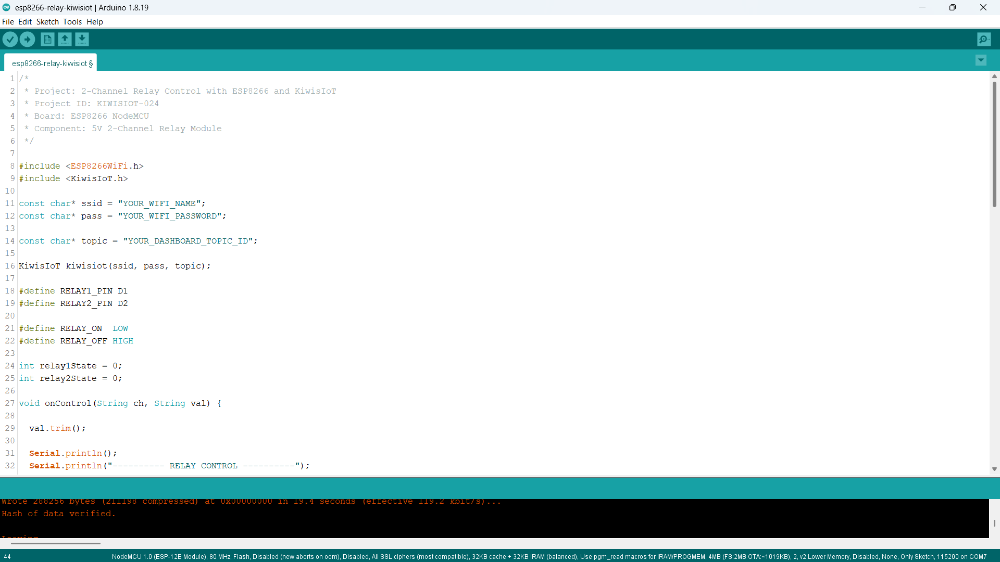
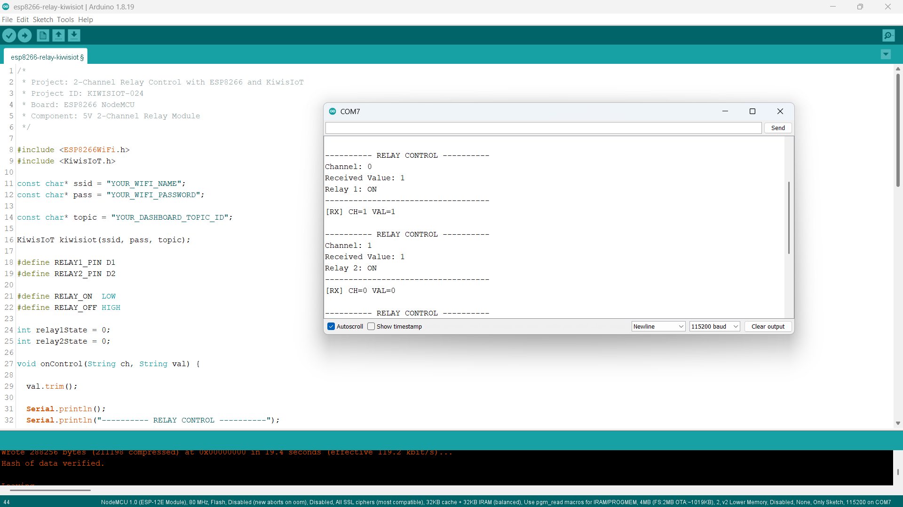

# ESP8266 Relay IoT Project: Control Electrical Devices Remotely with KiwisIoT 🔌

Build an **ESP8266 2-channel relay IoT project** to control two electrical devices remotely using an ESP8266 NodeMCU, a 5V 2-channel relay module, Arduino IDE, and KiwisIoT.

In this project, the ESP8266 NodeMCU connects to KiwisIoT over Wi-Fi. Two Toggle widgets on the KiwisIoT dashboard allow you to switch Relay 1 and Relay 2 ON or OFF independently.

The project uses digital pins D1 and D2 to control the relay module. KiwisIoT Channel 0 controls Relay 1, while Channel 1 controls Relay 2. The ESP8266 receives the dashboard commands and switches the corresponding relay using active-LOW control logic.

This project demonstrates how to build a simple wireless switching system using an ESP8266 and a cloud-connected IoT dashboard.

---

## 🚀 Project Highlights

- Remote electrical device control using KiwisIoT
- ESP8266 NodeMCU development board
- 5V 2-channel relay module
- Independent control of two relays
- KiwisIoT Toggle widgets for ON/OFF switching
- Channel 0 for Relay 1
- Channel 1 for Relay 2
- Active-LOW relay control logic
- Wi-Fi-based communication
- Serial Monitor output for debugging
- Callback-based command handling using `kiwisiot.onReceive()`
- Suitable for learning IoT-based switching and automation

---

## 🔎 Project Overview

The **ESP8266 Relay IoT project** demonstrates how to control two relay channels remotely using a KiwisIoT dashboard.

The ESP8266 NodeMCU connects to KiwisIoT over Wi-Fi. The dashboard contains two Toggle widgets, each assigned to a separate channel.

When a Toggle widget sends a value, the ESP8266 receives the channel and command through the KiwisIoT callback function. The program identifies the corresponding relay and changes its state.

| KiwisIoT Channel | ESP8266 Pin | Relay | Command `1` | Command `0` |
|---|---|---|---|---|
| Channel 0 | D1 | Relay 1 | ON | OFF |
| Channel 1 | D2 | Relay 2 | ON | OFF |

The project uses active-LOW relay logic:

- `LOW` activates the relay.
- `HIGH` deactivates the relay.

The project flow is:

```text
          KiwisIoT Dashboard
                   |
           +-------+-------+
           |               |
       Toggle 1         Toggle 2
           |               |
       Channel 0        Channel 1
           |               |
           +-------+-------+
                   |
                  Wi-Fi
                   |
            ESP8266 NodeMCU
                   |
             Receive Callback
                   |
          Check Channel and Value
                   |
           +-------+-------+
           |               |
        Relay 1          Relay 2
          D1                D2
           |                |
       Relay Module: 2 Independent Outputs
```

---

## 💡 Why This Project?

Relay modules allow a low-voltage controller to switch suitable external electrical circuits. By connecting a relay module to an ESP8266, you can build wireless switching prototypes that respond to commands from an IoT dashboard.

This project introduces remote switching without requiring a complex automation system.

It also provides a foundation for extending the system with additional sensors, schedules, alerts, and automation rules.

The project is useful for learning:

- Digital output control
- Relay module interfacing
- Active-LOW control logic
- Wi-Fi communication
- Dashboard-based device control
- Callback functions
- Basic IoT automation

---

## 📚 What You'll Learn

By building this project, you will learn how to:

- Connect a 2-channel relay module to an ESP8266 NodeMCU.
- Configure GPIO pins for relay control.
- Understand active-LOW relay operation.
- Connect an ESP8266 to KiwisIoT.
- Configure two Toggle widgets on a dashboard.
- Receive commands through Channels 0 and 1.
- Control two relay channels independently.
- Use callback functions to process incoming data.
- Display relay states in the Serial Monitor.
- Troubleshoot common circuit and IoT communication problems.

---

## 🧰 Components Required

| Component | Quantity |
|---|---:|
| ESP8266 NodeMCU | 1 |
| 5V 2-channel relay module | 1 |
| Breadboard or suitable mounting base | 1 |
| Jumper wires | As required |
| USB cable | 1 |
| Computer | 1 |
| Wi-Fi connection | 1 |

**Note:** The circuit uses a 5V relay module. Check the module's power requirements and input compatibility before connecting it to the ESP8266. Do not assume that every relay module can be powered directly from the NodeMCU's 3.3V output.

**Electrical safety:** Start testing with low-voltage DC loads. Mains electricity can cause electric shock, fire, or serious injury. If switching mains-powered equipment, use an appropriately rated and enclosed relay assembly, proper insulation, and suitable protection. Mains wiring should be handled by a qualified person. Never connect a mains circuit directly to ESP8266 GPIO pins.

---

## 💻 Software Requirements

- Arduino IDE
- ESP8266 board package
- KiwisIoT Arduino library
- KiwisIoT account
- Wi-Fi connection

### Common KiwisIoT Setup

Before starting this project, complete the common **KiwisIoT Arduino Setup Guide**.

The setup guide covers:

- Arduino IDE installation
- ESP8266 board installation and selection
- KiwisIoT Arduino library installation
- KiwisIoT panel setup
- Topic ID configuration
- Dashboard widget setup and configuration

The common setup guide is available in the parent `esp8266` directory:

[Open the KiwisIoT Arduino Setup Guide](../kiwisiot-arduino-setup/)

### KiwisIoT Library Setup

If the KiwisIoT Arduino library is not already installed:

1. Open Arduino IDE.
2. Navigate to **Sketch → Include Library → Manage Libraries**.
3. Search for the KiwisIoT library.
4. Install it according to the available library listing or the KiwisIoT setup guide.
5. Confirm that the library is available before compiling the program.

The `ESP8266WiFi.h` header provides ESP8266 Wi-Fi functionality, while `KiwisIoT.h` provides the functions used to communicate with KiwisIoT.

---

## 🛠️ Technologies Used

- ESP8266 NodeMCU
- 5V 2-channel relay module
- Arduino IDE
- ESP8266WiFi library
- KiwisIoT Arduino library
- KiwisIoT IoT dashboard
- Wi-Fi communication
- Digital GPIO control
- C++ / Arduino

---

## 🔌 Circuit Connection

Connect the 5V 2-channel relay module to the ESP8266 NodeMCU according to the circuit diagram.

### Pin Connections

| Relay Module Pin | ESP8266 NodeMCU Connection |
|---|---|
| IN1 | D1 |
| IN2 | D2 |
| VCC | VIN/5V supply, if supported by the module |
| GND | GND |

The exact header order can vary between relay modules. Identify the VCC, GND, IN1, and IN2 pins from the markings on your module before connecting the wires.

### Circuit Diagram



### Understanding the Connections

- **IN1 → D1:** Controls Relay 1.
- **IN2 → D2:** Controls Relay 2.
- **VCC:** Supplies the relay module with its required voltage.
- **GND:** Provides the common reference between the relay module and NodeMCU.

The control pins are defined in the Arduino program as:

```cpp
#define RELAY1_PIN D1
#define RELAY2_PIN D2
```

The project uses active-LOW relay control:

```cpp
#define RELAY_ON  LOW
#define RELAY_OFF HIGH
```

This means a LOW output activates the corresponding relay, while a HIGH output deactivates it.

**Important:** The diagram represents the low-voltage controller-to-relay connections. It does not provide a complete wiring diagram for an external electrical load. Follow the relay module's contact markings and ratings when connecting any load.

---

## 🔬 How Relay Control Works

### 1. Define the Relay Pins

The program assigns D1 to Relay 1 and D2 to Relay 2.

```cpp
#define RELAY1_PIN D1
#define RELAY2_PIN D2
```

These pins independently control the relay inputs.

### 2. Define the Relay Logic

The program defines the active and inactive states:

```cpp
#define RELAY_ON  LOW
#define RELAY_OFF HIGH
```

When the relay input is LOW, the relay activates. When the input is HIGH, the relay deactivates.

### 3. Initialize the Relays

The program initializes both relays to their OFF state:

```cpp
digitalWrite(RELAY1_PIN, RELAY_OFF);
digitalWrite(RELAY2_PIN, RELAY_OFF);

pinMode(RELAY1_PIN, OUTPUT);
pinMode(RELAY2_PIN, OUTPUT);
```

This sets the intended initial software state. For a more robust startup, hardware pull-ups or a suitable driver arrangement may be needed to prevent relay activation while the ESP8266 is booting.

### 4. Receive Dashboard Commands

The callback function processes commands received from KiwisIoT:

```cpp
void onControl(String ch, String val)
```

The `ch` parameter identifies the channel, while `val` contains the received command.

### 5. Validate the Received Value

The program removes surrounding whitespace and accepts only `1` or `0`:

```cpp
val.trim();

if (val != "1" && val != "0") {
  Serial.println("Invalid command. Use 1 or 0.");
  return;
}
```

This prevents unsupported command values from being interpreted as ON or OFF.

### 6. Control Relay 1

When the received channel is `0`, the program controls Relay 1:

```cpp
if (ch == "0") {
  relay1State = (val == "1");

  digitalWrite(
    RELAY1_PIN,
    relay1State ? RELAY_ON : RELAY_OFF
  );
}
```

- Channel 0 with value `1` activates Relay 1.
- Channel 0 with value `0` deactivates Relay 1.

### 7. Control Relay 2

When the received channel is `1`, the program controls Relay 2:

```cpp
else if (ch == "1") {
  relay2State = (val == "1");

  digitalWrite(
    RELAY2_PIN,
    relay2State ? RELAY_ON : RELAY_OFF
  );
}
```

- Channel 1 with value `1` activates Relay 2.
- Channel 1 with value `0` deactivates Relay 2.

### 8. Display the Result

The Serial Monitor prints the received channel, command, and relay state. This helps verify that the dashboard commands are reaching the ESP8266 and being processed.

---

## 🔁 Relay Control Reference

The project uses the following channel and output mapping:

| Channel | Value | GPIO Output | Relay State |
|---|---|---|---|
| 0 | `1` | D1 = LOW | Relay 1 ON |
| 0 | `0` | D1 = HIGH | Relay 1 OFF |
| 1 | `1` | D2 = LOW | Relay 2 ON |
| 1 | `0` | D2 = HIGH | Relay 2 OFF |

Both relays can be operated independently. Switching one relay does not intentionally change the state of the other relay.

---

## ☁️ KiwisIoT Dashboard

This project uses two **Toggle widgets** on the KiwisIoT dashboard.

The dashboard panel is named **Electrical Devices Control** and contains two Toggle widgets labelled **DEVICE 1** and **DEVICE 2**.



The widgets send control values to the ESP8266 through their assigned channels.

### Dashboard Control Mapping

| Dashboard Widget | Channel ID | Controlled Relay |
|---|---|---|
| DEVICE 1 | 0 | Relay 1 |
| DEVICE 2 | 1 | Relay 2 |

The expected command values are:

| Value | Function |
|---|---|
| `1` | Turn the corresponding relay ON |
| `0` | Turn the corresponding relay OFF |

The Toggle widgets should send these values in the format expected by the Arduino program.

---

## ⚙️ Dashboard Configuration

### 1. Open or Create a KiwisIoT Panel

Open your KiwisIoT account and create a panel or open the existing **Electrical Devices Control** panel.

### 2. Add the First Toggle Widget

Add a Toggle widget for the first relay.

Configure the widget as follows:

```text
Widget Name: DEVICE 1
Widget Type: Toggle
Channel ID: 0
ON Value: 1
OFF Value: 0
```

### 3. Add the Second Toggle Widget

Add another Toggle widget for the second relay.

```text
Widget Name: DEVICE 2
Widget Type: Toggle
Channel ID: 1
ON Value: 1
OFF Value: 0
```

### 4. Save the Dashboard

After configuring the widgets:

1. Click **Update** if the widget configuration provides that option.
2. Click **Edit** at the top of the dashboard if required.
3. Click **Save** to save the dashboard changes.

### 5. Verify the Channel IDs

The Arduino program uses these channel mappings:

```cpp
if (ch == "0") {
  // Relay 1 control
}
else if (ch == "1") {
  // Relay 2 control
}
```

Make sure each Toggle widget uses the correct channel. The channel IDs and command values must match the Arduino program for the relays to operate as expected.

---

## 💻 Arduino Code

The complete Arduino source file is available in the project's `code` directory.

The program uses these headers:

```cpp
#include <ESP8266WiFi.h>
#include <KiwisIoT.h>
```

The KiwisIoT object is initialized using the Wi-Fi credentials and dashboard Topic ID:

```cpp
KiwisIoT kiwisiot(ssid, pass, topic);
```

The receive callback is registered using:

```cpp
kiwisiot.onReceive(onControl);
```

The main loop continuously processes KiwisIoT:

```cpp
void loop() {
  kiwisiot.run();
}
```



---

## 🔐 Configure Wi-Fi and KiwisIoT

Before uploading the program, update the following values in the Arduino code:

```cpp
const char* ssid = "YOUR_WIFI_NAME";
const char* pass = "YOUR_WIFI_PASSWORD";

const char* topic = "YOUR_DASHBOARD_TOPIC_ID";
```

Replace `YOUR_WIFI_NAME` with your Wi-Fi network name.

Replace `YOUR_WIFI_PASSWORD` with your Wi-Fi password.

Replace `YOUR_DASHBOARD_TOPIC_ID` with the Topic ID of your KiwisIoT panel.

Make sure the Topic ID corresponds to the **Electrical Devices Control** panel containing the two Toggle widgets.

**Security:** Keep actual Wi-Fi credentials and private information out of public GitHub repositories. Use placeholders in the published code and enter your credentials locally.

---

## 📝 Complete Arduino Code

The following is the complete Arduino program for the ESP8266 2-channel relay control project.

```cpp
/*
 * Project: 2-Channel Relay Control with ESP8266 and KiwisIoT
 * Project ID: KIWISIOT-024
 * Board: ESP8266 NodeMCU
 * Component: 5V 2-Channel Relay Module
 */

#include <ESP8266WiFi.h>
#include <KiwisIoT.h>

const char* ssid = "YOUR_WIFI_NAME";
const char* pass = "YOUR_WIFI_PASSWORD";

const char* topic = "YOUR_DASHBOARD_TOPIC_ID";

KiwisIoT kiwisiot(ssid, pass, topic);

#define RELAY1_PIN D1
#define RELAY2_PIN D2

#define RELAY_ON  LOW
#define RELAY_OFF HIGH

int relay1State = 0;
int relay2State = 0;

void onControl(String ch, String val) {

  val.trim();

  Serial.println();
  Serial.println("---------- RELAY CONTROL ----------");
  Serial.print("Channel: ");
  Serial.println(ch);
  Serial.print("Received Value: ");
  Serial.println(val);

  if (val != "1" && val != "0") {
    Serial.println("Invalid command. Use 1 or 0.");
    return;
  }

  if (ch == "0") {
    relay1State = (val == "1");

    digitalWrite(
      RELAY1_PIN,
      relay1State ? RELAY_ON : RELAY_OFF
    );

    Serial.println(
      relay1State ? "Relay 1: ON" : "Relay 1: OFF"
    );
  }
  else if (ch == "1") {
    relay2State = (val == "1");

    digitalWrite(
      RELAY2_PIN,
      relay2State ? RELAY_ON : RELAY_OFF
    );

    Serial.println(
      relay2State ? "Relay 2: ON" : "Relay 2: OFF"
    );
  }

  Serial.println("-----------------------------------");
}

void setup() {

  Serial.begin(115200);

  digitalWrite(RELAY1_PIN, RELAY_OFF);
  digitalWrite(RELAY2_PIN, RELAY_OFF);

  pinMode(RELAY1_PIN, OUTPUT);
  pinMode(RELAY2_PIN, OUTPUT);

  Serial.println();
  Serial.println("===== ESP8266 2-CHANNEL RELAY =====");
  Serial.println("Relay 1 initialized: OFF");
  Serial.println("Relay 2 initialized: OFF");
  Serial.println("Connecting to KiwisIoT...");

  kiwisiot.begin();
  kiwisiot.onReceive(onControl);

  Serial.println("KiwisIoT relay control initialized.");
  Serial.println("Channel 0: Relay 1");
  Serial.println("Channel 1: Relay 2");
}

void loop() {
  kiwisiot.run();
}
```

---

## ⬆️ Upload the Program

Follow these steps to upload the program:

1. Connect the 2-channel relay module to the ESP8266 NodeMCU according to the circuit diagram.
2. Verify the relay module's supply voltage and input requirements.
3. Connect the NodeMCU to your computer using a USB cable.
4. Open `esp8266-relay-kiwisiot.ino` in Arduino IDE.
5. Install the ESP8266 board package if it is not already installed.
6. Install the KiwisIoT Arduino library.
7. Select the appropriate ESP8266 NodeMCU board.
8. Update the Wi-Fi credentials and KiwisIoT Topic ID.
9. Verify the program.
10. Upload the code.
11. Open the Serial Monitor.
12. Set the baud rate to `115200`.
13. Open the KiwisIoT dashboard and test both Toggle widgets.

When the program starts, it initializes the relay control pins and registers the receive callback. The main loop then processes incoming KiwisIoT messages.

When a command arrives on Channel 0 or Channel 1, the corresponding relay is activated or deactivated.

**Startup note:** The initialization messages indicate the intended initial state. Verify the physical relay state during startup because some relay modules may behave differently while the ESP8266 boots.

---

## 🖥️ Serial Monitor Output

The Serial Monitor displays the received channel, command value, and resulting relay state.

Set the baud rate to `115200` to match the program:

```cpp
Serial.begin(115200);
```

### Example Output: Relay 1 ON

When DEVICE 1 sends the value `1`, the program processes Channel 0.

```text
---------- RELAY CONTROL ----------
Channel: 0
Received Value: 1
Relay 1: ON
-----------------------------------
```

### Example Output: Relay 2 ON

When DEVICE 2 sends the value `1`, the program processes Channel 1.

```text
---------- RELAY CONTROL ----------
Channel: 1
Received Value: 1
Relay 2: ON
-----------------------------------
```

### Example Output: Relay 1 OFF

When DEVICE 1 sends the value `0`, the program processes Channel 0.

```text
---------- RELAY CONTROL ----------
Channel: 0
Received Value: 0
Relay 1: OFF
-----------------------------------
```

### Example Output: Relay 2 OFF

When DEVICE 2 sends the value `0`, the program processes Channel 1.

```text
---------- RELAY CONTROL ----------
Channel: 1
Received Value: 0
Relay 2: OFF
-----------------------------------
```

### Example Output: Invalid Command

If the program receives an unsupported value, such as `2`, it displays an error message.

```text
---------- RELAY CONTROL ----------
Channel: 0
Received Value: 2
Invalid command. Use 1 or 0.
```



The supplied Serial Monitor screenshot demonstrates relay control messages and received channel values. It shows Channel 0 activating Relay 1 and Channel 1 activating Relay 2.

---

## 🔄 Understanding the Data Flow

The project follows these steps to control the relays remotely.

### 1. Initialize the Relay Pins

The ESP8266 configures D1 and D2 as outputs and sets the intended OFF state.

### 2. Initialize KiwisIoT

The program starts the KiwisIoT library and registers the callback:

```cpp
kiwisiot.begin();
kiwisiot.onReceive(onControl);
```

### 3. Wait for Dashboard Commands

The main loop continuously processes KiwisIoT:

```cpp
void loop() {
  kiwisiot.run();
}
```

### 4. Read the Channel and Value

The callback receives the channel ID and command value:

```cpp
void onControl(String ch, String val)
```

### 5. Validate the Command

The program accepts only `1` and `0`.

### 6. Identify the Relay

- Channel `0` selects Relay 1.
- Channel `1` selects Relay 2.

### 7. Update the Relay State

The program converts the command into the appropriate active-LOW GPIO output.

### 8. Display the Result

The Serial Monitor displays the channel, received value, and resulting relay status.

The complete data flow is:

```text
        KiwisIoT Dashboard
                 |
          Toggle Widget
                 |
         Channel 0 or 1
                 |
                Wi-Fi
                 |
          ESP8266 NodeMCU
                 |
          kiwisiot.run()
                 |
          onControl(ch, val)
                 |
         Validate Value: 1 / 0
                 |
         Identify Channel ID
             /         \
       Channel 0     Channel 1
           |              |
       Relay 1         Relay 2
           D1             D2
           |              |
       ON / OFF       ON / OFF
```

---

## 🧪 Testing the Project

To test the project:

1. Verify the relay module's pin labels and supply voltage.
2. Check the connections from IN1 to D1 and IN2 to D2.
3. Confirm that VCC and GND are connected correctly.
4. Upload the Arduino program.
5. Open the Serial Monitor at `115200` baud.
6. Wait for the startup messages.
7. Open the KiwisIoT dashboard.
8. Turn DEVICE 1 ON.
9. Confirm that the Serial Monitor reports `Relay 1: ON`.
10. Turn DEVICE 1 OFF.
11. Confirm that the Serial Monitor reports `Relay 1: OFF`.
12. Repeat the test using DEVICE 2.
13. Test both relays independently.
14. Verify that switching one relay does not change the other relay's state.

Perform initial tests without connecting mains-powered equipment.

### Test 1: Relay 1 ON

Switch DEVICE 1 ON.

Expected result:

```text
Channel: 0
Received Value: 1
Relay 1: ON
```

The ESP8266 sets D1 LOW, activating Relay 1.

### Test 2: Relay 1 OFF

Switch DEVICE 1 OFF.

Expected result:

```text
Channel: 0
Received Value: 0
Relay 1: OFF
```

The ESP8266 sets D1 HIGH, deactivating Relay 1.

### Test 3: Relay 2 ON

Switch DEVICE 2 ON.

Expected result:

```text
Channel: 1
Received Value: 1
Relay 2: ON
```

The ESP8266 sets D2 LOW, activating Relay 2.

### Test 4: Relay 2 OFF

Switch DEVICE 2 OFF.

Expected result:

```text
Channel: 1
Received Value: 0
Relay 2: OFF
```

The ESP8266 sets D2 HIGH, deactivating Relay 2.

### Test 5: Independent Relay Control

Switch DEVICE 1 ON while DEVICE 2 remains OFF. Then switch DEVICE 2 ON while DEVICE 1 remains ON.

Confirm that the two relay channels operate independently and that the Serial Monitor reports the correct relay for each command.

### Test 6: Verify Dashboard Communication

Switch both Toggle widgets several times.

Check that:

- The Serial Monitor displays the received commands.
- Channel 0 controls Relay 1.
- Channel 1 controls Relay 2.
- The correct relay responds to each command.
- The dashboard uses values `1` and `0`.
- The ESP8266 maintains a working Wi-Fi connection.

---

## 🛠️ Troubleshooting

### Relay Does Not Turn ON

Check:

- Whether the relay module has the correct supply voltage.
- Whether IN1 and IN2 are connected to D1 and D2, respectively.
- Whether the module uses active-LOW inputs.
- Whether the ESP8266 has connected to KiwisIoT.
- Whether the dashboard sends the expected command value.
- Whether the correct Topic ID is configured.

### Relay Remains ON When the Dashboard Shows OFF

The code assumes active-LOW relay operation.

Check the module's input logic and verify that the OFF command is setting the relevant GPIO HIGH. Also check the Toggle widget configuration and the relay module's contact connections.

### Both Relays Operate Together

Confirm that:

- IN1 is connected to D1.
- IN2 is connected to D2.
- DEVICE 1 uses Channel 0.
- DEVICE 2 uses Channel 1.
- The Topic ID matches the intended dashboard panel.

Check for accidental wiring shorts between the relay inputs.

### Serial Monitor Does Not Show Received Commands

Check:

- Whether the baud rate is `115200`.
- Whether the ESP8266 has a working Wi-Fi connection.
- Whether the Topic ID is correct.
- Whether the dashboard widgets use the correct channel IDs.
- Whether the program contains `kiwisiot.onReceive(onControl)`.
- Whether `kiwisiot.run()` continues to execute in `loop()`.

### Dashboard Toggle Does Not Control the Relay

Confirm that:

- The correct KiwisIoT panel is open.
- The Topic ID matches the configured panel.
- DEVICE 1 uses Channel 0.
- DEVICE 2 uses Channel 1.
- The Toggle widgets send `1` for ON and `0` for OFF.
- The ESP8266 is connected to Wi-Fi.
- The library is processing incoming commands.

### Relay Clicks but the External Device Does Not Operate

Check the relay module's COM, NO, and NC terminals and the external circuit wiring.

A relay clicking confirms mechanical activation, but does not prove that the external circuit is wired correctly. Disconnect power before inspecting or changing load wiring.

### Relay Activates During ESP8266 Startup

Some relay modules may respond to transient GPIO states while the ESP8266 boots. Verify the module's behavior and use an appropriate hardware pull-up, driver, or relay module designed for safe startup behavior where necessary.

---

## 🔒 Security and Electrical Safety

Never publish sensitive credentials in a public GitHub repository.

Do not commit:

- Wi-Fi passwords
- API keys
- Access tokens
- Account passwords
- Private dashboard access information

Use placeholders in the public example:

```text
YOUR_WIFI_NAME
YOUR_WIFI_PASSWORD
YOUR_DASHBOARD_TOPIC_ID
```

Enter your actual credentials only in your local Arduino project.

For electrical safety:

- Confirm the relay module's voltage and current ratings.
- Do not exceed the relay contact ratings.
- Use appropriate insulation, enclosure, and circuit protection.
- Keep mains wiring separate from low-voltage controller wiring.
- Disconnect power before changing circuit connections.
- Use qualified assistance for mains-powered loads.

---

## 🌱 Possible Applications

An ESP8266 2-channel relay system can be used as a starting point for:

- Smart home switching prototypes
- Remote control of suitable DC loads
- Classroom IoT demonstrations
- Wireless equipment control
- Laboratory automation prototypes
- Embedded systems learning
- Student electronics projects
- Dashboard-controlled switching experiments

The project can be extended with sensors, timers, scheduled operations, and automatic control rules.

For example, a temperature sensor could be added to activate a suitable cooling device when a defined temperature threshold is reached.

**Important:** This project demonstrates remote switching, not a complete safety-certified home automation system. Any real-world application must account for load ratings, electrical isolation, fault conditions, and safe default states.

---

## 📁 Project Structure

```text
024-relay-kiwisiot/
│
├── README.md
│
├── code/
│   └── esp8266-relay-kiwisiot.ino
│
└── images/
    ├── circuit.png
    ├── code.png
    ├── serial-monitor.png
    └── dashboard-output.png
```

---

## 🔗 Related KiwisIoT ESP8266 Projects

This project is part of the KiwisIoT ESP8266 IoT project collection.

- [ESP8266 LDR Sensor IoT Project](../001-ldr-kiwisiot/)
- [ESP8266 IR Sensor IoT Project](../002-ir-kiwisiot/)
- [ESP8266 Ultrasonic Sensor IoT Project](../003-ultrasonic-kiwisiot/)
- [ESP8266 DHT11 Temperature and Humidity IoT Project](../004-dht11-kiwisiot/)
- [ESP8266 PIR Motion Sensor IoT Project](../005-pir-kiwisiot/)
- [ESP8266 Gas Sensor IoT Project](../006-gas-kiwisiot/)
- [ESP8266 Flame Sensor IoT Project](../007-flame-kiwisiot/)
- [ESP8266 Soil Moisture Sensor IoT Project](../008-soil-moisture-kiwisiot/)
- [ESP8266 Water Level Sensor IoT Project](../009-water-level-kiwisiot/)
- [ESP8266 Raindrop Sensor IoT Project](../010-raindrop-kiwisiot/)
- [ESP8266 Sound Sensor IoT Project](../011-sound-kiwisiot/)
- [ESP8266 MPU6050 Motion and Acceleration IoT Project](../012-mpu6050-kiwisiot/)
- [ESP8266 Voltage Sensor IoT Project](../013-voltage-kiwisiot/)
- [ESP8266 Current Sensor IoT Project](../014-current-kiwisiot/)
- [ESP8266 Vibration Sensor IoT Project](../015-vibration-kiwisiot/)
- [ESP8266 Reed Switch IoT Project](../016-reed-switch-kiwisiot/)
- [ESP8266 Hall Effect Sensor IoT Project](../017-hall-effect-kiwisiot/)
- [ESP8266 Touch Sensor IoT Project](../018-touch-sensor-kiwisiot/)
- [ESP8266 BMP180 Temperature and Air Pressure IoT Project](../019-bmp180-kiwisiot/)
- [ESP8266 DS18B20 Temperature Monitoring IoT Project](../020-ds18b20-kiwisiot/)
- [ESP8266 LED Remote Control IoT Project](../021-LED-kiwisiot/)
- [ESP8266 RGB LED IoT Project](../022-RGB-LED-kiwisiot/)
- [ESP8266 Buzzer IoT Project](../023-buzzer-kiwisiot/)

For Arduino and KiwisIoT setup, see the [KiwisIoT Arduino Setup Guide](../kiwisiot-arduino-setup/).

---

## ❓ Frequently Asked Questions

### What is the purpose of this project?

This project demonstrates how to control two relay channels remotely using an ESP8266 NodeMCU and a KiwisIoT dashboard.

### Which ESP8266 board is used?

The project uses the ESP8266 NodeMCU development board.

### Which relay module is used?

A 5V 2-channel relay module is used.

### Which pins control the relays?

- D1 controls Relay 1.
- D2 controls Relay 2.

### Which KiwisIoT widgets are used?

Two Toggle widgets are used to control the relays independently.

### Which KiwisIoT channels are used?

Channel 0 controls Relay 1, and Channel 1 controls Relay 2.

```text
Channel 0 → Relay 1 → D1
Channel 1 → Relay 2 → D2
```

### What value turns a relay ON?

The dashboard sends `1` to activate the corresponding relay.

### What value turns a relay OFF?

The dashboard sends `0` to deactivate the corresponding relay.

### Why does the code use LOW for relay ON?

The program assumes that the relay module uses active-LOW inputs. In this configuration, LOW activates the relay and HIGH deactivates it. Verify this behavior with your specific module.

### Can both relays be turned ON simultaneously?

Yes. Each relay has a separate GPIO pin and channel, so both can be activated independently.

### Can this project control household electrical appliances?

The relay may switch a suitable external circuit if the relay module, wiring, enclosure, and protection are correctly rated. Mains-powered appliances require appropriate electrical safety precautions and qualified wiring.

### Does this project require two separate ESP8266 boards?

No. A single ESP8266 NodeMCU controls both relay channels.

---

## 📌 Summary

This project demonstrates an **ESP8266 2-channel relay control system** using a 5V relay module and KiwisIoT.

The ESP8266 connects to KiwisIoT over Wi-Fi, receives commands through Channels 0 and 1, and controls two relay channels using D1 and D2.

The final control mapping is:

```text
Channel 0, 1 → Relay 1 ON
Channel 0, 0 → Relay 1 OFF

Channel 1, 1 → Relay 2 ON
Channel 1, 0 → Relay 2 OFF
```

With two Toggle widgets on the dashboard, the project provides a practical introduction to relay interfacing, GPIO output control, callback-based communication, and IoT-based remote switching.

---

## 📄 License

This project is licensed under the MIT License. See the [LICENSE](../../LICENSE) file for details.
