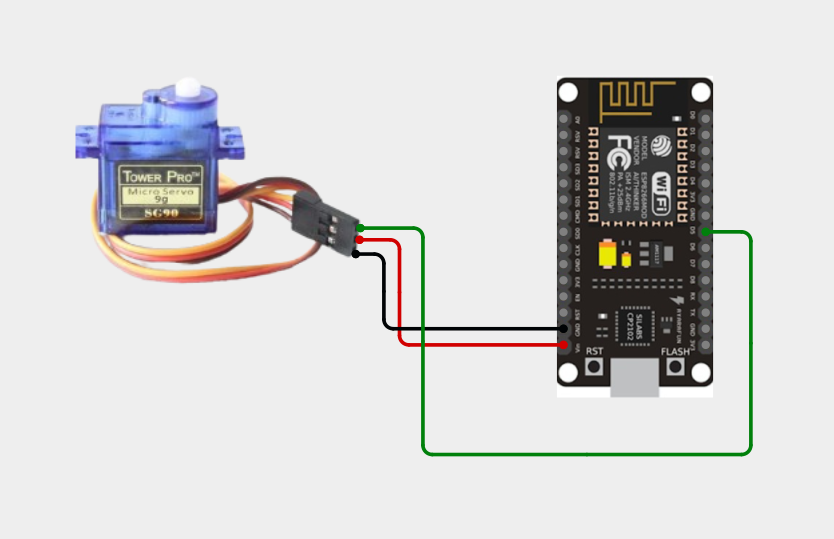
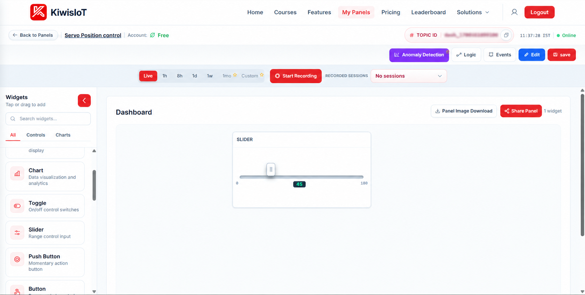
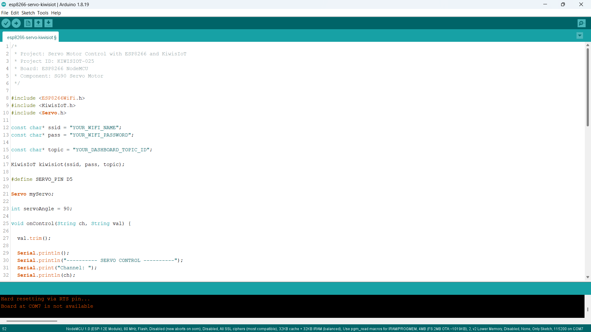
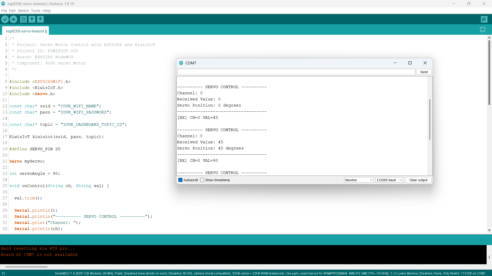

# ESP8266 Servo Motor IoT Project: Control Servo Position with KiwisIoT ⚙️

Build an **ESP8266 servo motor IoT project** to control the position of an SG90 servo motor remotely using an ESP8266 NodeMCU, Arduino IDE, and KiwisIoT.

In this project, the ESP8266 NodeMCU connects to KiwisIoT over Wi-Fi. A Slider widget on the KiwisIoT dashboard allows you to select a servo angle between **0° and 180°**.

The project uses digital pin D5 to control the servo signal. KiwisIoT Channel 0 sends the selected angle to the ESP8266, which validates the received value and moves the servo to the requested position.

This project demonstrates how to build a simple wireless positioning system using an ESP8266 and an IoT dashboard.

---

## 🚀 Project Highlights

- Remote servo motor control using KiwisIoT
- ESP8266 NodeMCU development board
- SG90 servo motor
- Adjustable servo position from 0° to 180°
- KiwisIoT Slider widget for angle selection
- Channel 0 for servo position control
- Wi-Fi-based communication
- Serial Monitor output for debugging
- Callback-based command handling using `kiwisiot.onReceive()`
- Input validation for servo angle commands
- Suitable for learning IoT-based motor control and robotics

---

## 🔎 Project Overview

The **ESP8266 Servo Motor IoT project** demonstrates how to control a servo motor remotely using a KiwisIoT dashboard.

The ESP8266 NodeMCU connects to KiwisIoT over Wi-Fi. The dashboard contains a Slider widget configured to send values between 0 and 180.

When the slider sends a value, the ESP8266 receives the channel and command through the KiwisIoT callback function. The program checks the received value and moves the servo to the selected angle.

| KiwisIoT Channel | ESP8266 Pin | Function | Accepted Values |
|---|---|---|---|
| Channel 0 | D5 | Servo position | 0–180 degrees |

The servo is initialized to 90° when the program starts.

The project flow is:

```text
          KiwisIoT Dashboard
                  |
            Slider Widget
                  |
              Channel 0
                  |
                Wi-Fi
                  |
           ESP8266 NodeMCU
                  |
            Receive Callback
                  |
          Validate Angle Value
                  |
           Servo Library
                  |
             Signal: D5
                  |
            SG90 Servo Motor
                  |
          Selected Angle: 0–180°
```

---

## 💡 Why This Project?

Servo motors are commonly used in robotics, positioning systems, and automation applications. By connecting a servo motor to an ESP8266, you can create a wireless positioning system controlled through an IoT dashboard.

This project introduces remote motor positioning without requiring a complex control system.

It also provides a foundation for extending the system with sensors, automatic positioning, and robotics applications.

The project is useful for learning:

- Servo motor interfacing
- Digital signal control
- Angle-based positioning
- Wi-Fi communication
- Dashboard-based device control
- Callback functions
- Input validation
- Basic IoT robotics

---

## 📚 What You'll Learn

By building this project, you will learn how to:

- Connect an SG90 servo motor to an ESP8266 NodeMCU.
- Configure a GPIO pin for servo signal output.
- Initialize and control a servo using the Servo library.
- Connect an ESP8266 to KiwisIoT.
- Configure a Slider widget on a dashboard.
- Receive commands through Channel 0.
- Convert dashboard values into servo positions.
- Validate received angle values.
- Display servo positions in the Serial Monitor.
- Troubleshoot common circuit and IoT communication problems.

---

## 🧰 Components Required

| Component | Quantity |
|---|---:|
| ESP8266 NodeMCU | 1 |
| SG90 servo motor | 1 |
| Jumper wires | As required |
| USB cable | 1 |
| Computer | 1 |
| Wi-Fi connection | 1 |
| Suitable regulated 5V supply | 1, if required |

**Power note:** Servo motors can draw more current than the ESP8266 board can reliably supply. Use a suitable regulated supply when required and connect the external supply ground to the ESP8266 GND. Do not connect the servo's power wire to the 3.3V pin.

---

## 💻 Software Requirements

- Arduino IDE
- ESP8266 board package
- KiwisIoT Arduino library
- ESP8266-compatible Servo library
- KiwisIoT account
- Wi-Fi connection

### Common KiwisIoT Setup

Before starting this project, complete the common **KiwisIoT Arduino Setup Guide**.

The setup guide covers:

- Arduino IDE installation
- ESP8266 board installation and selection
- KiwisIoT Arduino library installation
- KiwisIoT panel setup
- Topic ID configuration
- Dashboard widget setup and configuration

The common setup guide is available in the parent `esp8266` directory:

[Open the KiwisIoT Arduino Setup Guide](../kiwisiot-arduino-setup/)

### KiwisIoT Library Setup

If the KiwisIoT Arduino library is not already installed:

1. Open Arduino IDE.
2. Navigate to **Sketch → Include Library → Manage Libraries**.
3. Search for the KiwisIoT library.
4. Install it according to the available library listing or the KiwisIoT setup guide.
5. Confirm that the library is available before compiling the program.

The `ESP8266WiFi.h` header provides ESP8266 Wi-Fi functionality, `KiwisIoT.h` provides communication with KiwisIoT, and `Servo.h` provides servo positioning functions.

---

## 🛠️ Technologies Used

- ESP8266 NodeMCU
- SG90 servo motor
- Arduino IDE
- ESP8266WiFi library
- KiwisIoT Arduino library
- ESP8266 Servo library
- KiwisIoT IoT dashboard
- Wi-Fi communication
- GPIO signal control
- C++ / Arduino

---

## 🔌 Circuit Connection

Connect the SG90 servo motor to the ESP8266 NodeMCU according to the circuit diagram.

### Pin Connections

| Servo Wire | ESP8266 NodeMCU Connection |
|---|---|
| Brown / Black (GND) | GND |
| Red (VCC) | VIN / suitable 5V supply |
| Orange / Yellow (Signal) | D5 |

### Circuit Diagram



### Understanding the Connections

- **Signal → D5:** Sends the control signal used to position the servo.
- **VCC → suitable 5V supply:** Provides power to the servo motor.
- **GND → GND:** Provides the common electrical reference.

The servo signal pin is defined in the Arduino program as:

```cpp
#define SERVO_PIN D5
```

The servo object is created using:

```cpp
Servo myServo;
```

**Important:** The diagram represents the low-voltage controller-to-servo connections. Ensure that the servo supply meets the motor's specifications and that all grounds are connected together when using an external supply.

---

## 🔬 How Servo Position Control Works

### 1. Define the Servo Pin

The program assigns D5 as the servo signal pin.

```cpp
#define SERVO_PIN D5
```

This pin carries the control signal used by the Servo library.

### 2. Create the Servo Object

The program creates an object to control the motor.

```cpp
Servo myServo;
```

The object provides functions for attaching the servo and setting its position.

### 3. Initialize the Servo

The servo is attached to D5 and moved to its initial position of 90°.

```cpp
myServo.attach(SERVO_PIN);
myServo.write(servoAngle);
```

The initial angle is stored in the variable:

```cpp
int servoAngle = 90;
```

### 4. Receive Dashboard Commands

The callback function receives the channel and value sent from KiwisIoT.

```cpp
void onControl(String ch, String val)
```

The `ch` parameter identifies the channel, while `val` contains the received angle.

### 5. Validate the Received Value

The program removes surrounding whitespace and checks that the received command contains numeric digits.

```cpp
val.trim();
```

It then converts the value into an integer and checks whether the angle is between 0 and 180 degrees.

### 6. Move the Servo

When Channel 0 receives a valid angle, the program updates the servo position.

```cpp
servoAngle = angle;
myServo.write(servoAngle);
```

For example, if the dashboard sends `45`, the servo is instructed to move to 45°.

### 7. Display the Result

The Serial Monitor displays the received channel, value, and servo position. This helps verify that the dashboard commands are reaching the ESP8266 and being processed.

---

## 🔁 Servo Position Control Reference

The project uses the following channel and angle mapping:

| Channel | Received Value | Expected Servo Position |
|---|---:|---:|
| 0 | `0` | 0° |
| 0 | `45` | 45° |
| 0 | `90` | 90° |
| 0 | `135` | 135° |
| 0 | `180` | 180° |

The actual mechanical range may vary depending on the servo model and its mechanical limits. Avoid forcing the servo against its stops.

---

## ☁️ KiwisIoT Dashboard

This project uses a **Slider widget** on the KiwisIoT dashboard.

The dashboard panel is named **Servo Position Control** and contains a slider that selects the desired servo angle.



The slider sends angle values to the ESP8266 through Channel 0.

### Dashboard Control Mapping

| Dashboard Widget | Channel ID | Controlled Component |
|---|---|---|
| Servo Position Slider | 0 | SG90 Servo Motor |

The expected angle values range from `0` to `180`.

---

## ⚙️ Dashboard Configuration

### 1. Open or Create a KiwisIoT Panel

Open your KiwisIoT account and create a panel or open the existing **Servo Position Control** panel.

### 2. Add a Slider Widget

Add a Slider widget to the dashboard.

Configure the slider as follows:

```text
Widget Name: Servo Position
Widget Type: Slider
Channel ID: 0
Minimum Value: 0
Maximum Value: 180
```

### 3. Configure the Slider

Set the slider to send numeric angle values between 0 and 180. The values must match the range expected by the Arduino program.

### 4. Save the Dashboard

After configuring the widget:

1. Click **Update** if the widget configuration provides that option.
2. Click **Edit** at the top of the dashboard if required.
3. Click **Save** to save the dashboard changes.

### 5. Verify the Channel ID

The Arduino program uses Channel 0 for servo control.

```cpp
if (ch == "0") {
  // Servo position control
}
```

Make sure the Slider widget uses Channel 0 and sends a numeric angle value.

---

## 💻 Arduino Code

The complete Arduino source file is available in the project's `code` directory.

The program uses these headers:

```cpp
#include <ESP8266WiFi.h>
#include <KiwisIoT.h>
#include <Servo.h>
```

The KiwisIoT object is initialized using the Wi-Fi credentials and dashboard Topic ID:

```cpp
KiwisIoT kiwisiot(ssid, pass, topic);
```

The receive callback is registered using:

```cpp
kiwisiot.onReceive(onControl);
```

The main loop continuously processes KiwisIoT:

```cpp
void loop() {
  kiwisiot.run();
}
```



---

## 🔐 Configure Wi-Fi and KiwisIoT

Before uploading the program, update the following values in the Arduino code:

```cpp
const char* ssid = "YOUR_WIFI_NAME";
const char* pass = "YOUR_WIFI_PASSWORD";

const char* topic = "YOUR_DASHBOARD_TOPIC_ID";
```

Replace `YOUR_WIFI_NAME` with your Wi-Fi network name.

Replace `YOUR_WIFI_PASSWORD` with your Wi-Fi password.

Replace `YOUR_DASHBOARD_TOPIC_ID` with the Topic ID of your KiwisIoT panel.

Make sure the Topic ID corresponds to the **Servo Position Control** panel containing the Slider widget.

**Security:** Keep actual Wi-Fi credentials and private information out of public GitHub repositories. Use placeholders in the published code and enter your credentials locally.

---

## 📝 Complete Arduino Code

The following is the complete Arduino program for the ESP8266 servo motor control project.

```cpp
/*
 * Project: Servo Motor Control with ESP8266 and KiwisIoT
 * Project ID: KIWISIOT-025
 * Board: ESP8266 NodeMCU
 * Component: SG90 Servo Motor
 */

#include <ESP8266WiFi.h>
#include <KiwisIoT.h>
#include <Servo.h>

const char* ssid = "YOUR_WIFI_NAME";
const char* pass = "YOUR_WIFI_PASSWORD";

const char* topic = "YOUR_DASHBOARD_TOPIC_ID";

KiwisIoT kiwisiot(ssid, pass, topic);

#define SERVO_PIN D5

Servo myServo;

int servoAngle = 90;

void onControl(String ch, String val) {

  val.trim();

  Serial.println();
  Serial.println("---------- SERVO CONTROL ----------");
  Serial.print("Channel: ");
  Serial.println(ch);
  Serial.print("Received Value: ");
  Serial.println(val);

  if (ch == "0") {

    if (val.length() == 0) {
      Serial.println("Invalid command. Enter an angle from 0 to 180.");
      return;
    }

    for (unsigned int i = 0; i < val.length(); i++) {
      if (!isDigit(val[i])) {
        Serial.println("Invalid command. Enter an angle from 0 to 180.");
        return;
      }
    }

    int angle = val.toInt();

    if (angle >= 0 && angle <= 180) {

      servoAngle = angle;
      myServo.write(servoAngle);

      Serial.print("Servo Position: ");
      Serial.print(servoAngle);
      Serial.println(" degrees");

    } else {
      Serial.println("Invalid angle. Use a value from 0 to 180.");
    }
  } else {
    Serial.println("Unknown channel. Use Channel 0.");
  }

  Serial.println("-----------------------------------");
}

void setup() {

  Serial.begin(115200);

  myServo.attach(SERVO_PIN);
  myServo.write(servoAngle);

  Serial.println();
  Serial.println("===== ESP8266 SERVO MOTOR =====");
  Serial.println("Servo initialized: 90 degrees");
  Serial.println("Connecting to KiwisIoT...");

  kiwisiot.begin();
  kiwisiot.onReceive(onControl);

  Serial.println("KiwisIoT servo control initialized.");
  Serial.println("Channel 0: Servo position (0-180 degrees)");
}

void loop() {
  kiwisiot.run();
}
```

---

## ⬆️ Upload the Program

Follow these steps to upload the program:

1. Connect the SG90 servo motor to the ESP8266 NodeMCU according to the circuit diagram.
2. Verify the servo's power requirements and connections.
3. Connect the NodeMCU to your computer using a USB cable.
4. Open `esp8266-servo-kiwisiot.ino` in Arduino IDE.
5. Install the ESP8266 board package if it is not already installed.
6. Install the KiwisIoT Arduino library.
7. Ensure the ESP8266-compatible Servo library is available.
8. Select the appropriate ESP8266 NodeMCU board.
9. Update the Wi-Fi credentials and KiwisIoT Topic ID.
10. Verify the program.
11. Upload the code.
12. Open the Serial Monitor.
13. Set the baud rate to `115200`.
14. Open the KiwisIoT dashboard and move the Slider widget.

When the program starts, it initializes the servo at 90° and registers the receive callback. The main loop then processes incoming KiwisIoT messages.

When an angle arrives on Channel 0, the program validates the value and commands the servo to move to the requested position.

---

## 🖥️ Serial Monitor Output

The Serial Monitor displays the received channel, command value, and resulting servo position.

Set the baud rate to `115200` to match the program:

```cpp
Serial.begin(115200);
```

### Example Output: Servo at 0°

When the slider sends the value `0`, the program processes Channel 0.

```text
---------- SERVO CONTROL ----------
Channel: 0
Received Value: 0
Servo Position: 0 degrees
-----------------------------------
```

### Example Output: Servo at 45°

When the slider sends the value `45`, the program processes Channel 0.

```text
---------- SERVO CONTROL ----------
Channel: 0
Received Value: 45
Servo Position: 45 degrees
-----------------------------------
```

### Example Output: Servo at 90°

When the slider sends the value `90`, the program processes Channel 0.

```text
---------- SERVO CONTROL ----------
Channel: 0
Received Value: 90
Servo Position: 90 degrees
-----------------------------------
```

### Example Output: Servo at 180°

When the slider sends the value `180`, the program processes Channel 0.

```text
---------- SERVO CONTROL ----------
Channel: 0
Received Value: 180
Servo Position: 180 degrees
-----------------------------------
```

### Example Output: Invalid Angle

If the program receives a value outside the accepted range, such as `200`, it displays an error message.

```text
---------- SERVO CONTROL ----------
Channel: 0
Received Value: 200
Invalid angle. Use a value from 0 to 180.
-----------------------------------
```



The Serial Monitor confirms the received command and the angle requested by the program. The printed angle represents the commanded position, not independent feedback from the servo's physical shaft.

---

## 🔄 Understanding the Data Flow

The project follows these steps to control the servo remotely.

### 1. Initialize the Servo

The ESP8266 attaches the servo to D5 and sets the initial target angle to 90°.

### 2. Initialize KiwisIoT

The program starts the KiwisIoT library and registers the callback:

```cpp
kiwisiot.begin();
kiwisiot.onReceive(onControl);
```

### 3. Wait for Dashboard Commands

The main loop continuously processes KiwisIoT:

```cpp
void loop() {
  kiwisiot.run();
}
```

### 4. Read the Channel and Value

The callback receives the channel ID and angle:

```cpp
void onControl(String ch, String val)
```

### 5. Validate the Command

The program checks that the value contains numeric digits and falls within the range 0–180.

### 6. Update the Servo Position

The Servo library sends the control signal corresponding to the selected angle.

### 7. Display the Result

The Serial Monitor displays the channel, received value, and commanded servo position.

The complete data flow is:

```text
       KiwisIoT Dashboard
                |
          Slider Widget
                |
            Channel 0
                |
              Wi-Fi
                |
        ESP8266 NodeMCU
                |
         kiwisiot.run()
                |
        onControl(ch, val)
                |
         Validate Angle
                |
       Check Range: 0–180
                |
         myServo.write()
                |
            Signal D5
                |
         SG90 Servo Motor
                |
        Selected Position
```

---

## 🧪 Testing the Project

To test the project:

1. Verify the servo signal, power, and ground connections.
2. Confirm that the servo is connected to D5.
3. Upload the Arduino program.
4. Open the Serial Monitor at `115200` baud.
5. Wait for the startup messages.
6. Open the KiwisIoT dashboard.
7. Move the slider to 0°.
8. Confirm that the Serial Monitor reports `Servo Position: 0 degrees`.
9. Move the slider to 45° and verify the reported position.
10. Repeat the test at 90°, 135°, and 180°.
11. Observe whether the servo follows the commanded positions.
12. Check that invalid values are rejected.

Test the servo without attaching a mechanical load initially. If the motor buzzes, stalls, overheats, or reaches a mechanical stop, disconnect power and check the supply and operating range.

### Test 1: Servo at 0°

Move the slider to `0`.

Expected Serial Monitor message:

```text
Channel: 0
Received Value: 0
Servo Position: 0 degrees
```

### Test 2: Servo at 45°

Move the slider to `45`.

Expected Serial Monitor message:

```text
Channel: 0
Received Value: 45
Servo Position: 45 degrees
```

### Test 3: Servo at 90°

Move the slider to `90`.

Expected Serial Monitor message:

```text
Channel: 0
Received Value: 90
Servo Position: 90 degrees
```

### Test 4: Servo at 180°

Move the slider to `180`.

Expected Serial Monitor message:

```text
Channel: 0
Received Value: 180
Servo Position: 180 degrees
```

### Test 5: Invalid Angle

If an angle outside the allowed range is received, the program should display an invalid-angle message and not issue a new servo movement command.

### Test 6: Verify Dashboard Communication

Move the slider several times and check that:

- The Serial Monitor displays the received commands.
- Channel 0 is used for servo control.
- The received angle matches the slider value.
- The servo responds to valid commands.
- The ESP8266 maintains a working Wi-Fi connection.

---

## 🛠️ Troubleshooting

### Servo Does Not Move

Check:

- Whether the servo signal wire is connected to D5.
- Whether the servo receives the correct supply voltage.
- Whether the ESP8266 and external servo supply share GND.
- Whether the servo is mechanically obstructed.
- Whether the received angle appears in the Serial Monitor.

### Servo Moves Erratically or Resets the ESP8266

Check:

- Whether the 5V supply can provide sufficient current.
- Whether the power wires are secure.
- Whether the ground connection is shared.
- Whether the servo is drawing excessive current under load.

A suitable external 5V supply may be necessary.

### Serial Monitor Does Not Show Received Commands

Check:

- Whether the baud rate is `115200`.
- Whether the ESP8266 has a working Wi-Fi connection.
- Whether the Topic ID is correct.
- Whether the dashboard Slider widget uses Channel 0.
- Whether the program contains `kiwisiot.onReceive(onControl)`.
- Whether `kiwisiot.run()` continues to execute in `loop()`.

### Dashboard Slider Does Not Control the Servo

Confirm that:

- The correct KiwisIoT panel is open.
- The Topic ID matches the configured panel.
- The Slider widget uses Channel 0.
- The slider sends numeric values between 0 and 180.
- The ESP8266 is connected to Wi-Fi.

### Invalid Angle Message Appears

The program accepts numeric digits representing an angle from 0 through 180.

Check the slider configuration and ensure that it does not send text, decimal values, negative values, or values outside the configured range.

### Servo Cannot Reach the Selected Angle

The Serial Monitor shows the commanded angle. The actual physical range depends on the servo's mechanical limits, calibration, and power supply.

Do not force the servo beyond its physical travel.

---

## 🔒 Security and Hardware Safety

Never publish sensitive credentials in a public GitHub repository.

Do not commit:

- Wi-Fi passwords
- API keys
- Access tokens
- Account passwords
- Private dashboard access information

Use placeholders in the public example:

```text
YOUR_WIFI_NAME
YOUR_WIFI_PASSWORD
YOUR_DASHBOARD_TOPIC_ID
```

Enter your actual credentials only in your local Arduino project.

For hardware safety:

- Use a suitable regulated servo power supply.
- Do not power the servo from the ESP8266 3.3V pin.
- Connect grounds together when using an external supply.
- Disconnect power before changing wiring.
- Avoid stalling the servo or forcing it against mechanical stops.
- Keep fingers and wires clear of moving parts.

---

## 🌱 Possible Applications

An ESP8266 servo motor system can be used as a starting point for:

- IoT-based robotic arms
- Remote positioning systems
- Camera positioning prototypes
- Smart door prototypes
- Robotics education
- Embedded systems experiments
- Dashboard-controlled mechanisms
- Automated positioning projects

The project can be extended with sensors, scheduled movements, or automatic positioning rules.

For example, a sensor could be added to trigger a servo movement when a particular condition is detected.

**Important:** This is a basic servo positioning demonstration, not a complete safety-certified door lock or security system.

---

## 📁 Project Structure

```text
025-servo-kiwisiot/
│
├── README.md
│
├── code/
│   └── esp8266-servo-kiwisiot.ino
│
└── images/
    ├── circuit.png
    ├── code.png
    ├── serial-monitor.png
    └── dashboard-output.png
```

---

## 🔗 Related KiwisIoT ESP8266 Projects

This project is part of the KiwisIoT ESP8266 IoT project collection.

- [ESP8266 LDR Sensor IoT Project](../001-ldr-kiwisiot/)
- [ESP8266 IR Sensor IoT Project](../002-ir-kiwisiot/)
- [ESP8266 Ultrasonic Sensor IoT Project](../003-ultrasonic-kiwisiot/)
- [ESP8266 DHT11 Temperature and Humidity IoT Project](../004-dht11-kiwisiot/)
- [ESP8266 PIR Motion Sensor IoT Project](../005-pir-kiwisiot/)
- [ESP8266 Gas Sensor IoT Project](../006-gas-kiwisiot/)
- [ESP8266 Flame Sensor IoT Project](../007-flame-kiwisiot/)
- [ESP8266 Soil Moisture Sensor IoT Project](../008-soil-moisture-kiwisiot/)
- [ESP8266 Water Level Sensor IoT Project](../009-water-level-kiwisiot/)
- [ESP8266 Raindrop Sensor IoT Project](../010-raindrop-kiwisiot/)
- [ESP8266 Sound Sensor IoT Project](../011-sound-kiwisiot/)
- [ESP8266 MPU6050 Motion and Acceleration IoT Project](../012-mpu6050-kiwisiot/)
- [ESP8266 Voltage Sensor IoT Project](../013-voltage-kiwisiot/)
- [ESP8266 Current Sensor IoT Project](../014-current-kiwisiot/)
- [ESP8266 Vibration Sensor IoT Project](../015-vibration-kiwisiot/)
- [ESP8266 Reed Switch IoT Project](../016-reed-switch-kiwisiot/)
- [ESP8266 Hall Effect Sensor IoT Project](../017-hall-effect-kiwisiot/)
- [ESP8266 Touch Sensor IoT Project](../018-touch-sensor-kiwisiot/)
- [ESP8266 BMP180 Temperature and Air Pressure IoT Project](../019-bmp180-kiwisiot/)
- [ESP8266 DS18B20 Temperature Monitoring IoT Project](../020-ds18b20-kiwisiot/)
- [ESP8266 LED Remote Control IoT Project](../021-LED-kiwisiot/)
- [ESP8266 RGB LED IoT Project](../022-RGB-LED-kiwisiot/)
- [ESP8266 Buzzer IoT Project](../023-buzzer-kiwisiot/)
- [ESP8266 2-Channel Relay IoT Project](../024-relay-kiwisiot/)

For Arduino and KiwisIoT setup, see the [KiwisIoT Arduino Setup Guide](../kiwisiot-arduino-setup/).

---

## ❓ Frequently Asked Questions

### What is the purpose of this project?

This project demonstrates how to control an SG90 servo motor remotely using an ESP8266 NodeMCU and a KiwisIoT dashboard.

### Which ESP8266 board is used?

The project uses the ESP8266 NodeMCU development board.

### Which servo motor is used?

An SG90 servo motor is used for position control.

### Which pin controls the servo?

D5 is used for the servo signal connection.

### Which KiwisIoT widget is used?

A Slider widget is used to select the servo position.

### Which KiwisIoT channel is used?

Channel 0 controls the servo position.

### What is the allowed angle range?

The program accepts numeric angles from 0° to 180°.

### What happens when the program starts?

The program initializes the servo with a commanded position of 90°.

### Can I control the servo from a dashboard?

Yes. The KiwisIoT Slider widget sends the selected angle to the ESP8266 over Wi-Fi.

### Does the Serial Monitor show the actual shaft angle?

No. The program prints the angle it commands the servo to reach. The circuit does not include a separate position sensor to measure the actual shaft angle.

### Can I use an external power supply?

Yes. Use a suitable regulated supply for the servo and connect its ground to the ESP8266 GND.

### Can this project be used in robotics?

Yes. It provides a starting point for robotics and positioning experiments. Additional hardware and control logic may be needed for a complete application.

---

## 📌 Summary

This project demonstrates an **ESP8266 servo motor control system** using an SG90 servo motor and KiwisIoT.

The ESP8266 connects to KiwisIoT over Wi-Fi, receives angle commands through Channel 0, validates the received value, and controls the servo signal through D5.

The final control mapping is:

```text
Channel 0 + Value 0   → Servo position 0°
Channel 0 + Value 45  → Servo position 45°
Channel 0 + Value 90  → Servo position 90°
Channel 0 + Value 135 → Servo position 135°
Channel 0 + Value 180 → Servo position 180°
```

With a Slider widget on the dashboard, the project provides a practical introduction to servo interfacing, angle-based positioning, callback-based communication, and IoT-based control.

---

## 📄 License

This project is licensed under the MIT License. See the [LICENSE](../../LICENSE) file for details.
