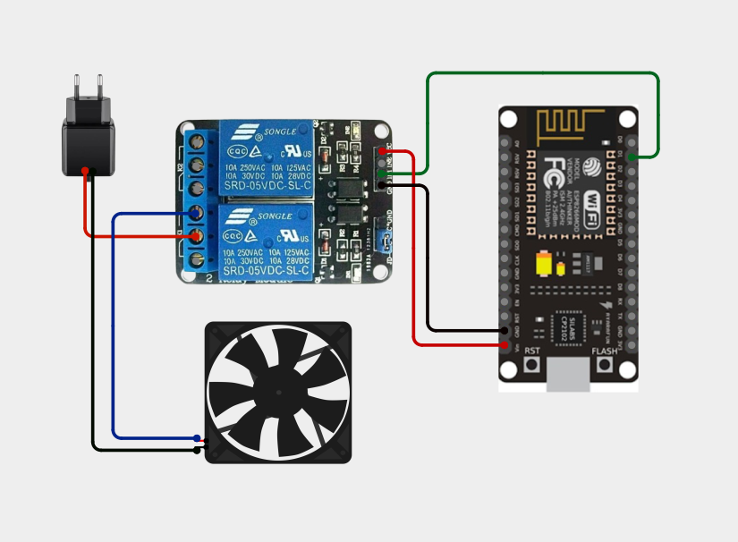
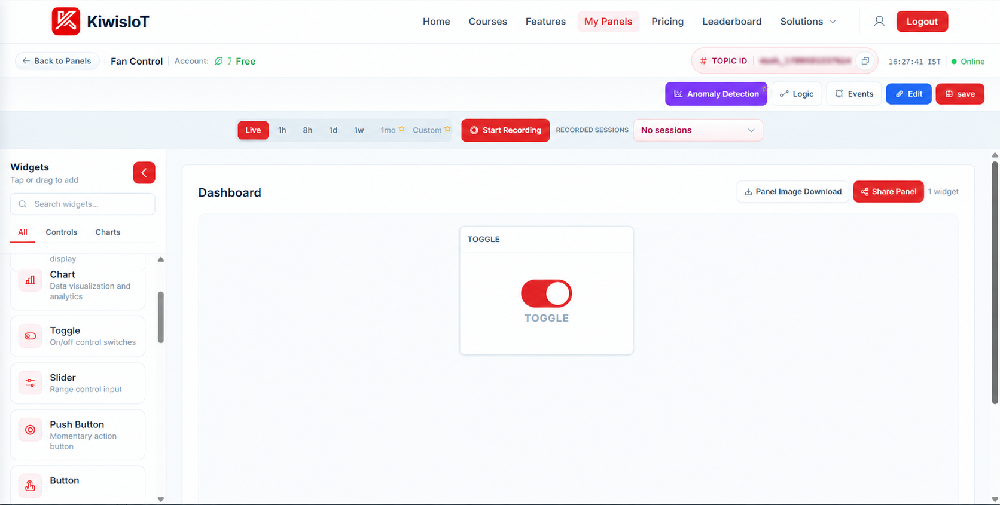
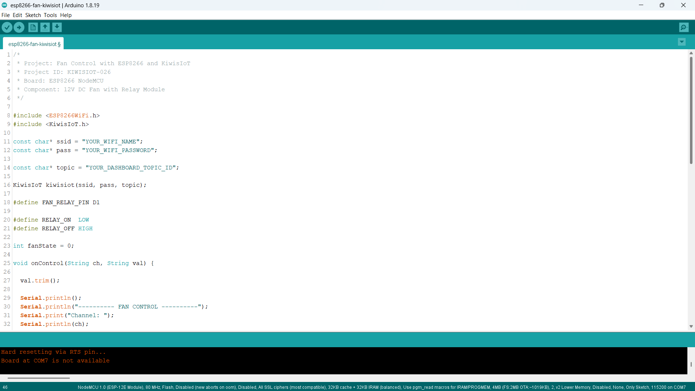
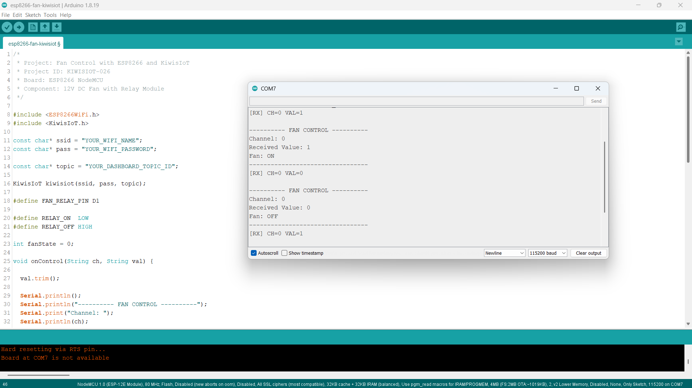

# ESP8266 Fan Control IoT Project: Remotely Control a DC Fan with KiwisIoT 🌀

Build an **ESP8266 fan control IoT project** to remotely switch a 12V DC fan ON and OFF using an ESP8266 NodeMCU, a relay module, Arduino IDE, and KiwisIoT.

In this project, the ESP8266 NodeMCU connects to KiwisIoT over Wi-Fi. A Toggle widget on the KiwisIoT dashboard allows you to control the fan remotely.

The project uses digital pin D1 to control the relay module. KiwisIoT Channel 0 sends the ON/OFF command to the ESP8266, which switches the relay to control the 12V DC fan.

This project demonstrates how to build a basic wireless fan-switching system using an ESP8266, a relay module, and an IoT dashboard.

---

## 🚀 Project Highlights

- Remote 12V DC fan control using KiwisIoT
- ESP8266 NodeMCU development board
- 12V DC fan controlled through a relay module
- KiwisIoT Toggle widget for ON/OFF control
- Channel 0 for fan control
- Relay control through digital pin D1
- Wi-Fi-based communication
- Serial Monitor output for debugging
- Callback-based command handling using `kiwisiot.onReceive()`
- Input validation for ON/OFF commands
- Suitable for learning IoT-based electrical switching and automation

---

## 🔎 Project Overview

The **ESP8266 Fan Control IoT project** demonstrates how to switch a 12V DC fan remotely using a KiwisIoT dashboard.

The ESP8266 NodeMCU connects to KiwisIoT over Wi-Fi. The dashboard contains a Toggle widget configured to send `1` when switched ON and `0` when switched OFF.

When the Toggle widget sends a value, the ESP8266 receives the channel and command through the KiwisIoT callback function. The program validates the received value and controls the relay module connected to D1.

The relay switches the fan's 12V power circuit without connecting the fan directly to an ESP8266 GPIO pin.

| KiwisIoT Channel | ESP8266 Pin | Function | Accepted Values |
|---|---|---|---|
| Channel 0 | D1 | Relay and fan control | `1` = ON, `0` = OFF |

The program initializes the relay in the OFF state.

The project flow is:

```text
          KiwisIoT Dashboard
                  |
             Toggle Widget
                  |
              Channel 0
                  |
                Wi-Fi
                  |
           ESP8266 NodeMCU
                  |
            Receive Callback
                  |
          Validate ON/OFF Value
                  |
          Relay Control: D1
                  |
             Relay Module
                  |
          12V DC Fan Power
                  |
              Fan ON/OFF
```

---

## 💡 Why This Project?

DC fans are used in cooling systems, electronic equipment, small ventilation systems, and automation projects. By connecting a fan to an ESP8266 through a relay module, you can build a wireless switching system controlled through an IoT dashboard.

This project introduces remote electrical switching without requiring the fan to be connected directly to the microcontroller's GPIO pin.

It also provides a foundation for extending the system with temperature sensors, automatic cooling rules, and other IoT-based automation features.

The project is useful for learning:

- Relay module interfacing
- Digital output control
- DC fan switching
- Wi-Fi communication
- Dashboard-based device control
- Callback functions
- Input validation
- Basic IoT automation

---

## 📚 What You'll Learn

By building this project, you will learn how to:

- Connect a relay module to an ESP8266 NodeMCU.
- Control a relay using a digital GPIO pin.
- Switch a 12V DC fan through relay contacts.
- Connect an ESP8266 to KiwisIoT.
- Configure a Toggle widget on a dashboard.
- Receive ON/OFF commands through Channel 0.
- Convert dashboard values into relay states.
- Use active-LOW relay control logic.
- Display fan-control commands in the Serial Monitor.
- Troubleshoot common circuit and IoT communication problems.

---

## 🧰 Components Required

| Component | Quantity |
|---|---:|
| ESP8266 NodeMCU | 1 |
| 12V DC fan | 1 |
| Relay module compatible with the ESP8266 control signal | 1 |
| 12V DC power adapter suitable for the fan | 1 |
| Jumper wires | As required |
| Connecting wires for the fan circuit | As required |
| USB cable | 1 |
| Computer | 1 |
| Wi-Fi connection | 1 |

**Power and safety note:** The 12V adapter powers the fan circuit, not the ESP8266 GPIO. Verify the relay module's coil voltage, input compatibility, contact ratings, and wiring requirements before connecting it. Do not connect 12V directly to the ESP8266 pins. The relay contacts must be rated for the fan's operating current and startup current.

---

## 💻 Software Requirements

- Arduino IDE
- ESP8266 board package
- KiwisIoT Arduino library
- KiwisIoT account
- Wi-Fi connection

### Common KiwisIoT Setup

Before starting this project, complete the common **KiwisIoT Arduino Setup Guide**.

The setup guide covers:

- Arduino IDE installation
- ESP8266 board installation and selection
- KiwisIoT Arduino library installation
- KiwisIoT panel setup
- Topic ID configuration
- Dashboard widget setup and configuration

The common setup guide is available in the parent `esp8266` directory:

[Open the KiwisIoT Arduino Setup Guide](../kiwisiot-arduino-setup/)

### KiwisIoT Library Setup

If the KiwisIoT Arduino library is not already installed:

1. Open Arduino IDE.
2. Navigate to **Sketch → Include Library → Manage Libraries**.
3. Search for the KiwisIoT library.
4. Install it according to the available library listing or the KiwisIoT setup guide.
5. Confirm that the library is available before compiling the program.

The `ESP8266WiFi.h` header provides ESP8266 Wi-Fi functionality, while `KiwisIoT.h` provides communication with KiwisIoT.

---

## 🛠️ Technologies Used

- ESP8266 NodeMCU
- 12V DC fan
- Relay module
- Arduino IDE
- ESP8266WiFi library
- KiwisIoT Arduino library
- KiwisIoT IoT dashboard
- Wi-Fi communication
- GPIO digital output control
- C++ / Arduino

---

## 🔌 Circuit Connection

Connect the ESP8266 NodeMCU, relay module, 12V DC fan, and 12V DC power adapter according to the circuit diagram.

### Pin Connections

#### ESP8266 NodeMCU to Relay Module

| ESP8266 NodeMCU | Relay Module |
|---|---|
| D1 | IN1 / IN, the relay control input used |
| GND | GND, where required by the module's input circuit |
| Suitable supply | Relay module VCC, according to the module's specifications |

The exact relay-module power connection depends on the module design. Check its markings and specifications before supplying power. Do not assume that every relay board can be powered from the NodeMCU VIN pin.

#### Relay Contacts and 12V DC Fan

| Component Connection | Connection |
|---|---|
| 12V adapter positive (+) | Relay COM |
| Relay NO | Fan positive (+) |
| Fan negative (-) | 12V adapter negative (-) |

This configuration uses the relay's **Normally Open (NO)** contact. When the relay is OFF, the fan circuit is open. When the relay is activated, COM connects to NO and supplies power to the fan.

### Circuit Diagram



### Understanding the Connections

- **D1 → Relay IN:** Sends the control signal that switches the relay.
- **Relay COM → 12V adapter positive:** Supplies the positive side of the fan circuit to the relay contact.
- **Relay NO → Fan positive:** Connects the fan to the supply when the relay activates.
- **Fan negative → Adapter negative:** Completes the 12V fan power circuit.
- **Relay VCC and GND:** Power the relay module according to its specifications.

The relay control pin is defined in the Arduino program as:

```cpp
#define FAN_RELAY_PIN D1
```

The program uses active-LOW relay logic:

```cpp
#define RELAY_ON  LOW
#define RELAY_OFF HIGH
```

**Important safety precautions:**

- Disconnect the power sources before changing wiring.
- Verify the relay contact ratings against the fan's voltage, operating current, and startup current.
- Use a relay module whose control input is compatible with the ESP8266's 3.3V GPIO logic.
- Keep the fan's 12V supply separate from the ESP8266 GPIO circuitry.
- Follow the relay board's instructions for VCC, GND, and input connections.
- Never connect the 12V adapter output directly to D1 or another ESP8266 GPIO pin.
- This project is designed for a low-voltage DC fan, not direct mains-powered fan switching.

---

## 🔬 How Fan Control Works

### 1. Define the Relay Pin

The program assigns D1 as the relay control pin.

```cpp
#define FAN_RELAY_PIN D1
```

This pin sends the digital control signal to the relay module.

### 2. Define the Relay States

The program defines the ON and OFF states:

```cpp
#define RELAY_ON  LOW
#define RELAY_OFF HIGH
```

This configuration assumes the relay module is active-LOW: a LOW signal activates the relay, and a HIGH signal deactivates it. Confirm this behavior for your specific module.

### 3. Initialize the Fan State

The fan state is initialized to OFF.

```cpp
int fanState = 0;
```

During startup, the program sets the relay output to the OFF level before configuring the pin as an output.

```cpp
digitalWrite(FAN_RELAY_PIN, RELAY_OFF);
pinMode(FAN_RELAY_PIN, OUTPUT);
```

This establishes the intended initial OFF state. Actual startup behavior can still depend on the relay module and its electrical design.

### 4. Receive Dashboard Commands

The callback function receives the channel and value sent from KiwisIoT.

```cpp
void onControl(String ch, String val)
```

The `ch` parameter identifies the channel, while `val` contains the received command.

### 5. Validate the Received Value

The program removes surrounding whitespace and checks whether Channel 0 has received either `1` or `0`.

```cpp
val.trim();

if (val != "1" && val != "0") {
  Serial.println("Invalid command. Use 1 or 0.");
  return;
}
```

This prevents unexpected values from being treated as valid fan commands.

### 6. Switch the Relay

When Channel 0 receives a valid command, the program updates the fan state and switches the relay.

```cpp
fanState = (val == "1");
digitalWrite(FAN_RELAY_PIN, fanState ? RELAY_ON : RELAY_OFF);
```

- If the received value is `1`, the relay activates and the fan turns ON.
- If the received value is `0`, the relay deactivates and the fan turns OFF.

### 7. Display the Result

The Serial Monitor displays the received channel, command, and resulting fan state.

This helps verify that dashboard commands reach the ESP8266 and are processed by the program.

---

## 🔁 Fan Control Reference

The project uses the following channel and command mapping:

| Channel | Received Value | Relay Action | Expected Fan State |
|---|---:|---|---|
| 0 | `0` | Relay OFF | Fan OFF |
| 0 | `1` | Relay ON | Fan ON |

The fan is switched using the relay contacts. The ESP8266 does not power the 12V fan directly.

---

## ☁️ KiwisIoT Dashboard

This project uses a **Toggle widget** on the KiwisIoT dashboard.

The dashboard contains a Toggle widget for switching the fan ON and OFF.



The Toggle widget sends a command to the ESP8266 through Channel 0.

### Dashboard Control Mapping

| Dashboard Widget | Channel ID | Value | Controlled Component |
|---|---|---:|---|
| Fan Control Toggle | 0 | `1` | Fan ON |
| Fan Control Toggle | 0 | `0` | Fan OFF |

The expected values are `1` and `0`. They must match the commands handled by the Arduino program.

---

## ⚙️ Dashboard Configuration

### 1. Open or Create a KiwisIoT Panel

Open your KiwisIoT account and create a panel or open your existing fan-control panel.

### 2. Add a Toggle Widget

Add a Toggle widget to the dashboard.

Configure the widget as follows:

```text
Widget Name: Fan Control
Widget Type: Toggle
Channel ID: 0
ON Value: 1
OFF Value: 0
```

### 3. Configure the Toggle

Set the Toggle widget to send `1` when ON and `0` when OFF.

These values match the conditions used by the Arduino program.

### 4. Save the Dashboard

After configuring the widget:

1. Click **Update** if the widget configuration provides that option.
2. Click **Edit** at the top of the dashboard if required.
3. Click **Save** to save the dashboard changes.

### 5. Verify the Channel ID

The Arduino program uses Channel 0 for fan control.

```cpp
if (ch == "0") {
  // Fan ON/OFF control
}
```

Make sure the Toggle widget uses Channel 0 and sends the expected values.

---

## 💻 Arduino Code

The complete Arduino source file is available in the project's `code` directory.

The program uses these headers:

```cpp
#include <ESP8266WiFi.h>
#include <KiwisIoT.h>
```

The KiwisIoT object is initialized using the Wi-Fi credentials and dashboard Topic ID:

```cpp
KiwisIoT kiwisiot(ssid, pass, topic);
```

The receive callback is registered using:

```cpp
kiwisiot.onReceive(onControl);
```

The main loop continuously processes KiwisIoT:

```cpp
void loop() {
  kiwisiot.run();
}
```



---

## 🔐 Configure Wi-Fi and KiwisIoT

Before uploading the program, update the following values in the Arduino code:

```cpp
const char* ssid = "YOUR_WIFI_NAME";
const char* pass = "YOUR_WIFI_PASSWORD";

const char* topic = "YOUR_DASHBOARD_TOPIC_ID";
```

Replace `YOUR_WIFI_NAME` with your Wi-Fi network name.

Replace `YOUR_WIFI_PASSWORD` with your Wi-Fi password.

Replace `YOUR_DASHBOARD_TOPIC_ID` with the Topic ID of your KiwisIoT panel.

Make sure the Topic ID corresponds to the panel containing the Fan Control Toggle widget.

**Security:** Keep actual Wi-Fi credentials and private information out of public GitHub repositories. Use placeholders in the published code and enter your credentials locally.

---

## 📝 Complete Arduino Code

The following is the complete Arduino program for the ESP8266 fan-control project.

```cpp
/*
 * Project: Fan Control with ESP8266 and KiwisIoT
 * Project ID: KIWISIOT-026
 * Board: ESP8266 NodeMCU
 * Component: 12V DC Fan with Relay Module
 */

#include <ESP8266WiFi.h>
#include <KiwisIoT.h>

const char* ssid = "YOUR_WIFI_NAME";
const char* pass = "YOUR_WIFI_PASSWORD";

const char* topic = "YOUR_DASHBOARD_TOPIC_ID";

KiwisIoT kiwisiot(ssid, pass, topic);

#define FAN_RELAY_PIN D1

#define RELAY_ON  LOW
#define RELAY_OFF HIGH

int fanState = 0;

void onControl(String ch, String val) {
  val.trim();

  Serial.println();
  Serial.println("---------- FAN CONTROL ----------");
  Serial.print("Channel: ");
  Serial.println(ch);
  Serial.print("Received Value: ");
  Serial.println(val);

  if (ch == "0") {
    if (val != "1" && val != "0") {
      Serial.println("Invalid command. Use 1 or 0.");
      return;
    }

    fanState = (val == "1");
    digitalWrite(FAN_RELAY_PIN, fanState ? RELAY_ON : RELAY_OFF);

    Serial.println(fanState ? "Fan: ON" : "Fan: OFF");
  } else {
    Serial.println("Unknown channel. Use Channel 0.");
  }

  Serial.println("---------------------------------");
}

void setup() {
  Serial.begin(115200);

  digitalWrite(FAN_RELAY_PIN, RELAY_OFF);
  pinMode(FAN_RELAY_PIN, OUTPUT);

  Serial.println();
  Serial.println("===== ESP8266 DC FAN CONTROL =====");
  Serial.println("Fan initialized: OFF");
  Serial.println("Connecting to KiwisIoT...");

  kiwisiot.begin();
  kiwisiot.onReceive(onControl);

  Serial.println("KiwisIoT fan control initialized.");
  Serial.println("Channel 0: Fan ON/OFF");
}

void loop() {
  kiwisiot.run();
}
```

---

## ⬆️ Upload the Program

Follow these steps to upload the program:

1. Check the relay module's voltage and control-input requirements.
2. Connect the ESP8266 NodeMCU to the relay module according to the circuit diagram.
3. Connect the 12V DC fan and adapter through the relay's COM and NO contacts.
4. Verify all wiring before applying power.
5. Connect the NodeMCU to your computer using a USB cable.
6. Open `esp8266-fan-kiwisiot.ino` in Arduino IDE.
7. Install the ESP8266 board package if it is not already installed.
8. Install the KiwisIoT Arduino library.
9. Select the appropriate ESP8266 NodeMCU board.
10. Update the Wi-Fi credentials and KiwisIoT Topic ID.
11. Verify the program.
12. Upload the code.
13. Open the Serial Monitor.
14. Set the baud rate to `115200`.
15. Open the KiwisIoT dashboard and operate the Toggle widget.

When the program starts, it configures the relay output to the OFF level, initializes KiwisIoT, and registers the receive callback.

When a command arrives on Channel 0, the program validates the value and switches the relay accordingly.

---

## 🖥️ Serial Monitor Output

The Serial Monitor displays the received channel, command value, and resulting fan state.

Set the baud rate to `115200` to match the program:

```cpp
Serial.begin(115200);
```

### Example Output: Fan ON

When the Toggle widget sends `1`, the program activates the relay.

```text
---------- FAN CONTROL ----------
Channel: 0
Received Value: 1
Fan: ON
---------------------------------
```

### Example Output: Fan OFF

When the Toggle widget sends `0`, the program deactivates the relay.

```text
---------- FAN CONTROL ----------
Channel: 0
Received Value: 0
Fan: OFF
---------------------------------
```

### Example Output: Invalid Command

If Channel 0 receives an unexpected value, such as `2`, the program rejects it.

```text
---------- FAN CONTROL ----------
Channel: 0
Received Value: 2
Invalid command. Use 1 or 0.
```

### Example Output: Unknown Channel

If the program receives a command on a channel other than Channel 0, it reports the channel mismatch.

```text
---------- FAN CONTROL ----------
Channel: 1
Received Value: 1
Unknown channel. Use Channel 0.
---------------------------------
```



The Serial Monitor confirms the command received by the ESP8266 and the state requested by the program. The printed fan state is based on the relay command; it does not independently measure whether the fan is physically rotating.

---

## 🔄 Understanding the Data Flow

The project follows these steps to control the fan remotely.

### 1. Initialize the Relay

The ESP8266 configures D1 as the relay-control output and sets the intended initial state to OFF.

### 2. Initialize KiwisIoT

The program starts the KiwisIoT library and registers the callback:

```cpp
kiwisiot.begin();
kiwisiot.onReceive(onControl);
```

### 3. Wait for Dashboard Commands

The main loop continuously processes KiwisIoT:

```cpp
void loop() {
  kiwisiot.run();
}
```

### 4. Read the Channel and Value

The callback receives the channel ID and command:

```cpp
void onControl(String ch, String val)
```

### 5. Validate the Command

The program checks that Channel 0 receives either `1` or `0`.

### 6. Update the Relay State

The program activates the relay for `1` and deactivates it for `0`.

### 7. Switch the Fan

The relay's COM and NO contacts control the fan's 12V power circuit.

### 8. Display the Result

The Serial Monitor displays the received command and the requested fan state.

The complete data flow is:

```text
        KiwisIoT Dashboard
                |
           Toggle Widget
                |
             Channel 0
                |
              Wi-Fi
                |
         ESP8266 NodeMCU
                |
          kiwisiot.run()
                |
         onControl(ch, val)
                |
         Validate: 1 or 0
                |
          Set Relay State
                |
            GPIO D1
                |
           Relay Module
                |
         12V DC Fan Circuit
                |
             Fan ON/OFF
```

---

## 🧪 Testing the Project

To test the project:

1. Verify the relay module's voltage and input requirements.
2. Confirm that the relay control input is connected to D1.
3. Check the fan wiring through COM and NO.
4. Confirm that the adapter's voltage matches the fan's rating.
5. Verify the adapter's current rating is sufficient for the fan, including startup current.
6. Upload the Arduino program.
7. Open the Serial Monitor at `115200` baud.
8. Wait for the startup messages.
9. Open the KiwisIoT dashboard.
10. Switch the Toggle widget ON.
11. Confirm that the Serial Monitor reports `Fan: ON`.
12. Verify that the relay activates and the fan starts.
13. Switch the Toggle widget OFF.
14. Confirm that the Serial Monitor reports `Fan: OFF`.
15. Verify that the relay deactivates and the fan stops.

### Test 1: Fan ON

Switch the dashboard Toggle widget ON.

Expected Serial Monitor message:

```text
Channel: 0
Received Value: 1
Fan: ON
```

Expected result: the relay activates and the fan receives power through the relay's COM and NO contacts.

### Test 2: Fan OFF

Switch the dashboard Toggle widget OFF.

Expected Serial Monitor message:

```text
Channel: 0
Received Value: 0
Fan: OFF
```

Expected result: the relay deactivates and the fan's power circuit opens.

### Test 3: Invalid Command

If Channel 0 receives a value other than `1` or `0`, the program should display an invalid-command message and should not change the relay state because of that invalid command.

### Test 4: Verify Dashboard Communication

Operate the Toggle widget several times and check that:

- The Serial Monitor displays the received commands.
- Channel 0 is used for fan control.
- Value `1` requests the ON state.
- Value `0` requests the OFF state.
- The relay responds to valid commands.
- The fan starts and stops as expected.
- The ESP8266 maintains a working Wi-Fi connection.

**Safety:** Test the relay and fan with the fan securely positioned and all exposed connections insulated. Disconnect power before correcting any wiring.

---

## 🛠️ Troubleshooting

### Fan Does Not Turn ON

Check:

- Whether the relay control input is connected to D1.
- Whether the relay module receives the correct supply voltage.
- Whether the relay input is compatible with the ESP8266's 3.3V logic.
- Whether the 12V adapter is working.
- Whether the adapter can supply sufficient current for the fan.
- Whether the fan is wired through COM and NO.
- Whether the received command appears in the Serial Monitor.

### Fan Does Not Turn OFF

Check:

- Whether the Toggle widget sends `0` when switched OFF.
- Whether the program receives the command on Channel 0.
- Whether the relay module is active-LOW as assumed by the code.
- Whether the relay contacts are wired to COM and NO rather than an unintended contact.
- Whether the relay contacts are damaged or stuck.

Disconnect power before inspecting the relay contacts or changing the wiring.

### Relay Does Not Click

Check:

- Whether the relay module has the correct supply voltage.
- Whether its GND and control connections are correct.
- Whether the input is compatible with the ESP8266.
- Whether the program is receiving commands.
- Whether the module requires a different control polarity.

The provided program assumes an active-LOW relay. If your module is active-HIGH, the relay logic must be changed to match the module.

### Serial Monitor Does Not Show Received Commands

Check:

- Whether the baud rate is `115200`.
- Whether the ESP8266 has a working Wi-Fi connection.
- Whether the Topic ID is correct.
- Whether the dashboard Toggle widget uses Channel 0.
- Whether the program contains `kiwisiot.onReceive(onControl)`.
- Whether `kiwisiot.run()` continues to execute in `loop()`.

### Dashboard Toggle Does Not Control the Fan

Confirm that:

- The correct KiwisIoT panel is open.
- The Topic ID matches the configured panel.
- The Toggle widget uses Channel 0.
- The widget sends `1` for ON and `0` for OFF.
- The ESP8266 is connected to Wi-Fi.
- The callback is receiving commands.

### Invalid Command Message Appears

The program accepts only `1` and `0` on Channel 0.

Check the Toggle widget configuration and ensure it does not send unexpected values.

### Fan Starts but Runs Unreliably

Check:

- Whether the adapter provides the correct voltage.
- Whether the adapter's current rating is sufficient.
- Whether the fan connections are secure.
- Whether the relay contacts are suitable for the fan's startup current.
- Whether the fan itself is damaged or obstructed.

Do not repeatedly switch a fan through an underrated relay. Replace unsuitable components before continuing the test.

---

## 🔒 Security and Hardware Safety

Never publish sensitive credentials in a public GitHub repository.

Do not commit:

- Wi-Fi passwords
- API keys
- Access tokens
- Account passwords
- Private dashboard access information

Use placeholders in the public example:

```text
YOUR_WIFI_NAME
YOUR_WIFI_PASSWORD
YOUR_DASHBOARD_TOPIC_ID
```

Enter your actual credentials only in your local Arduino project.

For hardware safety:

- Use a suitable 12V DC adapter for the fan.
- Confirm the fan's rated voltage and current.
- Confirm the relay's contact rating, including its suitability for motor startup current.
- Use a relay module compatible with ESP8266 GPIO logic.
- Do not connect 12V to the ESP8266 GPIO pins.
- Do not assume the relay board can be powered from NodeMCU VIN; check the module specifications.
- Disconnect power before changing wiring.
- Insulate exposed conductors and secure loose wires.
- Keep fingers and objects clear of the fan blades.
- Use the relay only within its specified electrical ratings.
- Do not use this low-voltage demonstration as a substitute for a properly designed mains-voltage switching system.

---

## 🌱 Possible Applications

An ESP8266 fan-control system can be used as a starting point for:

- Remote cooling control
- Electronics enclosure ventilation
- Small DC fan automation
- IoT-based cooling prototypes
- Educational relay-control experiments
- Embedded systems demonstrations
- Dashboard-controlled ventilation
- Temperature-based fan automation

The project can be extended by adding a temperature sensor and programming the ESP8266 to switch the fan automatically when the temperature crosses a chosen threshold.

For example, a temperature sensor could be used to activate the fan when the measured temperature rises above a configured limit.

**Important:** This project demonstrates remote ON/OFF switching. It does not measure fan speed, provide closed-loop speed control, or confirm physical fan operation through a feedback sensor.

---

## 📁 Project Structure

```text
026-fan-kiwisiot/
│
├── README.md
│
├── code/
│   └── esp8266-fan-kiwisiot.ino
│
└── images/
    ├── circuit.png
    ├── code.png
    ├── serial-monitor.png
    └── dashboard-output.png
```

---

## 🔗 Related KiwisIoT ESP8266 Projects

This project is part of the KiwisIoT ESP8266 IoT project collection.

- [ESP8266 LDR Sensor IoT Project](../001-ldr-kiwisiot/)
- [ESP8266 IR Sensor IoT Project](../002-ir-kiwisiot/)
- [ESP8266 Ultrasonic Sensor IoT Project](../003-ultrasonic-kiwisiot/)
- [ESP8266 DHT11 Temperature and Humidity IoT Project](../004-dht11-kiwisiot/)
- [ESP8266 PIR Motion Sensor IoT Project](../005-pir-kiwisiot/)
- [ESP8266 Gas Sensor IoT Project](../006-gas-kiwisiot/)
- [ESP8266 Flame Sensor IoT Project](../007-flame-kiwisiot/)
- [ESP8266 Soil Moisture Sensor IoT Project](../008-soil-moisture-kiwisiot/)
- [ESP8266 Water Level Sensor IoT Project](../009-water-level-kiwisiot/)
- [ESP8266 Raindrop Sensor IoT Project](../010-raindrop-kiwisiot/)
- [ESP8266 Sound Sensor IoT Project](../011-sound-kiwisiot/)
- [ESP8266 MPU6050 Motion and Acceleration IoT Project](../012-mpu6050-kiwisiot/)
- [ESP8266 Voltage Sensor IoT Project](../013-voltage-kiwisiot/)
- [ESP8266 Current Sensor IoT Project](../014-current-kiwisiot/)
- [ESP8266 Vibration Sensor IoT Project](../015-vibration-kiwisiot/)
- [ESP8266 Reed Switch IoT Project](../016-reed-switch-kiwisiot/)
- [ESP8266 Hall Effect Sensor IoT Project](../017-hall-effect-kiwisiot/)
- [ESP8266 Touch Sensor IoT Project](../018-touch-kiwisiot/)
- [ESP8266 BMP180 Temperature and Air Pressure IoT Project](../019-bmp180-kiwisiot/)
- [ESP8266 DS18B20 Temperature Monitoring IoT Project](../020-ds18b20-kiwisiot/)
- [ESP8266 LED Remote Control IoT Project](../021-led-kiwisiot/)
- [ESP8266 RGB LED IoT Project](../022-rgb-led-kiwisiot/)
- [ESP8266 Buzzer IoT Project](../023-buzzer-kiwisiot/)
- [ESP8266 2-Channel Relay IoT Project](../024-relay-kiwisiot/)
- [ESP8266 Servo Motor IoT Project](../025-servo-kiwisiot/)

For Arduino and KiwisIoT setup, see the [KiwisIoT Arduino Setup Guide](../kiwisiot-arduino-setup/).

---

## ❓ Frequently Asked Questions

### What is the purpose of this project?

This project demonstrates how to switch a 12V DC fan remotely using an ESP8266 NodeMCU, a relay module, and a KiwisIoT dashboard.

### Which ESP8266 board is used?

The project uses the ESP8266 NodeMCU development board.

### Which fan is used?

A 12V DC fan is used.

### Why is a relay module required?

The relay allows the ESP8266 to control the fan's separate 12V power circuit without powering the fan directly from a GPIO pin.

### Which pin controls the relay?

D1 is used as the relay-control output.

### Which KiwisIoT widget is used?

A Toggle widget is used to switch the fan ON and OFF.

### Which KiwisIoT channel is used?

Channel 0 controls the fan.

### What values control the fan?

The program accepts `1` for ON and `0` for OFF on Channel 0.

### Why does the code use active-LOW logic?

The code assumes the relay module activates when its input is LOW. Verify this behavior against your particular relay module before use.

### Does the ESP8266 supply power to the 12V fan?

No. The fan receives power from the 12V DC adapter through the relay contacts.

### Can the fan be controlled from a dashboard?

Yes. The KiwisIoT Toggle widget sends the ON/OFF command to the ESP8266 over Wi-Fi.

### Does the Serial Monitor confirm that the fan is physically running?

No. It reports the requested state based on the command. A separate sensor would be needed to detect actual fan rotation or operation.

### Can this project be extended?

Yes. A temperature sensor can be added to create an automatic cooling system, or additional control logic can be used for more advanced automation.

---

## 📌 Summary

This project demonstrates an **ESP8266 fan control IoT system** using a 12V DC fan, a relay module, and KiwisIoT.

The ESP8266 connects to KiwisIoT over Wi-Fi, receives commands through Channel 0, validates the received value, and controls the relay through D1.

The final control mapping is:

```text
Channel 0 + Value 0 → Relay OFF → Fan OFF
Channel 0 + Value 1 → Relay ON  → Fan ON
```

With a Toggle widget on the dashboard, the project provides a practical introduction to relay interfacing, low-voltage DC switching, callback-based communication, and IoT-based control.

---

## 📄 License

This project is licensed under the MIT License. See the [LICENSE](../../LICENSE) file for details.
