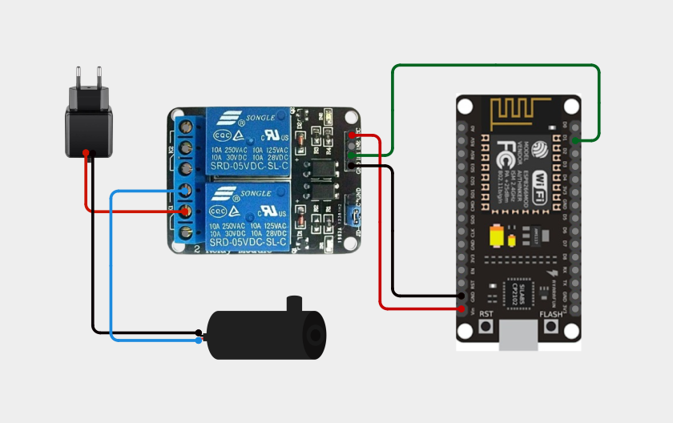
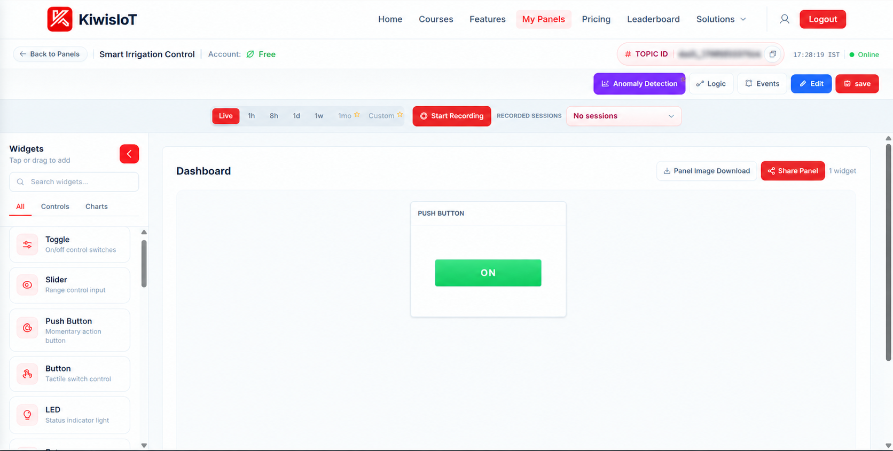
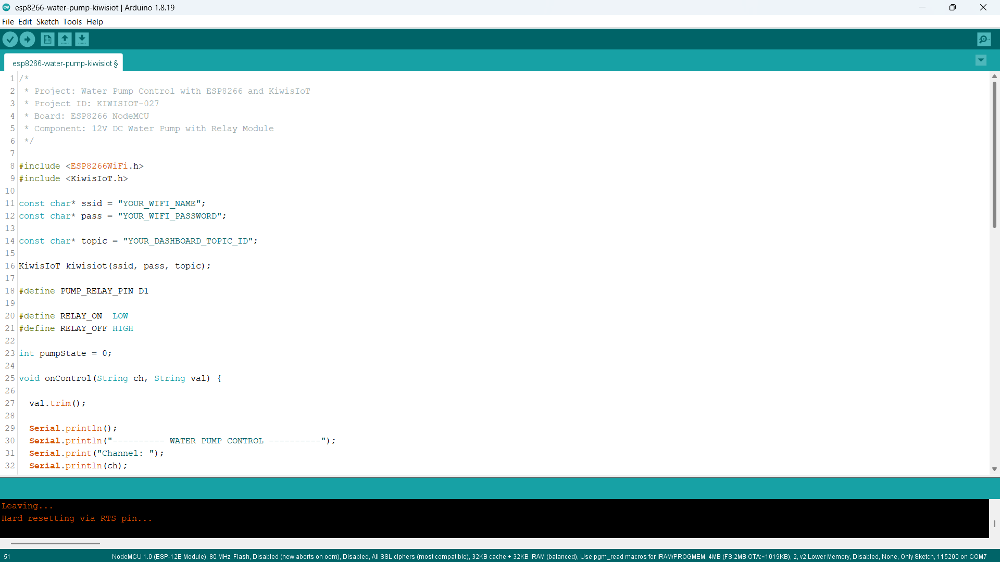
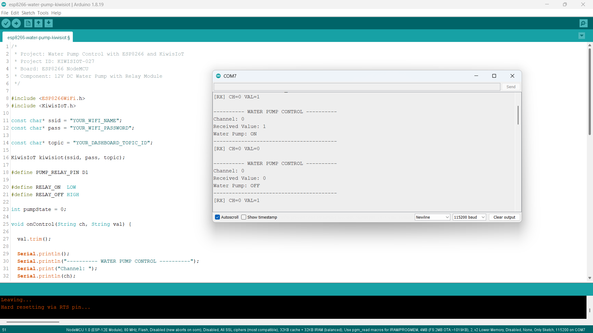

# ESP8266 Water Pump IoT Project: Build Smart Irrigation Control with KiwisIoT 💧

Build an **ESP8266 water pump IoT project** to remotely switch a 12V DC water pump ON and OFF using an ESP8266 NodeMCU, a relay module, Arduino IDE, and KiwisIoT.

In this project, the ESP8266 NodeMCU connects to KiwisIoT over Wi-Fi. A Push Button widget on the KiwisIoT dashboard allows you to control the water pump remotely.

The project uses digital pin D1 to control the relay module. KiwisIoT Channel 0 sends the ON/OFF command to the ESP8266, which switches the relay to control the 12V DC water pump.

This project demonstrates how to build a basic wireless pump-control system using an ESP8266, a relay module, and an IoT dashboard. It provides a foundation for irrigation automation without requiring a soil moisture sensor in this version.

---

## 🚀 Project Highlights

- Remote 12V DC water pump control using KiwisIoT
- ESP8266 NodeMCU development board
- 12V DC water pump controlled through a relay module
- KiwisIoT Push Button widget for ON/OFF control
- Channel 0 for water pump control
- Relay control through digital pin D1
- Wi-Fi-based communication
- Serial Monitor output for debugging
- Callback-based command handling using `kiwisiot.onReceive()`
- Input validation for ON/OFF commands
- Suitable for learning IoT-based pump switching and irrigation control

---

## 🔎 Project Overview

The **ESP8266 Water Pump IoT project** demonstrates how to switch a 12V DC water pump remotely using a KiwisIoT dashboard.

The ESP8266 NodeMCU connects to KiwisIoT over Wi-Fi. The dashboard contains a Push Button widget configured to send `1` when activated and `0` when deactivated.

When the dashboard sends a value, the ESP8266 receives the channel and command through the KiwisIoT callback function. The program validates the received value and controls the relay module connected to D1.

The relay switches the pump's 12V power circuit without connecting the pump directly to an ESP8266 GPIO pin.

| KiwisIoT Channel | ESP8266 Pin | Function | Accepted Values |
|---|---|---|---|
| Channel 0 | D1 | Relay and water pump control | `1` = ON, `0` = OFF |

The program initializes the relay in the OFF state.

The project flow is:

```text
         KiwisIoT Dashboard
                 |
          Push Button Widget
                 |
              Channel 0
                 |
                Wi-Fi
                 |
          ESP8266 NodeMCU
                 |
           Receive Callback
                 |
         Validate ON/OFF Value
                 |
         Relay Control: D1
                 |
            Relay Module
                 |
         12V DC Pump Power
                 |
           Pump ON/OFF
```

**Important:** This version provides manual remote pump control. It does not measure soil moisture or automatically decide when irrigation is required.

---

## 💡 Why This Project?

Water pumps are commonly used in gardens, agricultural fields, water tanks, and irrigation systems. Manually switching a pump can be inconvenient when the control point is located far away.

By connecting a DC water pump to an ESP8266 through a relay module, you can build a wireless switching system controlled through an IoT dashboard.

This project introduces remote pump switching without requiring the pump to be connected directly to the microcontroller's GPIO pin.

It also provides a foundation for extending the system with soil moisture sensors, water-level monitoring, timers, and other IoT-based automation features.

The project is useful for learning:

- Relay module interfacing
- Digital output control
- DC water pump switching
- Wi-Fi communication
- Dashboard-based device control
- Callback functions
- Input validation
- Basic IoT irrigation control

---

## 📚 What You'll Learn

By building this project, you will learn how to:

- Connect a relay module to an ESP8266 NodeMCU.
- Control a relay using a digital GPIO pin.
- Switch a 12V DC water pump through relay contacts.
- Connect an ESP8266 to KiwisIoT.
- Configure a Push Button widget on a dashboard.
- Receive ON/OFF commands through Channel 0.
- Convert dashboard values into relay states.
- Use active-LOW relay control logic.
- Display pump-control commands in the Serial Monitor.
- Troubleshoot common circuit and IoT communication problems.
- Understand the difference between manual pump control and automatic irrigation.

---

## 🧰 Components Required

| Component | Quantity |
|---|---:|
| ESP8266 NodeMCU | 1 |
| 12V DC water pump | 1 |
| Relay module compatible with the ESP8266 control signal | 1 |
| 12V DC power adapter suitable for the pump | 1 |
| Jumper wires | As required |
| Connecting wires for the pump circuit | As required |
| USB cable | 1 |
| Computer | 1 |
| Wi-Fi connection | 1 |

**Power and safety note:** The 12V adapter powers the pump circuit, not the ESP8266 GPIO. Verify the relay module's coil voltage, input compatibility, contact ratings, and wiring requirements before connecting it. Do not connect 12V directly to the ESP8266 pins. The relay contacts must be suitable for the pump's operating current and startup current.

---

## 💻 Software Requirements

- Arduino IDE
- ESP8266 board package
- KiwisIoT Arduino library
- KiwisIoT account
- Wi-Fi connection

### Common KiwisIoT Setup

Before starting this project, complete the common **KiwisIoT Arduino Setup Guide**.

The setup guide covers:

- Arduino IDE installation
- ESP8266 board installation and selection
- KiwisIoT Arduino library installation
- KiwisIoT panel setup
- Topic ID configuration
- Dashboard widget setup and configuration

The common setup guide is available in the parent `esp8266` directory:

[Open the KiwisIoT Arduino Setup Guide](../kiwisiot-arduino-setup/)

### KiwisIoT Library Setup

If the KiwisIoT Arduino library is not already installed:

1. Open Arduino IDE.
2. Navigate to **Sketch → Include Library → Manage Libraries**.
3. Search for the KiwisIoT library.
4. Install it according to the available library listing or the KiwisIoT setup guide.
5. Confirm that the library is available before compiling the program.

The `ESP8266WiFi.h` header provides ESP8266 Wi-Fi functionality, while `KiwisIoT.h` provides communication with KiwisIoT.

---

## 🛠️ Technologies Used

- ESP8266 NodeMCU
- 12V DC water pump
- Relay module
- Arduino IDE
- ESP8266WiFi library
- KiwisIoT Arduino library
- KiwisIoT IoT dashboard
- Wi-Fi communication
- GPIO digital output control
- C++ / Arduino

---

## 🔌 Circuit Connection

Connect the ESP8266 NodeMCU, relay module, 12V DC water pump, and 12V DC power adapter according to the circuit diagram.

### Pin Connections

#### ESP8266 NodeMCU to Relay Module

| ESP8266 NodeMCU | Relay Module |
|---|---|
| D1 | IN1 / IN, the relay control input used |
| GND | GND, where required by the module's input circuit |
| Suitable supply | Relay module VCC, according to the module's specifications |

The exact relay-module power connection depends on the module design. Check its markings and specifications before supplying power. Do not assume that every relay board can be powered from the NodeMCU VIN pin.

#### Relay Contacts and 12V DC Water Pump

| Component Connection | Connection |
|---|---|
| 12V adapter positive (+) | Relay COM |
| Relay NO | Water pump positive (+) |
| Water pump negative (-) | 12V adapter negative (-) |

This configuration uses the relay's **Normally Open (NO)** contact. When the relay is OFF, the pump circuit is open. When the relay is activated, COM connects to NO and supplies power to the pump.

### Circuit Diagram



### Understanding the Connections

- **D1 → Relay IN:** Sends the control signal that switches the relay.
- **Relay COM → 12V adapter positive:** Supplies the positive side of the pump circuit to the relay contact.
- **Relay NO → Pump positive:** Connects the pump to the supply when the relay activates.
- **Pump negative → Adapter negative:** Completes the 12V pump power circuit.
- **Relay VCC and GND:** Power the relay module according to its specifications.

The relay control pin is defined in the Arduino program as:

```cpp
#define PUMP_RELAY_PIN D1
```

The program uses active-LOW relay logic:

```cpp
#define RELAY_ON  LOW
#define RELAY_OFF HIGH
```

**Important safety precautions:**

- Disconnect the power sources before changing wiring.
- Verify the relay contact ratings against the pump's voltage, operating current, and startup current.
- Use a relay module whose control input is compatible with the ESP8266's 3.3V GPIO logic.
- Keep the pump's 12V supply separate from the ESP8266 GPIO circuitry.
- Follow the relay board's instructions for VCC, GND, and input connections.
- Never connect the 12V adapter output directly to D1 or another ESP8266 GPIO pin.
- Keep the pump and its electrical connections protected from water.
- This project is designed for a low-voltage DC pump, not direct mains-powered pump switching.

---

## 🔬 How Water Pump Control Works

### 1. Define the Relay Pin

The program assigns D1 as the relay control pin.

```cpp
#define PUMP_RELAY_PIN D1
```

This pin sends the digital control signal to the relay module.

### 2. Define the Relay States

The program defines the ON and OFF states:

```cpp
#define RELAY_ON  LOW
#define RELAY_OFF HIGH
```

This configuration assumes the relay module is active-LOW: a LOW signal activates the relay, and a HIGH signal deactivates it. Confirm this behavior for your specific module.

### 3. Initialize the Pump State

The pump state is initialized to OFF.

```cpp
int pumpState = 0;
```

During startup, the program sets the relay output to the OFF level before configuring the pin as an output.

```cpp
digitalWrite(PUMP_RELAY_PIN, RELAY_OFF);
pinMode(PUMP_RELAY_PIN, OUTPUT);
```

This establishes the intended initial OFF state. Actual startup behavior can still depend on the relay module and its electrical design.

### 4. Receive Dashboard Commands

The callback function receives the channel and value sent from KiwisIoT.

```cpp
void onControl(String ch, String val)
```

The `ch` parameter identifies the channel, while `val` contains the received command.

### 5. Validate the Received Value

The program removes surrounding whitespace and checks whether the received value is either `1` or `0`.

```cpp
val.trim();

if (val != "1" && val != "0") {
  Serial.println("Invalid command. Use 1 or 0.");
  Serial.println("----------------------------------------");
  return;
}
```

This prevents unexpected values from being treated as valid pump commands.

### 6. Check the Channel ID

The program processes the pump command only when the received channel is Channel 0.

```cpp
if (ch == "0") {
  // Water pump ON/OFF control
}
```

Commands from other channels are reported as unknown channels.

### 7. Switch the Relay

When Channel 0 receives a valid command, the program updates the pump state and switches the relay.

```cpp
pumpState = (val == "1");

digitalWrite(
  PUMP_RELAY_PIN,
  pumpState ? RELAY_ON : RELAY_OFF
);
```

- If the received value is `1`, the relay activates and the pump turns ON.
- If the received value is `0`, the relay deactivates and the pump turns OFF.

### 8. Display the Result

The Serial Monitor displays the received channel, command, and resulting pump state.

This helps verify that dashboard commands reach the ESP8266 and are processed by the program.

---

## 🔁 Water Pump Control Reference

The project uses the following channel and command mapping:

| Channel | Received Value | Relay Action | Expected Pump State |
|---|---:|---|---|
| 0 | `0` | Relay OFF | Pump OFF |
| 0 | `1` | Relay ON | Pump ON |

The pump is switched using the relay contacts. The ESP8266 does not power the 12V pump directly.

---

## ☁️ KiwisIoT Dashboard

This project uses a **Push Button widget** on the KiwisIoT dashboard.

The dashboard contains a Push Button widget for sending commands to switch the water pump ON and OFF.



The Push Button widget sends a command to the ESP8266 through Channel 0.

### Dashboard Control Mapping

| Dashboard Widget | Channel ID | Value | Controlled Component |
|---|---|---:|---|
| Water Pump Control Push Button | 0 | `1` | Pump ON |
| Water Pump Control Push Button | 0 | `0` | Pump OFF |

The expected values are `1` and `0`. They must match the commands handled by the Arduino program.

The Push Button widget shown in the dashboard is used for this project's manual switching demonstration.

---

## ⚙️ Dashboard Configuration

### 1. Open or Create a KiwisIoT Panel

Open your KiwisIoT account and create a panel or open your existing water-pump control panel.

### 2. Add a Push Button Widget

Add a Push Button widget to the dashboard.

Configure the widget for water pump control using Channel 0.

```text
Widget Name: Water Pump Control
Widget Type: Push Button
Channel ID: 0
ON Command: 1
OFF Command: 0
```

### 3. Configure the Button

Configure the widget to send `1` for the ON command and `0` for the OFF command, according to the available widget settings.

These values match the conditions used by the Arduino program.

### 4. Save the Dashboard

After configuring the widget:

1. Click **Update** if the widget configuration provides that option.
2. Click **Edit** at the top of the dashboard if required.
3. Click **Save** to save the dashboard changes.

### 5. Verify the Channel ID

The Arduino program uses Channel 0 for pump control.

```cpp
if (ch == "0") {
  // Water pump ON/OFF control
}
```

Make sure the Push Button widget uses Channel 0 and sends the expected values.

---

## 💻 Arduino Code

The complete Arduino source file is available in the project's `code` directory.

The program uses these headers:

```cpp
#include <ESP8266WiFi.h>
#include <KiwisIoT.h>
```

The KiwisIoT object is initialized using the Wi-Fi credentials and dashboard Topic ID:

```cpp
KiwisIoT kiwisiot(ssid, pass, topic);
```

The receive callback is registered using:

```cpp
kiwisiot.onReceive(onControl);
```

The main loop continuously processes KiwisIoT:

```cpp
void loop() {
  kiwisiot.run();
}
```



---

## 🔐 Configure Wi-Fi and KiwisIoT

Before uploading the program, update the following values in the Arduino code:

```cpp
const char* ssid = "YOUR_WIFI_NAME";
const char* pass = "YOUR_WIFI_PASSWORD";

const char* topic = "YOUR_DASHBOARD_TOPIC_ID";
```

Replace `YOUR_WIFI_NAME` with your Wi-Fi network name.

Replace `YOUR_WIFI_PASSWORD` with your Wi-Fi password.

Replace `YOUR_DASHBOARD_TOPIC_ID` with the Topic ID of your KiwisIoT panel.

Make sure the Topic ID corresponds to the panel containing the Water Pump Control Push Button widget.

**Security:** Keep actual Wi-Fi credentials and private information out of public GitHub repositories. Use placeholders in the published code and enter your credentials locally.

---

## 📝 Complete Arduino Code

The following is the complete Arduino program for the ESP8266 water pump-control project.

File: `code/esp8266-water-pump-kiwisiot.ino`

```cpp
/*
 * Project: Water Pump Control with ESP8266 and KiwisIoT
 * Project ID: KIWISIOT-027
 * Board: ESP8266 NodeMCU
 * Component: 12V DC Water Pump with Relay Module
 */

#include <ESP8266WiFi.h>
#include <KiwisIoT.h>

const char* ssid = "YOUR_WIFI_NAME";
const char* pass = "YOUR_WIFI_PASSWORD";

const char* topic = "YOUR_DASHBOARD_TOPIC_ID";

KiwisIoT kiwisiot(ssid, pass, topic);

#define PUMP_RELAY_PIN D1

#define RELAY_ON  LOW
#define RELAY_OFF HIGH

int pumpState = 0;

void onControl(String ch, String val) {

  val.trim();

  Serial.println();
  Serial.println("---------- WATER PUMP CONTROL ----------");
  Serial.print("Channel: ");
  Serial.println(ch);
  Serial.print("Received Value: ");
  Serial.println(val);

  if (val != "1" && val != "0") {
    Serial.println("Invalid command. Use 1 or 0.");
    Serial.println("----------------------------------------");
    return;
  }

  if (ch == "0") {

    pumpState = (val == "1");

    digitalWrite(
      PUMP_RELAY_PIN,
      pumpState ? RELAY_ON : RELAY_OFF
    );

    Serial.println(
      pumpState ? "Water Pump: ON" : "Water Pump: OFF"
    );

  } else {
    Serial.println("Unknown channel. Use Channel 0.");
  }

  Serial.println("----------------------------------------");
}

void setup() {

  Serial.begin(115200);

  digitalWrite(PUMP_RELAY_PIN, RELAY_OFF);
  pinMode(PUMP_RELAY_PIN, OUTPUT);

  Serial.println();
  Serial.println("===== ESP8266 WATER PUMP CONTROL =====");
  Serial.println("Water pump initialized: OFF");
  Serial.println("Connecting to KiwisIoT...");

  kiwisiot.begin();
  kiwisiot.onReceive(onControl);

  Serial.println("KiwisIoT water pump control initialized.");
  Serial.println("Channel 0: Water Pump ON/OFF");
}

void loop() {
  kiwisiot.run();
}
```

---

## ⬆️ Upload the Program

Follow these steps to upload the program:

1. Check the relay module's voltage and control-input requirements.
2. Connect the ESP8266 NodeMCU to the relay module according to the circuit diagram.
3. Connect the 12V DC pump and adapter through the relay's COM and NO contacts.
4. Verify all wiring before applying power.
5. Connect the NodeMCU to your computer using a USB cable.
6. Open `esp8266-water-pump-kiwisiot.ino` in Arduino IDE.
7. Install the ESP8266 board package if it is not already installed.
8. Install the KiwisIoT Arduino library.
9. Select the appropriate ESP8266 NodeMCU board.
10. Update the Wi-Fi credentials and KiwisIoT Topic ID.
11. Verify the program.
12. Upload the code.
13. Open the Serial Monitor.
14. Set the baud rate to `115200`.
15. Open the KiwisIoT dashboard and operate the Push Button widget.

When the program starts, it configures the relay output to the OFF level, initializes KiwisIoT, and registers the receive callback.

When a command arrives on Channel 0, the program validates the value and switches the relay accordingly.

---

## 🖥️ Serial Monitor Output

The Serial Monitor displays the received channel, command value, and resulting water pump state.

Set the baud rate to `115200` to match the program:

```cpp
Serial.begin(115200);
```

### Example Output: Water Pump ON

When the dashboard sends `1`, the program activates the relay.

```text
---------- WATER PUMP CONTROL ----------
Channel: 0
Received Value: 1
Water Pump: ON
----------------------------------------
```

### Example Output: Water Pump OFF

When the dashboard sends `0`, the program deactivates the relay.

```text
---------- WATER PUMP CONTROL ----------
Channel: 0
Received Value: 0
Water Pump: OFF
----------------------------------------
```

### Example Output: Invalid Command

If the program receives an unexpected value, such as `2`, it rejects the command.

```text
---------- WATER PUMP CONTROL ----------
Channel: 0
Received Value: 2
Invalid command. Use 1 or 0.
----------------------------------------
```

### Example Output: Unknown Channel

If the program receives a command on a channel other than Channel 0, it reports the channel mismatch.

```text
---------- WATER PUMP CONTROL ----------
Channel: 1
Received Value: 1
Unknown channel. Use Channel 0.
----------------------------------------
```



The Serial Monitor confirms the command received by the ESP8266 and the state requested by the program. The printed pump state is based on the relay command; it does not independently measure whether water is flowing.

---

## 🔄 Understanding the Data Flow

The project follows these steps to control the water pump remotely.

### 1. Initialize the Relay

The ESP8266 configures D1 as the relay-control output and sets the intended initial state to OFF.

### 2. Initialize KiwisIoT

The program starts the KiwisIoT library and registers the callback:

```cpp
kiwisiot.begin();
kiwisiot.onReceive(onControl);
```

### 3. Wait for Dashboard Commands

The main loop continuously processes KiwisIoT:

```cpp
void loop() {
  kiwisiot.run();
}
```

### 4. Read the Channel and Value

The callback receives the channel ID and command:

```cpp
void onControl(String ch, String val)
```

### 5. Validate the Command

The program checks that the received value is `1` or `0`.

### 6. Check Channel 0

The program accepts the pump-control command only when the channel is `0`.

### 7. Update the Relay State

The program activates the relay for `1` and deactivates it for `0`.

### 8. Switch the Water Pump

The relay's COM and NO contacts control the pump's 12V power circuit.

### 9. Display the Result

The Serial Monitor displays the received command and the requested pump state.

The complete data flow is:

```text
       KiwisIoT Dashboard
               |
        Push Button Widget
               |
            Channel 0
               |
             Wi-Fi
               |
        ESP8266 NodeMCU
               |
         kiwisiot.run()
               |
        onControl(ch, val)
               |
        Validate: 1 or 0
               |
         Check Channel 0
               |
         Set Relay State
               |
            GPIO D1
               |
          Relay Module
               |
        12V DC Pump Circuit
               |
          Water Pump ON/OFF
```

---

## 🧪 Testing the Project

To test the project:

1. Verify the relay module's voltage and input requirements.
2. Confirm that the relay control input is connected to D1.
3. Check the pump wiring through COM and NO.
4. Confirm that the adapter's voltage matches the pump's rating.
5. Verify that the adapter can supply sufficient current for the pump, including startup current.
6. Upload the Arduino program.
7. Open the Serial Monitor at `115200` baud.
8. Wait for the startup messages.
9. Open the KiwisIoT dashboard.
10. Activate the Push Button widget to send `1`.
11. Confirm that the Serial Monitor reports `Water Pump: ON`.
12. Verify that the relay activates and the pump starts.
13. Send `0` from the dashboard.
14. Confirm that the Serial Monitor reports `Water Pump: OFF`.
15. Verify that the relay deactivates and the pump stops.

### Test 1: Water Pump ON

Send the ON command from the dashboard.

Expected Serial Monitor message:

```text
Channel: 0
Received Value: 1
Water Pump: ON
```

Expected result: the relay activates and the pump receives power through the relay's COM and NO contacts.

### Test 2: Water Pump OFF

Send the OFF command from the dashboard.

Expected Serial Monitor message:

```text
Channel: 0
Received Value: 0
Water Pump: OFF
```

Expected result: the relay deactivates and the pump's power circuit opens.

### Test 3: Invalid Command

If the program receives a value other than `1` or `0`, it should display an invalid-command message and should not change the relay state because of that invalid command.

### Test 4: Verify Dashboard Communication

Operate the Push Button widget and check that:

- The Serial Monitor displays the received commands.
- Channel 0 is used for pump control.
- Value `1` requests the ON state.
- Value `0` requests the OFF state.
- The relay responds to valid commands.
- The pump starts and stops as expected.
- The ESP8266 maintains a working Wi-Fi connection.

**Safety:** Test with the pump securely positioned, tubing secured if used, and all exposed electrical connections insulated. Keep the electronics away from water and disconnect power before correcting any wiring. Never allow the pump to run dry if its manufacturer prohibits dry operation.

---

## 🛠️ Troubleshooting

### Water Pump Does Not Turn ON

Check:

- Whether the relay control input is connected to D1.
- Whether the relay module receives the correct supply voltage.
- Whether the relay input is compatible with the ESP8266's 3.3V logic.
- Whether the 12V adapter is working.
- Whether the adapter can supply sufficient current for the pump.
- Whether the pump is wired through COM and NO.
- Whether the received command appears in the Serial Monitor.
- Whether the pump is correctly connected and functioning.

### Water Pump Does Not Turn OFF

Check:

- Whether the dashboard sends `0` for the OFF command.
- Whether the program receives the command on Channel 0.
- Whether the relay module is active-LOW as assumed by the code.
- Whether the relay contacts are wired to COM and NO rather than an unintended contact.
- Whether the relay contacts are damaged or stuck.

Disconnect power before inspecting the relay contacts or changing the wiring.

### Relay Does Not Click

Check:

- Whether the relay module has the correct supply voltage.
- Whether its GND and control connections are correct.
- Whether the input is compatible with the ESP8266.
- Whether the program is receiving commands.
- Whether the module requires a different control polarity.

The provided program assumes an active-LOW relay. If your module is active-HIGH, the relay logic must be changed to match the module.

### Serial Monitor Does Not Show Received Commands

Check:

- Whether the baud rate is `115200`.
- Whether the ESP8266 has a working Wi-Fi connection.
- Whether the Topic ID is correct.
- Whether the dashboard Push Button widget uses Channel 0.
- Whether the program contains `kiwisiot.onReceive(onControl)`.
- Whether `kiwisiot.run()` continues to execute in `loop()`.

### Dashboard Button Does Not Control the Pump

Confirm that:

- The correct KiwisIoT panel is open.
- The Topic ID matches the configured panel.
- The Push Button widget uses Channel 0.
- The widget sends `1` for ON and `0` for OFF.
- The ESP8266 is connected to Wi-Fi.
- The callback is receiving commands.

### Invalid Command Message Appears

The program accepts only `1` and `0` as command values.

Check the Push Button widget configuration and ensure it does not send unexpected values.

### Pump Starts but Runs Unreliably

Check:

- Whether the adapter provides the correct voltage.
- Whether the adapter's current rating is sufficient.
- Whether the pump connections are secure.
- Whether the relay contacts are suitable for the pump's startup current.
- Whether the pump is obstructed or damaged.
- Whether electrical noise or supply-voltage drops are affecting the ESP8266.

Do not repeatedly switch a pump through an underrated relay. Replace unsuitable components before continuing the test.

---

## 🔒 Security and Hardware Safety

Never publish sensitive credentials in a public GitHub repository.

Do not commit:

- Wi-Fi passwords
- API keys
- Access tokens
- Account passwords
- Private dashboard access information

Use placeholders in the public example:

```text
YOUR_WIFI_NAME
YOUR_WIFI_PASSWORD
YOUR_DASHBOARD_TOPIC_ID
```

Enter your actual credentials only in your local Arduino project.

For hardware safety:

- Use a suitable 12V DC adapter for the pump.
- Confirm the pump's rated voltage and current.
- Confirm the relay's contact rating, including its suitability for motor startup current.
- Use a relay module compatible with ESP8266 GPIO logic.
- Do not connect 12V to the ESP8266 GPIO pins.
- Do not assume the relay board can be powered from NodeMCU VIN; check the module specifications.
- Disconnect power before changing wiring.
- Insulate exposed conductors and secure loose wires.
- Keep the electronics protected from water, splashes, and moisture.
- Ensure that the pump is used according to the manufacturer's instructions.
- Use appropriate protection against electrical faults.
- Do not leave the pump operating unattended during initial testing.
- Do not use this low-voltage demonstration as a substitute for a properly designed mains-voltage switching system.

---

## 🌱 Possible Applications

An ESP8266 water pump-control system can be used as a starting point for:

- Manual garden watering
- Remote pump switching
- Small irrigation demonstrations
- Water transfer experiments
- Educational IoT projects
- Embedded systems demonstrations
- Dashboard-controlled water pumps
- Remote switching prototypes for DC pumps

The project can be extended by adding a soil moisture sensor and programming the ESP8266 to activate the pump when the measured moisture falls below a selected threshold.

Other possible improvements include water-level monitoring, scheduled pump operation, dry-run protection, and pump status feedback.

**Important:** This project demonstrates manual ON/OFF switching. It does not measure soil moisture, monitor water level, prevent dry running automatically, detect water flow, or implement automatic irrigation scheduling.

---

## 📁 Project Structure

```text
027-water-pump-kiwisiot/
│
├── README.md
│
├── code/
│   └── esp8266-water-pump-kiwisiot.ino
│
└── images/
    ├── circuit.png
    ├── code.png
    ├── serial-monitor.png
    └── dashboard-output.png
```

---

## 🔗 Related KiwisIoT ESP8266 Projects

This project is part of the KiwisIoT ESP8266 IoT project collection.

- [ESP8266 LDR Sensor IoT Project](../001-ldr-kiwisiot/)
- [ESP8266 IR Sensor IoT Project](../002-ir-kiwisiot/)
- [ESP8266 Ultrasonic Sensor IoT Project](../003-ultrasonic-kiwisiot/)
- [ESP8266 DHT11 Temperature and Humidity IoT Project](../004-dht11-kiwisiot/)
- [ESP8266 PIR Motion Sensor IoT Project](../005-pir-kiwisiot/)
- [ESP8266 Gas Sensor IoT Project](../006-gas-kiwisiot/)
- [ESP8266 Flame Sensor IoT Project](../007-flame-kiwisiot/)
- [ESP8266 Soil Moisture Sensor IoT Project](../008-soil-moisture-kiwisiot/)
- [ESP8266 Water Level Sensor IoT Project](../009-water-level-kiwisiot/)
- [ESP8266 Raindrop Sensor IoT Project](../010-raindrop-kiwisiot/)
- [ESP8266 Sound Sensor IoT Project](../011-sound-kiwisiot/)
- [ESP8266 MPU6050 Motion and Acceleration IoT Project](../012-mpu6050-kiwisiot/)
- [ESP8266 Voltage Sensor IoT Project](../013-voltage-kiwisiot/)
- [ESP8266 Current Sensor IoT Project](../014-current-kiwisiot/)
- [ESP8266 Vibration Sensor IoT Project](../015-vibration-kiwisiot/)
- [ESP8266 Reed Switch IoT Project](../016-reed-switch-kiwisiot/)
- [ESP8266 Hall Effect Sensor IoT Project](../017-hall-effect-kiwisiot/)
- [ESP8266 Touch Sensor IoT Project](../018-touch-kiwisiot/)
- [ESP8266 BMP180 Temperature and Air Pressure IoT Project](../019-bmp180-kiwisiot/)
- [ESP8266 DS18B20 Temperature Monitoring IoT Project](../020-ds18b20-kiwisiot/)
- [ESP8266 LED Remote Control IoT Project](../021-led-kiwisiot/)
- [ESP8266 RGB LED IoT Project](../022-rgb-led-kiwisiot/)
- [ESP8266 Buzzer IoT Project](../023-buzzer-kiwisiot/)
- [ESP8266 Relay IoT Project](../024-relay-kiwisiot/)
- [ESP8266 Servo Motor IoT Project](../025-servo-kiwisiot/)
- [ESP8266 Fan Control IoT Project](../026-fan-kiwisiot/)

For Arduino and KiwisIoT setup, see the [KiwisIoT Arduino Setup Guide](../kiwisiot-arduino-setup/).

---

## ❓ Frequently Asked Questions

### What is the purpose of this project?

This project demonstrates how to switch a 12V DC water pump remotely using an ESP8266 NodeMCU, a relay module, and a KiwisIoT dashboard.

### Which ESP8266 board is used?

The project uses the ESP8266 NodeMCU development board.

### Which water pump is used?

A 12V DC water pump is used.

### Why is a relay module required?

The relay allows the ESP8266 to control the pump's separate 12V power circuit without powering the pump directly from a GPIO pin.

### Which pin controls the relay?

D1 is used as the relay-control output.

### Which KiwisIoT widget is used?

A Push Button widget is used to send commands to switch the pump ON and OFF.

### Which KiwisIoT channel is used?

Channel 0 controls the water pump.

### What values control the pump?

The program accepts `1` for ON and `0` for OFF on Channel 0.

### Why does the code use active-LOW logic?

The code assumes the relay module activates when its input is LOW. Verify this behavior against your particular relay module before use.

### Does the ESP8266 supply power to the 12V pump?

No. The pump receives power from the 12V DC adapter through the relay contacts.

### Can the pump be controlled from a dashboard?

Yes. The KiwisIoT Push Button widget sends the ON/OFF command to the ESP8266 over Wi-Fi.

### Does this project use a soil moisture sensor?

No. This version provides manual remote pump control without a soil moisture sensor.

### Does the Serial Monitor confirm that water is flowing?

No. It reports the requested pump state based on the received command. A separate flow sensor or another suitable feedback mechanism would be needed to verify water flow.

### Can this project be converted into an automatic irrigation system?

Yes. A future version could add a soil moisture sensor, water-level monitoring, and suitable control logic. Those functions are not included in this project.

### What happens if the Wi-Fi connection is lost?

The ESP8266 cannot receive new dashboard commands while communication is unavailable. This example does not implement a separate automatic shutdown or reconnection safety policy for the pump, so do not rely on the dashboard alone as an emergency stop.

---

## 📌 Summary

This project demonstrates an **ESP8266 water pump-control IoT system** using a 12V DC water pump, a relay module, and KiwisIoT.

The ESP8266 connects to KiwisIoT over Wi-Fi, receives commands through Channel 0, validates the received value, and controls the relay through D1.

The final control mapping is:

```text
Channel 0 + Value 0 → Relay OFF → Water Pump OFF
Channel 0 + Value 1 → Relay ON  → Water Pump ON
```

With a Push Button widget on the dashboard, the project provides a practical introduction to relay interfacing, low-voltage DC switching, callback-based communication, and IoT-based pump control.

The same principles can be extended to more advanced irrigation systems with sensors, scheduling, and automation.

**What would you add next: soil moisture-based automatic irrigation, water-level monitoring, or scheduled pump operation?**

---

## 📄 License

This project is licensed under the MIT License. See the [LICENSE](LICENSE) file for details.
