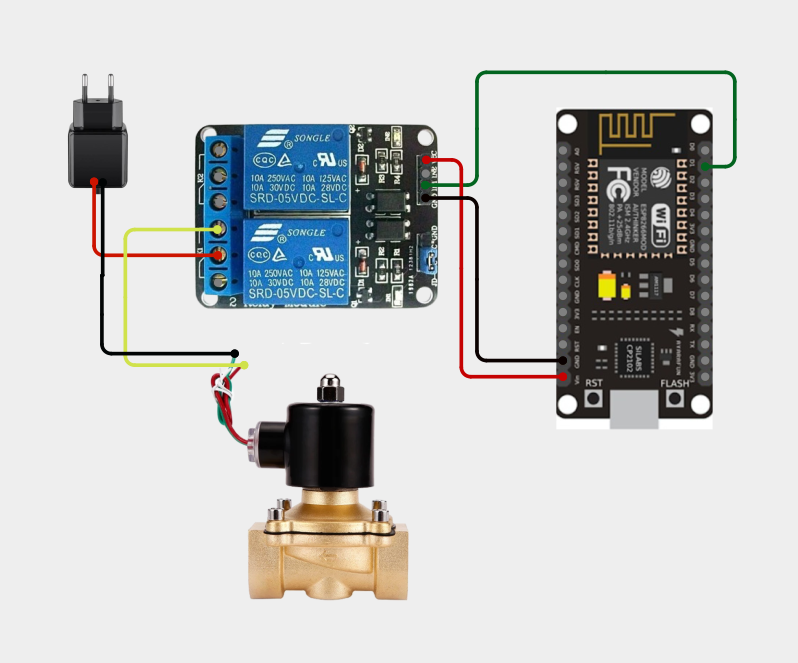
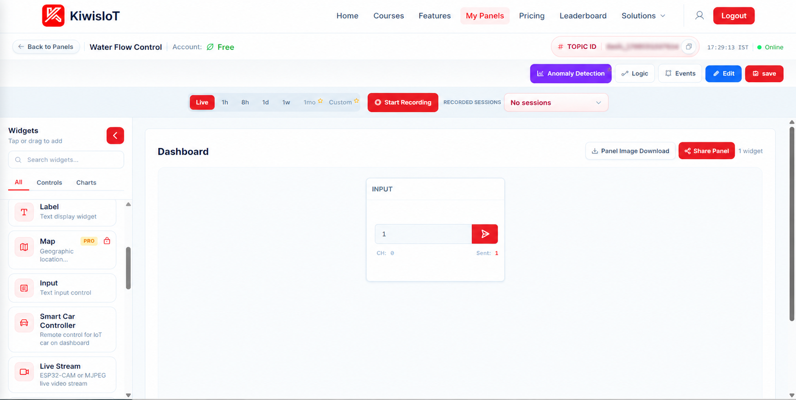
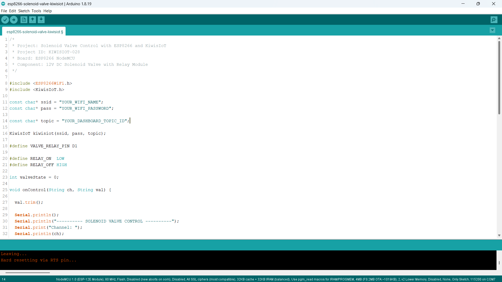
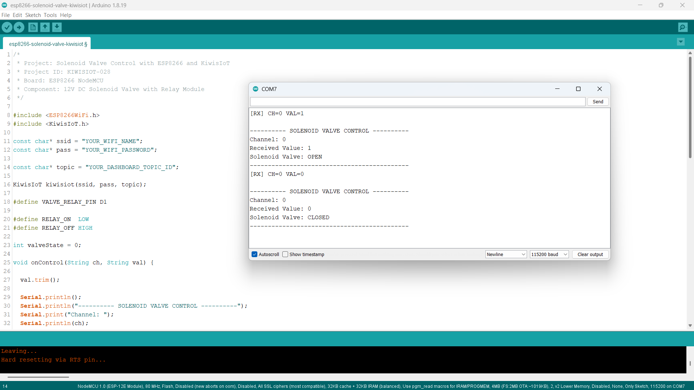

# ESP8266 Solenoid Valve IoT Project: Control Water Flow with KiwisIoT 🚰

Build an **ESP8266 solenoid valve IoT project** to remotely control water flow using an ESP8266 NodeMCU, a 12V DC solenoid valve, a relay module, Arduino IDE, and KiwisIoT.

In this project, the ESP8266 NodeMCU connects to KiwisIoT over Wi-Fi. A dashboard control sends commands to open or close the solenoid valve remotely.

The project uses digital pin D1 to control the relay module. KiwisIoT Channel 0 sends the command to the ESP8266, which switches the relay to control the 12V DC solenoid valve.

When the dashboard sends `1`, the program activates the relay and reports **Solenoid Valve: OPEN**. When it sends `0`, the program deactivates the relay and reports **Solenoid Valve: CLOSED**.

This project demonstrates a basic wireless water-flow control system using an ESP8266, a relay module, a solenoid valve, and an IoT dashboard.

---

## 🚀 Project Highlights

- Remote solenoid valve control using KiwisIoT
- ESP8266 NodeMCU development board
- 12V DC solenoid valve controlled through a relay module
- KiwisIoT dashboard control for opening and closing the valve
- Channel 0 for valve control
- Relay control through digital pin D1
- Wi-Fi-based communication
- Serial Monitor output for debugging
- Callback-based command handling using `kiwisiot.onReceive()`
- Input validation for ON/OFF commands
- Active-LOW relay control logic
- Suitable for learning IoT-based water-flow control and automation

---

## 🔎 Project Overview

The **ESP8266 Solenoid Valve IoT project** demonstrates how to control a 12V DC solenoid valve remotely using a KiwisIoT dashboard.

The ESP8266 NodeMCU connects to KiwisIoT over Wi-Fi. The dashboard sends a value through Channel 0. The program receives the command through the KiwisIoT callback function, validates the received value, and controls the relay module connected to D1.

The relay switches the solenoid valve's 12V power circuit. The valve's electrical state is controlled remotely, allowing the connected fluid path to open or close according to the valve's design and operating conditions.

| KiwisIoT Channel | ESP8266 Pin | Function | Accepted Values |
|---|---|---|---|
| Channel 0 | D1 | Relay and solenoid valve control | `1` = OPEN, `0` = CLOSED |

The program initializes the valve control output to the OFF state, which is intended to keep the valve closed with the relay and valve arrangement used in this project.

The project flow is:

```text
        KiwisIoT Dashboard
                |
         Dashboard Control
                |
            Channel 0
                |
              Wi-Fi
                |
         ESP8266 NodeMCU
                |
          Receive Callback
                |
        Validate Command Value
                |
        Relay Control: D1
                |
           Relay Module
                |
       12V DC Solenoid Valve
                |
         Water Flow Control
```

**Note:** This project demonstrates manual remote control. It does not use a soil moisture sensor, water-flow sensor, or automatic irrigation logic.

---

## 💡 Why This Project?

Solenoid valves are used in water dispensers, irrigation systems, liquid-control equipment, and other applications where a valve must be opened or closed electrically.

By connecting a solenoid valve to an ESP8266 through a relay module, you can create a wireless control system that operates through an IoT dashboard.

This project introduces relay interfacing, low-voltage electrical switching, dashboard-based control, and remote operation of a fluid-control component.

The project is useful for learning:

- Relay module interfacing
- Digital output control
- Solenoid valve operation
- Water-flow switching
- Wi-Fi communication
- Dashboard-based device control
- Callback functions
- Input validation
- Basic IoT automation

---

## 📚 What You'll Learn

By building this project, you will learn how to:

- Connect a relay module to an ESP8266 NodeMCU.
- Control a relay using a digital GPIO pin.
- Switch a 12V DC solenoid valve through relay contacts.
- Connect an ESP8266 to KiwisIoT.
- Configure dashboard controls for remote operation.
- Receive commands through Channel 0.
- Convert dashboard values into relay states.
- Use active-LOW relay control logic.
- Display valve-control commands in the Serial Monitor.
- Troubleshoot common circuit and IoT communication problems.
- Understand the difference between electrical valve control and measured water flow.

---

## 🧰 Components Required

| Component | Quantity |
|---|---:|
| ESP8266 NodeMCU | 1 |
| 12V DC solenoid valve | 1 |
| Relay module compatible with ESP8266 control signals | 1 |
| Suitable power adapter for the solenoid valve | 1 |
| Jumper wires | As required |
| Connecting wires for the valve circuit | As required |
| USB cable | 1 |
| Computer | 1 |
| Wi-Fi connection | 1 |

**Power and safety note:** The solenoid valve must receive power according to its rated voltage and current. The ESP8266 GPIO pin must not power the valve directly. Check the relay module's coil voltage, input compatibility, contact ratings, and wiring requirements before connecting it. The relay contacts must be suitable for the valve's DC inductive load.

---

## 💻 Software Requirements

- Arduino IDE
- ESP8266 board package
- KiwisIoT Arduino library
- KiwisIoT account
- Wi-Fi connection

### Common KiwisIoT Setup

Before starting this project, complete the common **KiwisIoT Arduino Setup Guide**.

The setup guide covers:

- Arduino IDE installation
- ESP8266 board installation and selection
- KiwisIoT Arduino library installation
- KiwisIoT panel setup
- Topic ID configuration
- Dashboard widget setup and configuration

The common setup guide is available in the parent `esp8266` directory:

[Open the KiwisIoT Arduino Setup Guide](../kiwisiot-arduino-setup/)

### KiwisIoT Library Setup

If the KiwisIoT Arduino library is not already installed:

1. Open Arduino IDE.
2. Navigate to **Sketch → Include Library → Manage Libraries**.
3. Search for the KiwisIoT library.
4. Install it according to the available library listing or the KiwisIoT setup guide.
5. Confirm that the library is available before compiling the program.

The `ESP8266WiFi.h` header provides ESP8266 Wi-Fi functionality, while `KiwisIoT.h` provides communication with KiwisIoT.

---

## 🛠️ Technologies Used

- ESP8266 NodeMCU
- 12V DC solenoid valve
- Relay module
- Arduino IDE
- ESP8266WiFi library
- KiwisIoT Arduino library
- KiwisIoT IoT dashboard
- Wi-Fi communication
- GPIO digital output control
- C++ / Arduino

---

## 🔌 Circuit Connection

Connect the ESP8266 NodeMCU, relay module, solenoid valve, and suitable valve power supply according to the circuit diagram.

### Pin Connections

#### ESP8266 NodeMCU to Relay Module

| ESP8266 NodeMCU | Relay Module |
|---|---|
| D1 | IN1 / relay control input used |
| GND | GND, where required by the module's input circuit |
| Suitable supply | Relay module VCC, according to the module specifications |

The exact relay-module power connection depends on the module design. Check the board markings and specifications before supplying power. Do not assume every relay board can be powered from the NodeMCU VIN pin.

#### Relay Contacts and Solenoid Valve

Following the arrangement shown in the circuit diagram:

| Component Connection | Connection |
|---|---|
| Valve power supply positive (+) | Relay COM |
| Relay NO | Solenoid valve positive (+), if the valve is polarity-sensitive and this matches its wiring |
| Solenoid valve negative (-) | Valve power supply negative (-) |

This arrangement uses the relay's **Normally Open (NO)** contact. When the relay is deactivated, the circuit is open. When the relay activates, COM connects to NO and supplies power to the valve.

**Important:** Verify the valve's actual rated voltage and wiring diagram. Some DC solenoid valves are polarity-sensitive, especially those with built-in suppression components. Follow the manufacturer's wiring instructions.

### Circuit Diagram



### Understanding the Connections

- **D1 → Relay IN:** Sends the control signal that switches the relay.
- **Relay COM → valve supply positive:** Routes the positive supply through the relay contact.
- **Relay NO → valve positive:** Supplies power to the valve when the relay activates.
- **Valve negative → supply negative:** Completes the valve's power circuit.
- **Relay VCC and GND:** Power the relay module according to its specifications.

The relay control pin is defined in the Arduino program as:

```cpp
#define VALVE_RELAY_PIN D1
```

The program uses active-LOW relay logic:

```cpp
#define RELAY_ON  LOW
#define RELAY_OFF HIGH
```

**Important safety precautions:**

- Disconnect power sources before changing wiring.
- Confirm the solenoid valve's rated voltage and current.
- Verify the relay contact ratings for the valve's DC inductive load.
- Use a relay module compatible with the ESP8266's 3.3V GPIO logic.
- Do not connect the valve directly to an ESP8266 GPIO pin.
- Do not connect 12V directly to D1 or another ESP8266 GPIO pin.
- Follow the relay module's instructions for VCC, GND, and input connections.
- Use appropriate inductive-load suppression if required by the valve and relay design.
- Keep electrical connections protected from water and moisture.
- Do not use this low-voltage demonstration as a substitute for a properly designed mains-voltage switching system.

---

## 🔬 How Solenoid Valve Control Works

### 1. Define the Relay Pin

The program assigns D1 as the relay control pin.

```cpp
#define VALVE_RELAY_PIN D1
```

This pin sends the digital control signal to the relay module.

### 2. Define the Relay States

The program defines the ON and OFF states:

```cpp
#define RELAY_ON  LOW
#define RELAY_OFF HIGH
```

This configuration assumes the relay module is active-LOW: a LOW signal activates the relay, and a HIGH signal deactivates it. Confirm this behavior for your specific module.

### 3. Initialize the Valve State

The valve state is initialized to zero:

```cpp
int valveState = 0;
```

In this program, `0` represents the requested CLOSED state and `1` represents the requested OPEN state.

During startup, the program sets the relay output to the OFF level before configuring the pin as an output:

```cpp
digitalWrite(VALVE_RELAY_PIN, RELAY_OFF);
pinMode(VALVE_RELAY_PIN, OUTPUT);
```

This establishes the intended initial OFF state. Actual startup behavior can still depend on the relay module and its electrical design.

### 4. Receive Dashboard Commands

The callback function receives the channel and value sent from KiwisIoT.

```cpp
void onControl(String ch, String val)
```

The `ch` parameter identifies the channel, while `val` contains the received command.

### 5. Validate the Received Value

The program removes surrounding whitespace and accepts only `1` or `0`.

```cpp
val.trim();

if (val != "1" && val != "0") {
  Serial.println("Invalid command. Use 1 or 0.");
  Serial.println("--------------------------------------------");
  return;
}
```

This prevents unexpected values from being treated as valid valve-control commands.

### 6. Check the Channel

The program checks whether the command arrived on Channel 0.

```cpp
if (ch == "0") {
  // Solenoid valve control
}
```

If a command arrives on another channel, the program displays an unknown-channel message.

### 7. Switch the Relay

When Channel 0 receives a valid command, the program updates the valve state and switches the relay.

```cpp
valveState = (val == "1");

digitalWrite(
  VALVE_RELAY_PIN,
  valveState ? RELAY_ON : RELAY_OFF
);
```

- If the received value is `1`, the relay activates and the program reports **Solenoid Valve: OPEN**.
- If the received value is `0`, the relay deactivates and the program reports **Solenoid Valve: CLOSED**.

These messages represent the commanded valve state. They do not independently verify the physical valve position or actual water flow.

### 8. Display the Result

The Serial Monitor displays the received channel, command, and resulting requested valve state.

This helps verify that dashboard commands reach the ESP8266 and are processed by the program.

---

## 🔁 Solenoid Valve Control Reference

The project uses the following channel and command mapping:

| Channel | Received Value | Relay Action | Reported Valve State |
|---|---:|---|---|
| 0 | `0` | Relay OFF | CLOSED |
| 0 | `1` | Relay ON | OPEN |

The solenoid valve is switched using the relay contacts. The ESP8266 does not supply the valve's operating current directly.

---

## ☁️ KiwisIoT Dashboard

This project uses a dashboard control on KiwisIoT to send commands to the ESP8266.

The dashboard screenshot shows the **Water Flow Control** panel with an Input widget configured for Channel 0. In the demonstrated test, the Input widget sends `1` and `0` to open and close the valve.



### Dashboard Control Mapping

| Dashboard Widget | Channel ID | Value | Requested Valve State |
|---|---|---:|---|
| Input widget | 0 | `1` | OPEN |
| Input widget | 0 | `0` | CLOSED |

The widget shown in the provided dashboard screenshot is an **Input widget**, not a Toggle widget. Enter the command and send it using the widget's send control.

---

## ⚙️ Dashboard Configuration

### 1. Open or Create a KiwisIoT Panel

Open your KiwisIoT account and create a panel or open your existing **Water Flow Control** panel.

### 2. Add an Input Widget

Add an Input widget to the dashboard if one is not already present.

Configure it as follows:

```text
Panel Name: Water Flow Control
Widget Name: Valve Control
Widget Type: Input
Channel ID: 0
OPEN Command: 1
CLOSE Command: 0
```

The widget name is a suggested label. The important settings are Channel 0 and the values expected by the program.

### 3. Send the OPEN Command

Enter `1` in the Input widget and click its send control.

The ESP8266 should receive Channel 0 with value `1`, activate the relay, and print:

```text
Solenoid Valve: OPEN
```

### 4. Send the CLOSE Command

Enter `0` in the Input widget and click its send control.

The ESP8266 should receive Channel 0 with value `0`, deactivate the relay, and print:

```text
Solenoid Valve: CLOSED
```

### 5. Save the Dashboard

After configuring the widget:

1. Click **Update** if the widget configuration provides that option.
2. Click **Edit** at the top of the dashboard if required.
3. Click **Save** to save the dashboard changes.

### 6. Verify the Channel ID

The Arduino program uses Channel 0 for valve control:

```cpp
if (ch == "0") {
  // Solenoid valve OPEN/CLOSE control
}
```

Make sure the dashboard widget uses Channel 0 and sends the expected values.

---

## 💻 Arduino Code

The complete Arduino source file is available in the project's `code` directory.

The program uses these headers:

```cpp
#include <ESP8266WiFi.h>
#include <KiwisIoT.h>
```

The KiwisIoT object is initialized using the Wi-Fi credentials and dashboard Topic ID:

```cpp
KiwisIoT kiwisiot(ssid, pass, topic);
```

The receive callback is registered using:

```cpp
kiwisiot.onReceive(onControl);
```

The main loop continuously processes KiwisIoT:

```cpp
void loop() {
  kiwisiot.run();
}
```



---

## 🔐 Configure Wi-Fi and KiwisIoT

Before uploading the program, update the following values in the Arduino code:

```cpp
const char* ssid = "YOUR_WIFI_NAME";
const char* pass = "YOUR_WIFI_PASSWORD";

const char* topic = "YOUR_DASHBOARD_TOPIC_ID";
```

Replace `YOUR_WIFI_NAME` with your Wi-Fi network name.

Replace `YOUR_WIFI_PASSWORD` with your Wi-Fi password.

Replace `YOUR_DASHBOARD_TOPIC_ID` with the Topic ID of your KiwisIoT panel.

Make sure the Topic ID corresponds to the panel containing the valve-control widget.

**Security:** Keep actual Wi-Fi credentials and private information out of public GitHub repositories. Use placeholders in the published code and enter your credentials locally.

---

## 📝 Complete Arduino Code

The following is the complete Arduino program for the ESP8266 solenoid valve control project.

```cpp
/*
 * Project: Solenoid Valve Control with ESP8266 and KiwisIoT
 * Project ID: KIWISIOT-028
 * Board: ESP8266 NodeMCU
 * Component: 12V DC Solenoid Valve with Relay Module
 */

#include <ESP8266WiFi.h>
#include <KiwisIoT.h>

const char* ssid = "YOUR_WIFI_NAME";
const char* pass = "YOUR_WIFI_PASSWORD";

const char* topic = "YOUR_DASHBOARD_TOPIC_ID";

KiwisIoT kiwisiot(ssid, pass, topic);

#define VALVE_RELAY_PIN D1

#define RELAY_ON  LOW
#define RELAY_OFF HIGH

int valveState = 0;

void onControl(String ch, String val) {

  val.trim();

  Serial.println();
  Serial.println("---------- SOLENOID VALVE CONTROL ----------");
  Serial.print("Channel: ");
  Serial.println(ch);
  Serial.print("Received Value: ");
  Serial.println(val);

  if (val != "1" && val != "0") {
    Serial.println("Invalid command. Use 1 or 0.");
    Serial.println("--------------------------------------------");
    return;
  }

  if (ch == "0") {

    valveState = (val == "1");

    digitalWrite(
      VALVE_RELAY_PIN,
      valveState ? RELAY_ON : RELAY_OFF
    );

    Serial.println(
      valveState ? "Solenoid Valve: OPEN" : "Solenoid Valve: CLOSED"
    );

  } else {
    Serial.println("Unknown channel. Use Channel 0.");
  }

  Serial.println("--------------------------------------------");
}

void setup() {

  Serial.begin(115200);

  digitalWrite(VALVE_RELAY_PIN, RELAY_OFF);
  pinMode(VALVE_RELAY_PIN, OUTPUT);

  Serial.println();
  Serial.println("===== ESP8266 SOLENOID VALVE CONTROL =====");
  Serial.println("Solenoid valve initialized: CLOSED");
  Serial.println("Connecting to KiwisIoT...");

  kiwisiot.begin();
  kiwisiot.onReceive(onControl);

  Serial.println("KiwisIoT valve control initialized.");
  Serial.println("Channel 0: Solenoid Valve OPEN/CLOSE");
}

void loop() {
  kiwisiot.run();
}
```

---

## ⬆️ Upload the Program

Follow these steps to upload the program:

1. Check the relay module's voltage and control-input requirements.
2. Connect the ESP8266 NodeMCU to the relay module according to the circuit diagram.
3. Connect the solenoid valve through the relay's COM and NO contacts.
4. Verify that the valve power supply matches the valve's rating.
5. Check all wiring before applying power.
6. Connect the NodeMCU to your computer using a USB cable.
7. Open `esp8266-solenoid-valve-kiwisiot.ino` in Arduino IDE.
8. Install the ESP8266 board package if it is not already installed.
9. Install the KiwisIoT Arduino library.
10. Select the appropriate ESP8266 NodeMCU board.
11. Update the Wi-Fi credentials and KiwisIoT Topic ID.
12. Verify the program.
13. Upload the code.
14. Open the Serial Monitor.
15. Set the baud rate to `115200`.
16. Open the KiwisIoT dashboard and send `1` or `0` using the Input widget.

When the program starts, it configures the relay output to the OFF level, initializes KiwisIoT, and registers the receive callback.

When a command arrives on Channel 0, the program validates the value and switches the relay accordingly.

**Before testing with water, verify the electrical operation with the fluid supply safely isolated where practical.** Then test the valve with the correct fluid pressure and operating conditions specified by its manufacturer.

---

## 🖥️ Serial Monitor Output

The Serial Monitor displays the received channel, command value, and resulting requested valve state.

Set the baud rate to `115200` to match the program:

```cpp
Serial.begin(115200);
```

### Example Output: Valve OPEN

When the dashboard sends `1`, the program activates the relay.

```text
[RX] CH=0 VAL=1

---------- SOLENOID VALVE CONTROL ----------
Channel: 0
Received Value: 1
Solenoid Valve: OPEN
--------------------------------------------
```

### Example Output: Valve CLOSED

When the dashboard sends `0`, the program deactivates the relay.

```text
[RX] CH=0 VAL=0

---------- SOLENOID VALVE CONTROL ----------
Channel: 0
Received Value: 0
Solenoid Valve: CLOSED
--------------------------------------------
```

### Example Output: Invalid Command

If the callback receives an unexpected value, such as `2`, the program rejects it.

```text
---------- SOLENOID VALVE CONTROL ----------
Channel: 0
Received Value: 2
Invalid command. Use 1 or 0.
--------------------------------------------
```

### Example Output: Unknown Channel

If the program receives a command on a channel other than Channel 0, it reports the channel mismatch.

```text
---------- SOLENOID VALVE CONTROL ----------
Channel: 1
Received Value: 1
Unknown channel. Use Channel 0.
--------------------------------------------
```



The Serial Monitor confirms the command received by the ESP8266 and the state requested by the program. It does not independently confirm that the valve physically moved or that water is flowing.

---

## 🔄 Understanding the Data Flow

The project follows these steps to control the solenoid valve remotely.

### 1. Initialize the Relay

The ESP8266 configures D1 as the relay-control output and sets the intended initial state to OFF.

### 2. Initialize KiwisIoT

The program starts the KiwisIoT library and registers the callback:

```cpp
kiwisiot.begin();
kiwisiot.onReceive(onControl);
```

### 3. Wait for Dashboard Commands

The main loop continuously processes KiwisIoT:

```cpp
void loop() {
  kiwisiot.run();
}
```

### 4. Read the Channel and Value

The callback receives the channel ID and command:

```cpp
void onControl(String ch, String val)
```

### 5. Validate the Command

The program checks that the received value is either `1` or `0`.

### 6. Check the Channel

Only Channel 0 is used for valve control. Other channels produce an unknown-channel message.

### 7. Update the Relay State

The program activates the relay for `1` and deactivates it for `0`.

### 8. Control the Solenoid Valve

The relay's COM and NO contacts control the valve's power circuit.

### 9. Display the Result

The Serial Monitor displays the received command and the requested valve state.

The complete data flow is:

```text
       KiwisIoT Dashboard
               |
          Input Widget
               |
            Channel 0
               |
             Wi-Fi
               |
        ESP8266 NodeMCU
               |
         kiwisiot.run()
               |
        onControl(ch, val)
               |
        Validate: 1 or 0
               |
        Check Channel: 0
               |
        Set Relay State
               |
            GPIO D1
               |
          Relay Module
               |
      12V DC Solenoid Valve
               |
        Water Flow Control
```

---

## 🧪 Testing the Project

To test the project:

1. Verify the relay module's voltage and input requirements.
2. Confirm that the relay control input is connected to D1.
3. Check the valve wiring through COM and NO.
4. Confirm that the power supply matches the valve's rated voltage and current.
5. Verify that the relay contacts are suitable for the valve's inductive load.
6. Upload the Arduino program.
7. Open the Serial Monitor at `115200` baud.
8. Wait for the startup messages.
9. Open the KiwisIoT dashboard.
10. Enter `1` in the Input widget and send it.
11. Confirm that the Serial Monitor reports `Solenoid Valve: OPEN`.
12. Verify the relay activates and the valve responds as expected.
13. Enter `0` in the Input widget and send it.
14. Confirm that the Serial Monitor reports `Solenoid Valve: CLOSED`.
15. Verify the relay deactivates and the valve returns to its de-energized state.

### Test 1: Valve OPEN

Send `1` through the dashboard on Channel 0.

Expected Serial Monitor message:

```text
Channel: 0
Received Value: 1
Solenoid Valve: OPEN
```

Expected result: the relay activates and supplies power to the solenoid valve through the COM and NO contacts.

### Test 2: Valve CLOSED

Send `0` through the dashboard on Channel 0.

Expected Serial Monitor message:

```text
Channel: 0
Received Value: 0
Solenoid Valve: CLOSED
```

Expected result: the relay deactivates and opens the valve power circuit.

The valve's actual mechanical state depends on whether it is normally closed or normally open and on its specified operating conditions.

### Test 3: Invalid Command

If Channel 0 receives a value other than `1` or `0`, the program should display an invalid-command message and return without changing the relay state because of that invalid command.

### Test 4: Verify Dashboard Communication

Operate the dashboard control several times and check that:

- The Serial Monitor displays the received commands.
- Channel 0 is used for valve control.
- Value `1` requests OPEN.
- Value `0` requests CLOSED.
- The relay responds to valid commands.
- The valve responds as expected.
- The ESP8266 maintains a working Wi-Fi connection.

**Safety:** Keep electrical connections protected from water. Do not handle the valve wiring while the circuit is powered. Follow the valve manufacturer's pressure, fluid, and installation requirements.

---

## 🛠️ Troubleshooting

### Solenoid Valve Does Not Open

Check:

- Whether the relay control input is connected to D1.
- Whether the relay module receives the correct supply voltage.
- Whether the relay input is compatible with the ESP8266's 3.3V logic.
- Whether the valve power supply is working.
- Whether the power supply can provide sufficient current for the valve.
- Whether the valve is wired through COM and NO.
- Whether the valve requires a particular polarity.
- Whether the received command appears in the Serial Monitor.
- Whether the valve is being operated within its specified pressure and fluid conditions.

### Solenoid Valve Does Not Close

Check:

- Whether the dashboard sends `0`.
- Whether the program receives the command on Channel 0.
- Whether the relay module is active-LOW as assumed by the code.
- Whether the relay contacts are wired to COM and NO.
- Whether the relay contacts are damaged or stuck.
- Whether the valve is designed to close when de-energized.
- Whether residual pressure, debris, or an installation issue prevents the valve from closing.

Disconnect power before inspecting the wiring or relay contacts.

### Relay Does Not Click

Check:

- Whether the relay module has the correct supply voltage.
- Whether its GND and control connections are correct.
- Whether the input is compatible with the ESP8266.
- Whether the program is receiving commands.
- Whether the module requires a different control polarity.

The provided program assumes an active-LOW relay. If your module is active-HIGH, the relay logic must be changed to match the module.

### Serial Monitor Does Not Show Received Commands

Check:

- Whether the baud rate is `115200`.
- Whether the ESP8266 has a working Wi-Fi connection.
- Whether the Topic ID is correct.
- Whether the dashboard widget uses Channel 0.
- Whether the program contains `kiwisiot.onReceive(onControl)`.
- Whether `kiwisiot.run()` continues to execute in `loop()`.

### Dashboard Control Does Not Operate the Valve

Confirm that:

- The correct KiwisIoT panel is open.
- The Topic ID matches the configured panel.
- The dashboard widget uses Channel 0.
- The widget sends `1` for OPEN and `0` for CLOSED.
- The ESP8266 is connected to Wi-Fi.
- The callback is receiving commands.

### Invalid Command Message Appears

The program accepts only `1` and `0` as command values.

Check the widget configuration and ensure it does not send unexpected values.

### Relay Activates but Water Flow Does Not Change

Check:

- Whether the valve is receiving its rated voltage.
- Whether the valve is installed in the correct flow direction, if applicable.
- Whether the valve requires a minimum operating pressure or differential pressure.
- Whether the fluid supply is available.
- Whether the valve is blocked or damaged.
- Whether the valve is normally closed or normally open.

Do not assume that a relay click proves water is flowing. The project does not include a water-flow feedback sensor.

---

## 🔒 Security and Hardware Safety

Never publish sensitive credentials in a public GitHub repository.

Do not commit:

- Wi-Fi passwords
- API keys
- Access tokens
- Account passwords
- Private dashboard access information

Use placeholders in the public example:

```text
YOUR_WIFI_NAME
YOUR_WIFI_PASSWORD
YOUR_DASHBOARD_TOPIC_ID
```

Enter your actual credentials only in your local Arduino project.

For hardware safety:

- Use a suitable power supply that matches the solenoid valve's voltage and current requirements.
- Confirm the relay's contact ratings for the valve's DC inductive load.
- Use a relay module compatible with ESP8266 GPIO logic.
- Do not connect the solenoid valve directly to an ESP8266 GPIO pin.
- Do not connect 12V to the ESP8266 GPIO pins.
- Do not assume the relay board can be powered from NodeMCU VIN; check the module specifications.
- Disconnect power before changing wiring.
- Insulate exposed conductors and secure loose wires.
- Keep electrical components protected from water, splashes, and condensation.
- Use appropriate suppression for inductive switching where required by the component specifications.
- Follow the valve manufacturer's installation and operating instructions.
- Do not use this low-voltage demonstration as a substitute for a properly designed mains-voltage switching system.

**Fluid-control safety:** A remotely controlled valve may affect water supply or pressure. Do not use this demonstration for safety-critical, unattended, or high-pressure systems without suitable protection, monitoring, and fail-safe design.

---

## 🌱 Possible Applications

An ESP8266 solenoid valve control system can be used as a starting point for:

- Remote water-flow control
- Small irrigation prototypes
- Water dispensing demonstrations
- Liquid-control experiments
- IoT-based valve switching
- Educational relay-control experiments
- Embedded systems demonstrations
- Dashboard-controlled fluid systems

The project can be extended by adding sensors and control logic. For example, a soil moisture sensor could be added in a future version to request irrigation when the soil becomes dry. A water-flow sensor could also be used to monitor whether water is actually flowing.

**Important:** This project demonstrates manual remote OPEN/CLOSE control. It does not measure soil moisture, water level, flow rate, or valve position, and it does not implement automatic irrigation.

---

## 📁 Project Structure

```text
028-solenoid-valve-kiwisiot/
│
├── README.md
│
├── code/
│   └── esp8266-solenoid-valve-kiwisiot.ino
│
└── images/
    ├── circuit.png
    ├── code.png
    ├── serial-monitor.png
    └── dashboard-output.png
```

---

## 🔗 Related KiwisIoT ESP8266 Projects

This project is part of the KiwisIoT ESP8266 IoT project collection.

- [ESP8266 LDR Sensor IoT Project](../001-ldr-kiwisiot/)
- [ESP8266 IR Sensor IoT Project](../002-ir-kiwisiot/)
- [ESP8266 Ultrasonic Sensor IoT Project](../003-ultrasonic-kiwisiot/)
- [ESP8266 DHT11 Temperature and Humidity IoT Project](../004-dht11-kiwisiot/)
- [ESP8266 PIR Motion Sensor IoT Project](../005-pir-kiwisiot/)
- [ESP8266 Gas Sensor IoT Project](../006-gas-kiwisiot/)
- [ESP8266 Flame Sensor IoT Project](../007-flame-kiwisiot/)
- [ESP8266 Soil Moisture Sensor IoT Project](../008-soil-moisture-kiwisiot/)
- [ESP8266 Water Level Sensor IoT Project](../009-water-level-kiwisiot/)
- [ESP8266 Raindrop Sensor IoT Project](../010-raindrop-kiwisiot/)
- [ESP8266 Sound Sensor IoT Project](../011-sound-kiwisiot/)
- [ESP8266 MPU6050 Motion and Acceleration IoT Project](../012-mpu6050-kiwisiot/)
- [ESP8266 Voltage Sensor IoT Project](../013-voltage-kiwisiot/)
- [ESP8266 Current Sensor IoT Project](../014-current-kiwisiot/)
- [ESP8266 Vibration Sensor IoT Project](../015-vibration-kiwisiot/)
- [ESP8266 Reed Switch IoT Project](../016-reed-switch-kiwisiot/)
- [ESP8266 Hall Effect Sensor IoT Project](../017-hall-effect-kiwisiot/)
- [ESP8266 Touch Sensor IoT Project](../018-touch-kiwisiot/)
- [ESP8266 BMP180 Temperature and Air Pressure IoT Project](../019-bmp180-kiwisiot/)
- [ESP8266 DS18B20 Temperature Monitoring IoT Project](../020-ds18b20-kiwisiot/)
- [ESP8266 LED Remote Control IoT Project](../021-led-kiwisiot/)
- [ESP8266 RGB LED IoT Project](../022-rgb-led-kiwisiot/)
- [ESP8266 Buzzer IoT Project](../023-buzzer-kiwisiot/)
- [ESP8266 2-Channel Relay IoT Project](../024-relay-kiwisiot/)
- [ESP8266 Servo Motor IoT Project](../025-servo-kiwisiot/)
- [ESP8266 Fan Control IoT Project](../026-fan-kiwisiot/)
- [ESP8266 Water Pump IoT Project](../027-water-pump-kiwisiot/)

For Arduino and KiwisIoT setup, see the [KiwisIoT Arduino Setup Guide](../kiwisiot-arduino-setup/).

---

## ❓ Frequently Asked Questions

### What is the purpose of this project?

This project demonstrates how to control a 12V DC solenoid valve remotely using an ESP8266 NodeMCU, a relay module, and a KiwisIoT dashboard.

### Which ESP8266 board is used?

The project uses the ESP8266 NodeMCU development board.

### Which solenoid valve is used?

A 12V DC solenoid valve is used, as identified in the project code.

### Why is a relay module required?

The relay allows the ESP8266 to control the valve's separate power circuit without supplying the valve's operating current directly from a GPIO pin.

### Which pin controls the relay?

D1 is used as the relay-control output.

### Which KiwisIoT channel is used?

Channel 0 controls the solenoid valve.

### What values control the valve?

The program accepts `1` for OPEN and `0` for CLOSED on Channel 0.

### Why does the code use active-LOW logic?

The code assumes the relay module activates when its input is LOW. Verify this behavior against your particular relay module before use.

### Does the ESP8266 supply power to the solenoid valve?

No. The valve receives power from its separate supply through the relay contacts.

### Does the project use a Toggle widget?

The provided dashboard screenshot shows an Input widget. Enter `1` to request OPEN or `0` to request CLOSED and send the value on Channel 0.

### Does the Serial Monitor confirm that water is flowing?

No. It reports the requested valve state based on the received command. A separate flow sensor would be needed to measure water flow.

### Does this project automatically water plants?

No. It provides manual remote valve control. Automatic irrigation would require additional sensors and control logic.

### Can this project be extended?

Yes. Soil moisture sensing, water-flow monitoring, water-level sensing, and automated control logic could be added in a future version.

---

## 📌 Summary

This project demonstrates an **ESP8266 solenoid valve IoT control system** using a 12V DC solenoid valve, a relay module, and KiwisIoT.

The ESP8266 connects to KiwisIoT over Wi-Fi, receives commands through Channel 0, validates the received value, and controls the relay through D1.

The final control mapping is:

```text
Channel 0 + Value 0 → Relay OFF → Valve CLOSED
Channel 0 + Value 1 → Relay ON  → Valve OPEN
```

With dashboard-based control, the project provides a practical introduction to relay interfacing, solenoid valve switching, callback-based communication, and IoT-based water-flow control.

---

## 📄 License

This project is licensed under the MIT License. See the [LICENSE](../../LICENSE) file for details.
