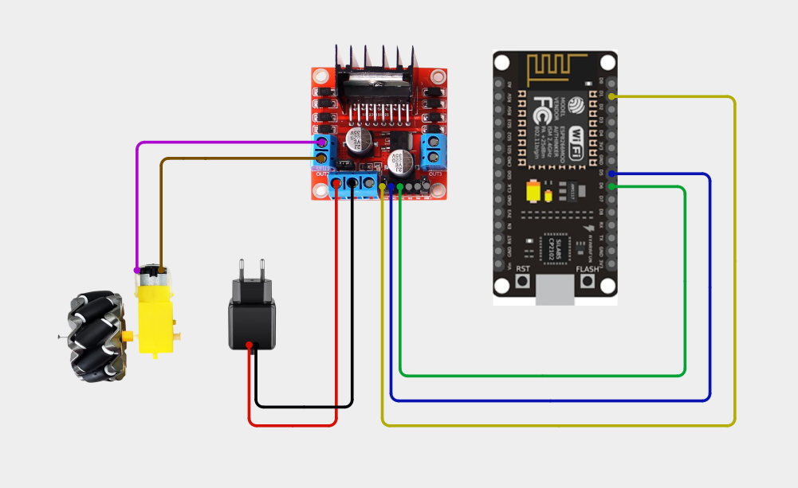
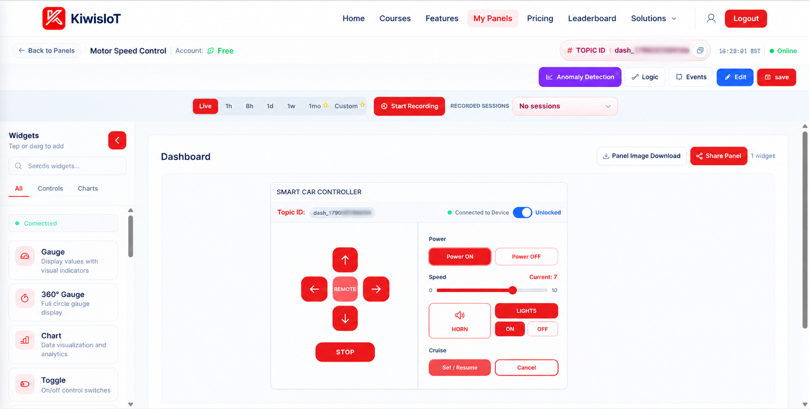
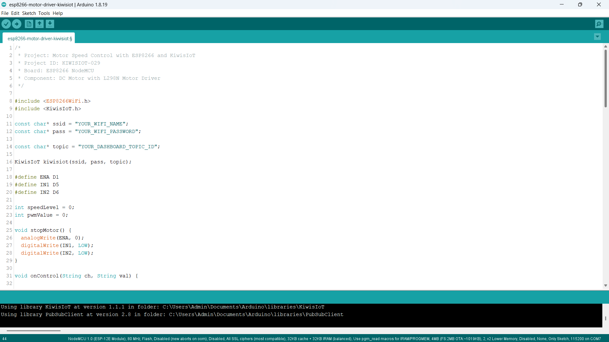
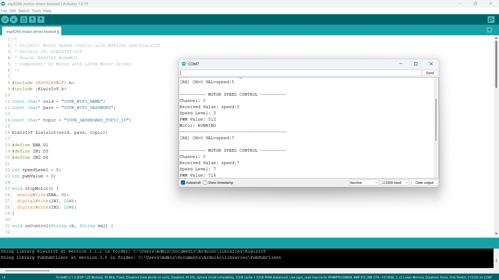

# ESP8266 L298N Motor Driver IoT Project: Control Motor Speed with KiwisIoT ⚙️

Build an **ESP8266 motor speed control IoT project** to remotely control the speed of a DC motor using an ESP8266 NodeMCU, an L298N motor driver, Arduino IDE, and KiwisIoT.

In this project, the ESP8266 NodeMCU connects to KiwisIoT over Wi-Fi. A speed control slider on the KiwisIoT dashboard allows you to select the motor speed level remotely.

The project uses digital pin D1 for PWM speed control, D5 for IN1, and D6 for IN2. KiwisIoT Channel 0 sends speed commands in the format `speed:0` to `speed:10`. The ESP8266 converts the selected speed level into a PWM value and sends it to the ENA pin of the L298N motor driver.

This project demonstrates how to build a wireless DC motor speed control system using an ESP8266, an L298N motor driver, and an IoT dashboard.

---

## 🚀 Project Highlights

- Remote DC motor speed control using KiwisIoT
- ESP8266 NodeMCU development board
- L298N motor driver for DC motor control
- Single DC motor operation
- KiwisIoT dashboard speed control
- Channel 0 for motor speed commands
- PWM speed control through the ENA pin
- Three digital pins used for motor driver control
- Ten speed levels from 1 to 10, plus a stop level of 0
- Wi-Fi-based communication
- Serial Monitor output for debugging
- Callback-based command handling using `kiwisiot.onReceive()`
- Input validation for speed commands
- Suitable for learning PWM, motor drivers, and IoT-based motor control

---

## 🔎 Project Overview

The **ESP8266 L298N Motor Driver IoT project** demonstrates how to control the speed of a DC motor remotely using a KiwisIoT dashboard.

The ESP8266 NodeMCU connects to KiwisIoT over Wi-Fi. The dashboard sends speed commands through Channel 0 in the following format:

```text
speed:0
speed:1
speed:2
speed:3
...
speed:10
```

When a speed command arrives, the ESP8266 receives it through the KiwisIoT callback function. The program extracts the speed level, validates the value, and converts it into a PWM value.

The PWM signal is sent through the ENA pin of the L298N motor driver. The L298N controls the power supplied to the DC motor.

| KiwisIoT Channel | ESP8266 Pin | Function | Accepted Values |
|---|---|---|---|
| Channel 0 | D1 (ENA) | PWM speed control | `speed:0` to `speed:10` |
| Channel 0 | D5 (IN1) | Motor direction input | HIGH |
| Channel 0 | D6 (IN2) | Motor direction input | LOW |

The motor runs in one direction when the selected speed is greater than 0. When the speed level is 0, the program stops the motor.

The project flow is:

```text
          KiwisIoT Dashboard
                  |
          Speed Control Slider
                  |
              Channel 0
                  |
          speed:0 to speed:10
                  |
                Wi-Fi
                  |
          ESP8266 NodeMCU
                  |
           Receive Callback
                  |
          Validate Speed Value
                  |
          Convert Speed to PWM
                  |
           PWM Output: D1
                  |
            L298N Driver
                  |
             DC Motor
                  |
          Speed Control / Stop
```

---

## 💡 Why This Project?

DC motors are commonly used in robotics, conveyor systems, small machines, cooling systems, and automation applications.

The L298N motor driver allows a microcontroller to control a motor without connecting the motor directly to its GPIO pins. It provides a separate motor power path and supports PWM-based speed control.

By connecting the L298N to an ESP8266, you can control the motor remotely through an IoT dashboard.

This project introduces wireless motor speed control and demonstrates how a selected speed level can be converted into a PWM signal.

The project is useful for learning:

- DC motor interfacing
- L298N motor driver operation
- PWM speed control
- ESP8266 digital output control
- Wi-Fi communication
- Dashboard-based motor control
- Callback functions
- Input validation
- Basic IoT-based robotics

---

## 📚 What You'll Learn

By building this project, you will learn how to:

- Connect an L298N motor driver to an ESP8266 NodeMCU.
- Control a DC motor using a motor driver.
- Understand the ENA, IN1, and IN2 pins of the L298N.
- Generate PWM signals using the ESP8266.
- Convert speed levels into PWM values.
- Connect an ESP8266 to KiwisIoT.
- Configure a dashboard speed control widget.
- Receive speed commands through Channel 0.
- Validate speed commands received from the dashboard.
- Stop the motor using a speed level of 0.
- Display motor speed and PWM information in the Serial Monitor.
- Troubleshoot common motor driver and IoT communication problems.

---

## 🧰 Components Required

| Component | Quantity |
|---|---:|
| ESP8266 NodeMCU | 1 |
| L298N motor driver module | 1 |
| DC geared motor | 1 |
| Suitable DC power adapter for the motor | 1 |
| Jumper wires | As required |
| Connecting wires for motor power | As required |
| USB cable | 1 |
| Computer | 1 |
| Wi-Fi connection | 1 |

**Power and safety note:** The external DC power supply powers the motor through the L298N. The ESP8266 GPIO pins provide control signals only; they do not power the motor. Select a motor supply voltage and current rating suitable for the motor. Check the L298N module's voltage, current, and thermal limits before operating it.

---

## 💻 Software Requirements

- Arduino IDE
- ESP8266 board package
- KiwisIoT Arduino library
- KiwisIoT account
- Wi-Fi connection

### Common KiwisIoT Setup

Before starting this project, complete the common **KiwisIoT Arduino Setup Guide**.

The setup guide covers:

- Arduino IDE installation
- ESP8266 board installation and selection
- KiwisIoT Arduino library installation
- KiwisIoT panel setup
- Topic ID configuration
- Dashboard widget setup and configuration

The common setup guide is available in the parent `esp8266` directory:

[Open the KiwisIoT Arduino Setup Guide](../kiwisiot-arduino-setup/)

### KiwisIoT Library Setup

If the KiwisIoT Arduino library is not already installed:

1. Open Arduino IDE.
2. Navigate to **Sketch → Include Library → Manage Libraries**.
3. Search for the KiwisIoT library.
4. Install it according to the available library listing or the KiwisIoT setup guide.
5. Confirm that the library is available before compiling the program.

The `ESP8266WiFi.h` header provides ESP8266 Wi-Fi functionality, while `KiwisIoT.h` provides communication with KiwisIoT.

---

## 🛠️ Technologies Used

- ESP8266 NodeMCU
- L298N motor driver
- DC geared motor
- Arduino IDE
- ESP8266WiFi library
- KiwisIoT Arduino library
- KiwisIoT IoT dashboard
- Wi-Fi communication
- PWM (Pulse Width Modulation)
- GPIO digital output control
- C++ / Arduino

---

## 🔌 Circuit Connection

Connect the ESP8266 NodeMCU, L298N motor driver, DC motor, and external motor power supply according to the circuit diagram.

### Pin Connections

#### ESP8266 NodeMCU to L298N Motor Driver

| ESP8266 NodeMCU | L298N Motor Driver | Function |
|---|---|---|
| D1 | ENA | PWM speed control |
| D5 | IN1 | Motor direction control |
| D6 | IN2 | Motor direction control |
| GND | GND | Common ground |

The ENA pin receives the PWM signal from D1. IN1 and IN2 determine the motor direction.

#### L298N to DC Motor

| L298N Motor Driver | DC Motor |
|---|---|
| OUT1 | Motor terminal 1 |
| OUT2 | Motor terminal 2 |

The motor is connected to the first motor output channel of the L298N.

#### External Power Supply to L298N

| Power Supply | L298N Motor Driver |
|---|---|
| Positive (+) | Motor supply terminal (+12V / VS, according to the board marking) |
| Negative (-) | GND |

The external power supply must match the DC motor's rated voltage and current requirements.

**Common ground:** Connect the ESP8266 GND and L298N GND together so that the control signals have a common reference.

### Circuit Diagram



### Understanding the Connections

- **D1 → ENA:** Supplies the PWM signal used to control motor speed.
- **D5 → IN1:** Controls the first direction input of the motor driver.
- **D6 → IN2:** Controls the second direction input of the motor driver.
- **OUT1 and OUT2 → Motor:** Connect the DC motor to the L298N output terminals.
- **External supply → Motor supply terminal:** Provides power to the motor.
- **ESP8266 GND → L298N GND:** Establishes a common ground reference.

The motor driver pins are defined in the Arduino program as:

```cpp
#define ENA D1
#define IN1 D5
#define IN2 D6
```

### Important L298N Configuration

The ENA pin is used for PWM speed control.

If your L298N module has an ENA jumper, remove it when using an external PWM signal from the ESP8266. The ENA pin must receive the PWM signal from D1.

Check the module's documentation for the correct logic supply configuration. Do not connect the motor supply voltage to the ESP8266 or to the L298N logic supply input.

**Important safety precautions:**

- Disconnect power sources before changing wiring.
- Verify the motor's rated voltage and current.
- Check the L298N module's motor supply and output current limits.
- Ensure the motor's startup or stall current does not exceed the driver rating.
- Use a suitable external power supply for the motor.
- Connect the ESP8266 GND and L298N GND together.
- Do not connect the motor directly to an ESP8266 GPIO pin.
- Remove the ENA jumper when using D1 for PWM control.
- Provide adequate ventilation for the L298N heatsink and avoid overheating.
- Secure the motor and any attached rotating parts before testing.

---

## 🔬 How Motor Speed Control Works

### 1. Define the Motor Driver Pins

The program assigns D1, D5, and D6 to the L298N motor driver.

```cpp
#define ENA D1
#define IN1 D5
#define IN2 D6
```

- ENA controls the motor speed using PWM.
- IN1 and IN2 control the motor direction.

### 2. Initialize the Speed Variables

The program uses two variables:

```cpp
int speedLevel = 0;
int pwmValue = 0;
```

- `speedLevel` stores the speed level received from KiwisIoT.
- `pwmValue` stores the corresponding PWM value.

Initially, both values are set to 0.

### 3. Configure the Motor Stop Function

The `stopMotor()` function stops the motor by setting the PWM value to 0 and setting both direction inputs LOW.

```cpp
void stopMotor() {
  analogWrite(ENA, 0);
  digitalWrite(IN1, LOW);
  digitalWrite(IN2, LOW);
}
```

When the received speed level is 0, this function is called.

### 4. Receive Dashboard Commands

The callback function receives the channel and command sent from KiwisIoT.

```cpp
void onControl(String ch, String val)
```

The `ch` parameter identifies the channel, while `val` contains the received command.

For example:

```text
Channel: 0
Received Value: speed:5
```

### 5. Validate the Received Command

The program first checks whether the command starts with `speed:`.

```cpp
if (!val.startsWith("speed:")) {
  Serial.println("Invalid command. Use speed:0 to speed:10.");
  return;
}
```

It then extracts the speed value:

```cpp
String levelText = val.substring(6);
```

The program checks that the extracted value is not empty and contains only numeric characters.

This prevents unexpected commands from being processed as valid speed values.

### 6. Check the Speed Range

The program converts the extracted value into an integer.

```cpp
int newSpeed = levelText.toInt();
```

The accepted speed range is 0 to 10.

```cpp
if (newSpeed < 0 || newSpeed > 10) {
  Serial.println("Speed must be between 0 and 10.");
  return;
}
```

Only values within the accepted range are processed.

### 7. Convert Speed Level into PWM

The program uses the Arduino `map()` function to convert the speed level into a PWM value.

```cpp
pwmValue = map(speedLevel, 0, 10, 0, 1023);
```

The ESP8266 PWM range is configured as 0 to 1023.

For example:

- Speed 0 produces PWM 0.
- Speed 5 produces PWM 512.
- Speed 7 produces PWM 716.
- Speed 10 produces PWM 1023.

### 8. Control the Motor

When the speed level is greater than 0, the program sets the direction inputs and applies the PWM signal.

```cpp
digitalWrite(IN1, HIGH);
digitalWrite(IN2, LOW);

pwmValue = map(speedLevel, 0, 10, 0, 1023);
analogWrite(ENA, pwmValue);
```

When the speed level is 0, the program calls `stopMotor()`.

```cpp
if (speedLevel == 0) {
  stopMotor();
  pwmValue = 0;
}
```

### 9. Display the Result

The Serial Monitor displays:

- Received channel
- Received command
- Selected speed level
- Calculated PWM value
- Motor status

This helps verify that the ESP8266 receives and processes the dashboard commands correctly.

**Note:** The PWM value represents the requested motor-driver control level. Actual motor RPM depends on the motor, supply voltage, load, and driver characteristics. This project does not measure actual RPM.

---

## 🔁 Motor Speed Reference

The project uses the following speed and PWM mapping:

| Speed Command | Speed Level | PWM Value | Expected Motor State |
|---|---:|---:|---|
| `speed:0` | 0 | 0 | STOPPED |
| `speed:1` | 1 | 102 | RUNNING |
| `speed:2` | 2 | 204 | RUNNING |
| `speed:3` | 3 | 306 | RUNNING |
| `speed:4` | 4 | 409 | RUNNING |
| `speed:5` | 5 | 512 | RUNNING |
| `speed:6` | 6 | 613 | RUNNING |
| `speed:7` | 7 | 716 | RUNNING |
| `speed:8` | 8 | 818 | RUNNING |
| `speed:9` | 9 | 920 | RUNNING |
| `speed:10` | 10 | 1023 | RUNNING |

The PWM values are calculated using:

```cpp
map(speedLevel, 0, 10, 0, 1023);
```

The speed level is a control setting, not a direct RPM measurement. The motor may not start at very low PWM levels depending on its load and characteristics.

---

## ☁️ KiwisIoT Dashboard

This project uses the **Smart Car Controller widget** on the KiwisIoT dashboard for motor speed control.

The dashboard provides a speed slider with values ranging from 0 to 10.



The speed control sends commands to the ESP8266 through Channel 0.

### Dashboard Control Mapping

| Dashboard Control | Channel ID | Command | Function |
|---|---|---|---|
| Speed Slider | 0 | `speed:0` | Stop motor |
| Speed Slider | 0 | `speed:1` to `speed:10` | Set motor speed level |

The Arduino program specifically handles the `speed:` command format.

**Dashboard functionality note:** The displayed Smart Car Controller may contain other controls such as direction buttons, power buttons, lights, horn, and cruise control. The Arduino program in this project implements only speed-level control and stopping through `speed:0`. The other dashboard controls are not implemented by this sketch.

---

## ⚙️ Dashboard Configuration

### 1. Open or Create a KiwisIoT Panel

Open your KiwisIoT account and create a panel or open your existing Motor Speed Control panel.

### 2. Add the Smart Car Controller Widget

Add the Smart Car Controller widget to the dashboard.

### 3. Configure the Speed Control

Configure the speed control to send commands in the following format:

```text
Widget Name: Motor Speed Control
Widget Type: Smart Car Controller
Channel ID: 0
Minimum Speed: 0
Maximum Speed: 10
Command Format: speed:<value>
```

The slider must send values such as:

```text
speed:0
speed:1
speed:2
...
speed:10
```

These commands match the format handled by the Arduino program.

### 4. Save the Dashboard

After configuring the widget:

1. Click **Update** if the widget configuration provides that option.
2. Click **Edit** at the top of the dashboard if required.
3. Click **Save** to save the dashboard changes.

### 5. Verify the Channel ID

The Arduino program uses Channel 0 for motor speed control.

```cpp
if (ch != "0") {
  Serial.println("Unknown channel. Use Channel 0.");
  return;
}
```

Make sure the dashboard speed control uses Channel 0 and sends commands in the expected format.

---

## 💻 Arduino Code

The complete Arduino source file is available in the project's `code` directory.

The program uses these headers:

```cpp
#include <ESP8266WiFi.h>
#include <KiwisIoT.h>
```

The KiwisIoT object is initialized using the Wi-Fi credentials and dashboard Topic ID:

```cpp
KiwisIoT kiwisiot(ssid, pass, topic);
```

The receive callback is registered using:

```cpp
kiwisiot.onReceive(onControl);
```

The main loop continuously processes KiwisIoT:

```cpp
void loop() {
  kiwisiot.run();
}
```



---

## 🔐 Configure Wi-Fi and KiwisIoT

Before uploading the program, update the following values in the Arduino code:

```cpp
const char* ssid = "YOUR_WIFI_NAME";
const char* pass = "YOUR_WIFI_PASSWORD";

const char* topic = "YOUR_DASHBOARD_TOPIC_ID";
```

Replace `YOUR_WIFI_NAME` with your Wi-Fi network name.

Replace `YOUR_WIFI_PASSWORD` with your Wi-Fi password.

Replace `YOUR_DASHBOARD_TOPIC_ID` with the Topic ID of your KiwisIoT panel.

Make sure the Topic ID corresponds to the panel containing the Motor Speed Control widget.

**Security:** Keep actual Wi-Fi credentials and private information out of public GitHub repositories. Use placeholders in the published code and enter your credentials locally.

---

## 📝 Complete Arduino Code

The following is the complete Arduino program for the ESP8266 L298N motor speed control project.

```cpp
/*
 * Project: Motor Speed Control with ESP8266 and KiwisIoT
 * Project ID: KIWISIOT-029
 * Board: ESP8266 NodeMCU
 * Component: DC Motor with L298N Motor Driver
 */

#include <ESP8266WiFi.h>
#include <KiwisIoT.h>

const char* ssid = "YOUR_WIFI_NAME";
const char* pass = "YOUR_WIFI_PASSWORD";

const char* topic = "YOUR_DASHBOARD_TOPIC_ID";

KiwisIoT kiwisiot(ssid, pass, topic);

#define ENA D1
#define IN1 D5
#define IN2 D6

int speedLevel = 0;
int pwmValue = 0;

void stopMotor() {
  analogWrite(ENA, 0);
  digitalWrite(IN1, LOW);
  digitalWrite(IN2, LOW);
}

void onControl(String ch, String val) {

  val.trim();

  Serial.println();
  Serial.println("---------- MOTOR SPEED CONTROL ----------");
  Serial.print("Channel: ");
  Serial.println(ch);
  Serial.print("Received Value: ");
  Serial.println(val);

  if (ch != "0") {
    Serial.println("Unknown channel. Use Channel 0.");
    Serial.println("-----------------------------------------");
    return;
  }

  if (!val.startsWith("speed:")) {
    Serial.println("Invalid command. Use speed:0 to speed:10.");
    Serial.println("-----------------------------------------");
    return;
  }

  String levelText = val.substring(6);

  if (levelText.length() == 0) {
    Serial.println("Invalid speed value.");
    Serial.println("-----------------------------------------");
    return;
  }

  for (unsigned int i = 0; i < levelText.length(); i++) {
    if (!isDigit(levelText[i])) {
      Serial.println("Invalid speed value.");
      Serial.println("-----------------------------------------");
      return;
    }
  }

  int newSpeed = levelText.toInt();

  if (newSpeed < 0 || newSpeed > 10) {
    Serial.println("Speed must be between 0 and 10.");
    Serial.println("-----------------------------------------");
    return;
  }

  speedLevel = newSpeed;

  if (speedLevel == 0) {
    stopMotor();
    pwmValue = 0;
  } else {
    digitalWrite(IN1, HIGH);
    digitalWrite(IN2, LOW);

    pwmValue = map(speedLevel, 0, 10, 0, 1023);
    analogWrite(ENA, pwmValue);
  }

  Serial.print("Speed Level: ");
  Serial.println(speedLevel);

  Serial.print("PWM Value: ");
  Serial.println(pwmValue);

  Serial.println(
    speedLevel == 0 ? "Motor: STOPPED" : "Motor: RUNNING"
  );

  Serial.println("-----------------------------------------");
}

void setup() {

  Serial.begin(115200);

  pinMode(ENA, OUTPUT);
  pinMode(IN1, OUTPUT);
  pinMode(IN2, OUTPUT);

  analogWriteRange(1023);

  stopMotor();

  Serial.println();
  Serial.println("===== ESP8266 MOTOR SPEED CONTROL =====");
  Serial.println("Motor initialized: STOPPED");
  Serial.println("Connecting to KiwisIoT...");

  kiwisiot.begin();
  kiwisiot.onReceive(onControl);

  Serial.println("KiwisIoT motor control initialized.");
  Serial.println("Channel 0: speed:0 to speed:10");
}

void loop() {
  kiwisiot.run();
}
```

---

## ⬆️ Upload the Program

Follow these steps to upload the program:

1. Check the L298N motor driver's voltage and current requirements.
2. Connect the ESP8266 NodeMCU to the L298N according to the circuit diagram.
3. Connect the DC motor to OUT1 and OUT2.
4. Connect the external motor power supply to the L298N motor supply terminals.
5. Connect the ESP8266 GND and L298N GND together.
6. Remove the ENA jumper if using D1 for PWM speed control.
7. Verify all wiring before applying power.
8. Connect the NodeMCU to your computer using a USB cable.
9. Open `esp8266-motor-driver-kiwisiot.ino` in Arduino IDE.
10. Install the ESP8266 board package if it is not already installed.
11. Install the KiwisIoT Arduino library.
12. Select the appropriate ESP8266 NodeMCU board.
13. Update the Wi-Fi credentials and KiwisIoT Topic ID.
14. Verify the program.
15. Upload the code.
16. Open the Serial Monitor.
17. Set the baud rate to `115200`.
18. Open the KiwisIoT dashboard and operate the speed control slider.

When the program starts, it configures the motor driver pins, sets the PWM range to 1023, and stops the motor.

When a valid speed command arrives on Channel 0, the program calculates the corresponding PWM value and controls the motor.

---

## 🖥️ Serial Monitor Output

The Serial Monitor displays the received channel, speed command, selected speed level, PWM value, and motor status.

Set the baud rate to `115200` to match the program:

```cpp
Serial.begin(115200);
```

### Example Output: Speed Level 5

When the dashboard sends `speed:5`, the program calculates the PWM value.

```text
[RX] CH=0 VAL=speed:5

---------- MOTOR SPEED CONTROL ----------
Channel: 0
Received Value: speed:5
Speed Level: 5
PWM Value: 512
Motor: RUNNING
-----------------------------------------
```

### Example Output: Speed Level 7

When the dashboard sends `speed:7`, the program calculates the PWM value.

```text
[RX] CH=0 VAL=speed:7

---------- MOTOR SPEED CONTROL ----------
Channel: 0
Received Value: speed:7
Speed Level: 7
PWM Value: 716
Motor: RUNNING
-----------------------------------------
```

### Example Output: Motor Stopped

When the dashboard sends `speed:0`, the program stops the motor.

```text
---------- MOTOR SPEED CONTROL ----------
Channel: 0
Received Value: speed:0
Speed Level: 0
PWM Value: 0
Motor: STOPPED
-----------------------------------------
```

### Example Output: Invalid Command

If Channel 0 receives a command that does not start with `speed:`, the program rejects it.

```text
---------- MOTOR SPEED CONTROL ----------
Channel: 0
Received Value: 5
Invalid command. Use speed:0 to speed:10.
-----------------------------------------
```

### Example Output: Invalid Speed Value

If the speed value is outside the accepted range or contains non-numeric characters, the program displays an error message.

```text
Received Value: speed:15
Speed must be between 0 and 10.
```



The Serial Monitor confirms the command received by the ESP8266 and the PWM value requested by the program. The displayed motor status is based on the command; it does not independently measure the actual motor RPM.

---

## 🔄 Understanding the Data Flow

The project follows these steps to control the motor remotely.

### 1. Initialize the Motor Driver

The ESP8266 configures D1, D5, and D6 as output pins.

### 2. Set the PWM Range

The program configures the ESP8266 PWM range:

```cpp
analogWriteRange(1023);
```

This allows PWM values between 0 and 1023.

### 3. Stop the Motor Initially

The `stopMotor()` function sets the PWM value to 0 and both direction inputs LOW.

### 4. Initialize KiwisIoT

The program starts the KiwisIoT library and registers the callback:

```cpp
kiwisiot.begin();
kiwisiot.onReceive(onControl);
```

### 5. Wait for Dashboard Commands

The main loop continuously processes KiwisIoT:

```cpp
void loop() {
  kiwisiot.run();
}
```

### 6. Read the Channel and Command

The callback receives the channel ID and speed command:

```cpp
void onControl(String ch, String val)
```

### 7. Validate the Speed Command

The program checks the channel, command format, and speed range.

### 8. Convert the Speed into PWM

The `map()` function converts the speed level into a PWM value between 0 and 1023.

### 9. Control the L298N

The ESP8266 sends the PWM signal through D1 and direction signals through D5 and D6.

### 10. Run or Stop the Motor

The L298N controls the DC motor according to the received PWM signal. A speed level of 0 stops the motor.

The complete data flow is:

```text
          KiwisIoT Dashboard
                  |
          Speed Control Slider
                  |
               Channel 0
                  |
           speed:<value>
                  |
                Wi-Fi
                  |
          ESP8266 NodeMCU
                  |
            kiwisiot.run()
                  |
          onControl(ch, val)
                  |
          Validate Speed Command
                  |
          Extract Speed Level
                  |
          Convert Speed to PWM
                  |
             PWM Output
                D1
                  |
          Direction Control
           D5        D6
                  |
            L298N Driver
                  |
               DC Motor
                  |
          Speed Control / Stop
```

---

## 🧪 Testing the Project

To test the project:

1. Verify the L298N motor driver's voltage and current requirements.
2. Confirm that ENA is connected to D1.
3. Confirm that IN1 is connected to D5.
4. Confirm that IN2 is connected to D6.
5. Check that the motor is connected to OUT1 and OUT2.
6. Verify that the external supply matches the motor's rating.
7. Confirm that the ESP8266 and L298N share a common ground.
8. Upload the Arduino program.
9. Open the Serial Monitor at `115200` baud.
10. Wait for the startup messages.
11. Open the KiwisIoT dashboard.
12. Move the speed slider to level 5.
13. Confirm that the Serial Monitor reports `Speed Level: 5` and `PWM Value: 512`.
14. Verify that the motor runs.
15. Change the speed slider to level 7.
16. Confirm that the Serial Monitor reports `PWM Value: 716`.
17. Move the speed slider to level 0.
18. Confirm that the Serial Monitor reports `Motor: STOPPED`.
19. Verify that the motor stops.

### Test 1: Speed Level 5

Send:

```text
speed:5
```

Expected Serial Monitor values:

```text
Speed Level: 5
PWM Value: 512
Motor: RUNNING
```

Expected result: The motor runs with a PWM control value of 512.

### Test 2: Speed Level 7

Send:

```text
speed:7
```

Expected Serial Monitor values:

```text
Speed Level: 7
PWM Value: 716
Motor: RUNNING
```

Expected result: The motor receives a higher PWM command than at speed level 5.

### Test 3: Motor STOP

Send:

```text
speed:0
```

Expected Serial Monitor values:

```text
Speed Level: 0
PWM Value: 0
Motor: STOPPED
```

Expected result: The PWM output becomes 0 and the motor stops.

### Test 4: Invalid Speed Command

Send a command such as:

```text
speed:15
```

Expected result: The program displays a speed-range error and does not apply the invalid speed command.

### Test 5: Verify Dashboard Communication

Operate the speed slider several times and check that:

- The Serial Monitor displays the received commands.
- Channel 0 is used for motor speed control.
- Commands follow the `speed:<value>` format.
- Speed values remain between 0 and 10.
- PWM values change according to the selected speed.
- The motor responds to valid speed commands.
- The motor stops at speed level 0.
- The ESP8266 maintains a working Wi-Fi connection.

**Safety:** Secure the motor and any attached rotating parts before testing. Keep hands, wires, and other objects away from moving parts. Disconnect power before correcting wiring.

---

## 🛠️ Troubleshooting

### Motor Does Not Run

Check:

- Whether ENA is connected to D1.
- Whether the ENA jumper has been removed when using external PWM control.
- Whether IN1 is connected to D5.
- Whether IN2 is connected to D6.
- Whether the motor is connected to OUT1 and OUT2.
- Whether the L298N receives the correct motor supply voltage.
- Whether the ESP8266 and L298N share a common ground.
- Whether the motor and power supply are working.
- Whether the received command appears in the Serial Monitor.

### Motor Does Not Change Speed

Check:

- Whether the dashboard sends the `speed:<value>` command format.
- Whether Channel 0 is configured correctly.
- Whether ENA is connected to D1.
- Whether the ENA jumper has been removed.
- Whether `analogWriteRange(1023)` is configured.
- Whether the program receives different speed values.
- Whether the motor is operating under a mechanical load.

The actual speed difference may be difficult to notice at nearby PWM levels, especially with a geared motor.

### Motor Does Not Stop

Check:

- Whether the dashboard sends `speed:0`.
- Whether the program receives the command on Channel 0.
- Whether the ENA pin is correctly connected.
- Whether the PWM output is set to 0.
- Whether the motor driver is wired correctly.

### L298N Does Not Respond

Check:

- Whether the motor supply is connected correctly.
- Whether the L298N logic supply is configured according to its module specifications.
- Whether the common ground is connected.
- Whether ENA, IN1, and IN2 are connected to the correct pins.
- Whether the driver is overheating.
- Whether the motor current is within the driver's rated limits.

### Serial Monitor Does Not Show Received Commands

Check:

- Whether the baud rate is `115200`.
- Whether the ESP8266 has a working Wi-Fi connection.
- Whether the Topic ID is correct.
- Whether the dashboard uses Channel 0.
- Whether the command format is `speed:<value>`.
- Whether the program contains `kiwisiot.onReceive(onControl)`.
- Whether `kiwisiot.run()` continues to execute in `loop()`.

### Dashboard Does Not Control the Motor

Confirm that:

- The correct KiwisIoT panel is open.
- The Topic ID matches the configured panel.
- The speed control uses Channel 0.
- The speed control sends values in the expected command format.
- The ESP8266 is connected to Wi-Fi.
- The callback is receiving commands.

### Motor Does Not Start at Low Speed

A DC motor may require a minimum starting PWM value to overcome friction and its initial load.

Check:

- Whether the motor supply voltage is suitable.
- Whether the motor is mechanically obstructed.
- Whether the motor is suitable for the L298N driver.
- Whether the selected PWM value is sufficient to start the motor.

The provided code maps speed level 1 to a PWM value of approximately 102. This does not guarantee that every motor will start at that level.

### Motor Driver Becomes Hot

Check:

- Whether the motor current exceeds the L298N rating.
- Whether the motor is overloaded or stalled.
- Whether the motor supply voltage is appropriate.
- Whether the driver has adequate ventilation.
- Whether the heatsink is properly installed.

Stop testing if the motor driver becomes excessively hot. Do not operate the driver beyond its specified electrical and thermal limits.

---

## 🔒 Security and Hardware Safety

Never publish sensitive credentials in a public GitHub repository.

Do not commit:

- Wi-Fi passwords
- API keys
- Access tokens
- Account passwords
- Private dashboard access information

Use placeholders in the public example:

```text
YOUR_WIFI_NAME
YOUR_WIFI_PASSWORD
YOUR_DASHBOARD_TOPIC_ID
```

Enter your actual credentials only in your local Arduino project.

For hardware safety:

- Use a suitable external DC power supply for the motor.
- Confirm the motor's rated voltage and current.
- Check the L298N motor driver's voltage and current limits.
- Do not connect the DC motor directly to ESP8266 GPIO pins.
- Connect ESP8266 GND and L298N GND together.
- Remove the ENA jumper when using an external PWM signal.
- Keep motor power connections secure and insulated.
- Disconnect power before changing wiring.
- Avoid touching the motor or driver while operating.
- Keep rotating parts away from fingers and loose wires.
- Provide adequate ventilation for the L298N module.
- Do not operate a stalled motor for extended periods.

---

## 🌱 Possible Applications

An ESP8266 motor speed control system can be used as a starting point for:

- IoT-based robotics
- Small conveyor systems
- DC motor speed control experiments
- Remote-controlled machines
- Small automation systems
- Educational motor driver experiments
- Wireless motor control prototypes
- Embedded systems demonstrations

The project can be extended by adding additional sensors and control logic for more advanced applications.

For example, a motor RPM sensor or encoder can be added to measure the actual motor speed and provide feedback.

**Important:** This project demonstrates PWM-based speed control in one direction. It does not measure actual RPM, provide closed-loop speed regulation, or implement reverse-direction control.

---

## 📁 Project Structure

```text
029-motor-driver-kiwisiot/
│
├── README.md
│
├── code/
│   └── esp8266-motor-driver-kiwisiot.ino
│
└── images/
    ├── circuit.png
    ├── code.png
    ├── serial-monitor.png
    └── dashboard-output.png
```

---

## 🔗 Related KiwisIoT ESP8266 Projects

This project is part of the KiwisIoT ESP8266 IoT project collection.

- [ESP8266 LDR Sensor IoT Project](../001-ldr-kiwisiot/)
- [ESP8266 IR Sensor IoT Project](../002-ir-kiwisiot/)
- [ESP8266 Ultrasonic Sensor IoT Project](../003-ultrasonic-kiwisiot/)
- [ESP8266 DHT11 Temperature and Humidity IoT Project](../004-dht11-kiwisiot/)
- [ESP8266 PIR Motion Sensor IoT Project](../005-pir-kiwisiot/)
- [ESP8266 Gas Sensor IoT Project](../006-gas-kiwisiot/)
- [ESP8266 Flame Sensor IoT Project](../007-flame-kiwisiot/)
- [ESP8266 Soil Moisture Sensor IoT Project](../008-soil-moisture-kiwisiot/)
- [ESP8266 Water Level Sensor IoT Project](../009-water-level-kiwisiot/)
- [ESP8266 Raindrop Sensor IoT Project](../010-raindrop-kiwisiot/)
- [ESP8266 Sound Sensor IoT Project](../011-sound-kiwisiot/)
- [ESP8266 MPU6050 Motion and Acceleration IoT Project](../012-mpu6050-kiwisiot/)
- [ESP8266 Voltage Sensor IoT Project](../013-voltage-kiwisiot/)
- [ESP8266 Current Sensor IoT Project](../014-current-kiwisiot/)
- [ESP8266 Vibration Sensor IoT Project](../015-vibration-kiwisiot/)
- [ESP8266 Reed Switch IoT Project](../016-reed-switch-kiwisiot/)
- [ESP8266 Hall Effect Sensor IoT Project](../017-hall-effect-kiwisiot/)
- [ESP8266 Touch Sensor IoT Project](../018-touch-kiwisiot/)
- [ESP8266 BMP180 Temperature and Air Pressure IoT Project](../019-bmp180-kiwisiot/)
- [ESP8266 DS18B20 Temperature Monitoring IoT Project](../020-ds18b20-kiwisiot/)
- [ESP8266 LED Remote Control IoT Project](../021-led-kiwisiot/)
- [ESP8266 RGB LED IoT Project](../022-rgb-led-kiwisiot/)
- [ESP8266 Buzzer IoT Project](../023-buzzer-kiwisiot/)
- [ESP8266 2-Channel Relay IoT Project](../024-relay-kiwisiot/)
- [ESP8266 Servo Motor IoT Project](../025-servo-kiwisiot/)
- [ESP8266 Fan Control IoT Project](../026-fan-kiwisiot/)
- [ESP8266 Water Pump IoT Project](../027-water-pump-kiwisiot/)
- [ESP8266 Solenoid Valve IoT Project](../028-solenoid-valve-kiwisiot/)

For Arduino and KiwisIoT setup, see the [KiwisIoT Arduino Setup Guide](../kiwisiot-arduino-setup/).

---

## ❓ Frequently Asked Questions

### What is the purpose of this project?

This project demonstrates how to control the speed of a DC motor remotely using an ESP8266 NodeMCU, an L298N motor driver, and a KiwisIoT dashboard.

### Which ESP8266 board is used?

The project uses the ESP8266 NodeMCU development board.

### Which motor driver is used?

The project uses an L298N motor driver module.

### How many motors are controlled?

This project controls one DC motor using the first motor output channel of the L298N.

### Which pins control the L298N?

D1 is used for ENA PWM control, D5 is used for IN1, and D6 is used for IN2.

### What is the function of the ENA pin?

ENA receives the PWM signal that controls the motor's speed.

### What is PWM?

PWM stands for Pulse Width Modulation. It controls the average power delivered to the motor by switching the output signal rapidly.

### Which KiwisIoT channel is used?

Channel 0 is used for motor speed control.

### What commands control the motor?

The program accepts commands from `speed:0` to `speed:10`.

### What happens when speed is set to 0?

The program sets the PWM output to 0 and sets both direction inputs LOW, stopping the motor.

### What is the PWM value for speed level 5?

The PWM value for speed level 5 is 512.

### What is the PWM value for speed level 10?

The PWM value for speed level 10 is 1023.

### Why is an L298N motor driver required?

The L298N allows the ESP8266 to control a motor using a separate motor power supply without powering the motor directly from GPIO pins.

### Why must the ENA jumper be removed?

The ENA jumper must be removed when the ESP8266 supplies an external PWM signal to the ENA input.

### Does the project measure actual motor RPM?

No. It calculates a PWM value from the selected speed level. A separate encoder or RPM sensor would be required to measure actual motor speed.

### Does this project support reverse direction?

No. The current program sets IN1 HIGH and IN2 LOW whenever the motor runs, so it operates in one direction.

### Can this project be extended?

Yes. It can be extended with an encoder for RPM measurement, reverse-direction control, or additional automation features.

---

## 📌 Summary

This project demonstrates an **ESP8266 motor speed control IoT system** using a DC motor, an L298N motor driver, and KiwisIoT.

The ESP8266 connects to KiwisIoT over Wi-Fi, receives speed commands through Channel 0, validates the received command, converts the selected speed level into a PWM value, and controls the L298N through D1, D5, and D6.

The final control mapping is:

```text
Channel 0 + speed:0  → PWM 0    → Motor STOPPED
Channel 0 + speed:1  → PWM 102  → Motor RUNNING
Channel 0 + speed:5  → PWM 512  → Motor RUNNING
Channel 0 + speed:7  → PWM 716  → Motor RUNNING
Channel 0 + speed:10 → PWM 1023 → Motor RUNNING
```

With a speed control slider on the KiwisIoT dashboard, the project provides a practical introduction to motor driver interfacing, PWM generation, DC motor speed control, callback-based communication, and IoT-based control.

---

## 📄 License

This project is licensed under the MIT License. See the [LICENSE](../../LICENSE) file for details.
