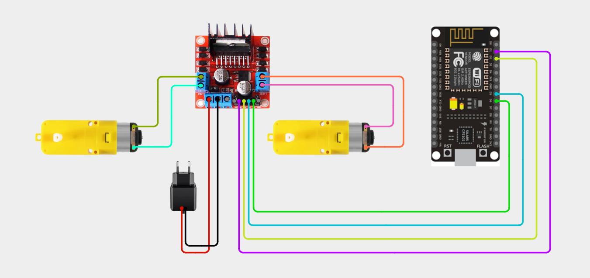
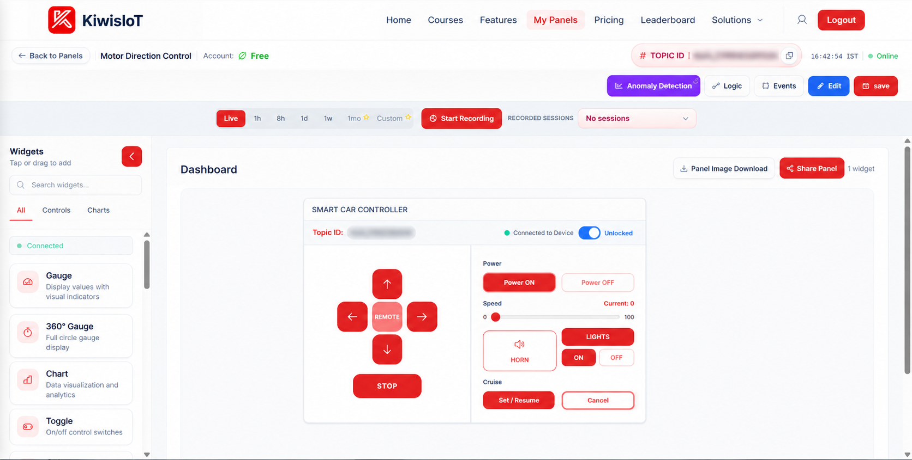
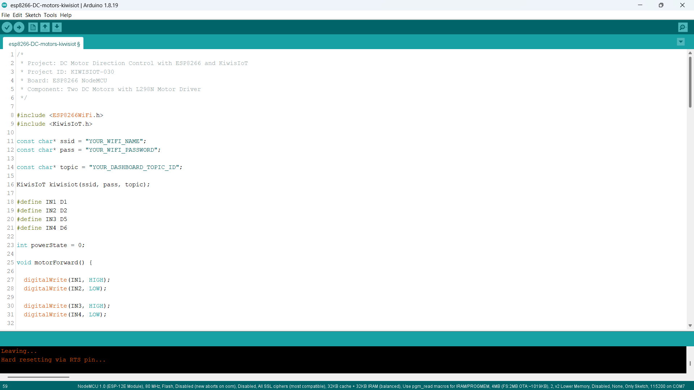
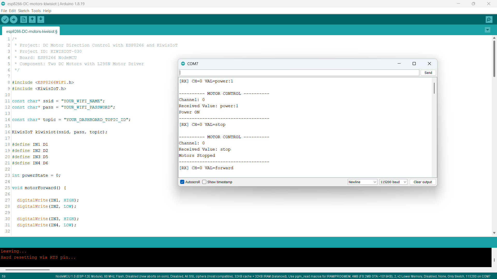

# ESP8266 DC Motors IoT Project: Control Motor Direction with KiwisIoT 🚗

Build an **ESP8266 DC motor control IoT project** to control the movement of two DC motors using an ESP8266 NodeMCU, an L298N motor driver, Arduino IDE, and KiwisIoT.

In this project, the ESP8266 NodeMCU connects to KiwisIoT over Wi-Fi. A dashboard allows you to remotely control the direction of two DC motors.

The project uses four digital pins to control the L298N motor driver:

- D1 and D2 control Motor A.
- D5 and D6 control Motor B.

KiwisIoT Channel 0 sends commands to the ESP8266 to move the motors forward, backward, left, right, or stop. A separate power control command enables or disables motor movement.

This project demonstrates how to build a wireless two-motor direction control system using an ESP8266, an L298N motor driver, and an IoT dashboard.

---

## 🚀 Project Highlights

- Remote control of two DC motors using KiwisIoT
- ESP8266 NodeMCU development board
- L298N dual H-bridge motor driver
- Independent direction signals for two motors
- Forward and backward movement
- Left and right turning
- Remote motor stop control
- Separate motor power ON/OFF command
- Channel 0 for motor control
- Wi-Fi-based communication
- Serial Monitor output for debugging
- Callback-based command handling using `kiwisiot.onReceive()`
- Suitable for learning IoT-based robotics and motor control

---

## 🔎 Project Overview

The **ESP8266 DC Motors IoT project** demonstrates how to control the direction of two DC motors remotely using a KiwisIoT dashboard.

The ESP8266 NodeMCU connects to KiwisIoT over Wi-Fi. The dashboard sends commands through Channel 0 to control the two motors connected to the L298N motor driver.

The L298N driver receives direction signals from the ESP8266 and controls the rotation of both motors.

Depending on the received command, the motors can:

- Move forward
- Move backward
- Turn right
- Turn left
- Stop

The project also includes a separate power control command. The motors must be enabled using `power:1` before movement commands are accepted. Sending `power:0` stops both motors and disables further movement commands until power is enabled again.

### Motor Control Pin Mapping

| ESP8266 Pin | L298N Pin | Function |
|---|---|---|
| D1 | IN1 | Motor A direction control |
| D2 | IN2 | Motor A direction control |
| D5 | IN3 | Motor B direction control |
| D6 | IN4 | Motor B direction control |

### KiwisIoT Command Mapping

| Channel | Command | Function |
|---|---|---|
| 0 | `power:1` | Enable motor control |
| 0 | `power:0` | Disable motor control and stop motors |
| 0 | `forward` | Move forward |
| 0 | `back` | Move backward |
| 0 | `right` | Turn right |
| 0 | `left` | Turn left |
| 0 | `stop` | Stop both motors |

The project flow is:

```text
             KiwisIoT Dashboard
                      |
               Motor Control
                      |
                  Channel 0
                      |
                    Wi-Fi
                      |
              ESP8266 NodeMCU
                      |
               Receive Callback
                      |
              Validate Command
                      |
              Motor Control Logic
                      |
                GPIO Signals
                 /        \
             IN1/IN2     IN3/IN4
                 |          |
                 +----+-----+
                      |
                L298N Driver
                 /        \
             Motor A    Motor B
                 \        /
                  DC Motor
                  Movement
```

---

## 💡 Why This Project?

DC motors are widely used in robotics, mobile robots, automated vehicles, and other embedded systems.

By connecting two DC motors to an L298N motor driver and controlling them through an ESP8266, you can build a wireless motor direction control system.

The L298N motor driver makes it possible to control the direction of both motors using digital signals from the ESP8266.

This project introduces the basic concepts of:

- DC motor interfacing
- H-bridge motor control
- Motor direction control
- Dual-motor operation
- Digital output control
- Wi-Fi communication
- Dashboard-based robotics control
- IoT-based movement commands

---

## 📚 What You'll Learn

By building this project, you will learn how to:

- Interface an L298N motor driver with an ESP8266 NodeMCU.
- Connect and control two DC motors.
- Control motor direction using digital GPIO pins.
- Understand the working of an H-bridge motor driver.
- Move two motors forward and backward.
- Control turning directions using different motor combinations.
- Stop both motors using a dashboard command.
- Enable and disable motor control remotely.
- Connect an ESP8266 to KiwisIoT.
- Configure dashboard commands.
- Receive commands through Channel 0.
- Display motor-control information in the Serial Monitor.

---

## 🧰 Components Required

| Component | Quantity |
|---|---:|
| ESP8266 NodeMCU | 1 |
| DC Motors | 2 |
| L298N Motor Driver Module | 1 |
| Suitable DC motor power supply | 1 |
| Jumper wires | As required |
| Connecting wires | As required |
| USB cable | 1 |
| Computer | 1 |
| Wi-Fi connection | 1 |

**Power and safety note:** The DC motors must receive power through the motor driver's motor supply connection. Do not power the motors directly from the ESP8266 GPIO pins. Select a suitable motor supply according to the motors and L298N module specifications.

---

## 💻 Software Requirements

- Arduino IDE
- ESP8266 board package
- KiwisIoT Arduino library
- KiwisIoT account
- Wi-Fi connection

### Common KiwisIoT Setup

Before starting this project, complete the common **KiwisIoT Arduino Setup Guide**.

The setup guide covers:

- Arduino IDE installation
- ESP8266 board installation and selection
- KiwisIoT Arduino library installation
- KiwisIoT panel setup
- Topic ID configuration
- Dashboard widget setup and configuration

The common setup guide is available in the parent `esp8266` directory:

[Open the KiwisIoT Arduino Setup Guide](../kiwisiot-arduino-setup/)

### KiwisIoT Library Setup

If the KiwisIoT Arduino library is not already installed:

1. Open Arduino IDE.
2. Navigate to **Sketch → Include Library → Manage Libraries**.
3. Search for the KiwisIoT library.
4. Install it according to the available library listing or the KiwisIoT setup guide.
5. Confirm that the library is available before compiling the program.

The `ESP8266WiFi.h` header provides ESP8266 Wi-Fi functionality, while `KiwisIoT.h` provides communication with KiwisIoT.

---

## 🛠️ Technologies Used

- ESP8266 NodeMCU
- L298N motor driver
- Two DC motors
- Arduino IDE
- ESP8266WiFi library
- KiwisIoT Arduino library
- KiwisIoT IoT dashboard
- Wi-Fi communication
- GPIO digital output control
- H-bridge motor control
- C++ / Arduino

---

## 🔌 Circuit Connection

Connect the ESP8266 NodeMCU, L298N motor driver, and two DC motors according to the circuit diagram.

### Pin Connections

#### ESP8266 NodeMCU to L298N Motor Driver

| ESP8266 NodeMCU | L298N Motor Driver | Function |
|---|---|---|
| D1 | IN1 | Motor A input 1 |
| D2 | IN2 | Motor A input 2 |
| D5 | IN3 | Motor B input 1 |
| D6 | IN4 | Motor B input 2 |
| GND | GND | Common ground |

Connect the motor supply to the L298N motor power input according to the motor voltage and driver specifications.

The ESP8266 and L298N logic circuit must share a common ground for the control signals to work correctly.

#### L298N to DC Motors

| L298N Output | Component |
|---|---|
| OUT1 and OUT2 | Motor A |
| OUT3 and OUT4 | Motor B |

Connect the two DC motors to their respective output terminals.

The direction labels depend on the actual motor terminal connections. If a motor rotates in the opposite direction from the expected movement, interchange its two output wires or adjust the corresponding control logic.

### Enable Pins

The L298N module generally provides ENA and ENB enable connections.

For this project, the Arduino code controls direction using IN1, IN2, IN3, and IN4. It does not generate PWM speed-control signals.

Make sure the motor-driver enable inputs are enabled according to your module's design. If the module uses ENA and ENB jumpers, follow its instructions for enabling the outputs.

### Circuit Diagram



### Understanding the Connections

- **D1 → IN1:** Controls the first direction input of Motor A.
- **D2 → IN2:** Controls the second direction input of Motor A.
- **D5 → IN3:** Controls the first direction input of Motor B.
- **D6 → IN4:** Controls the second direction input of Motor B.
- **OUT1 and OUT2:** Connect to Motor A.
- **OUT3 and OUT4:** Connect to Motor B.
- **Motor supply:** Provides the required power to the DC motors.
- **Common GND:** Provides a shared reference for the ESP8266 and motor driver.

The motor control pins are defined in the Arduino program as:

```cpp
#define IN1 D1
#define IN2 D2
#define IN3 D5
#define IN4 D6
```

**Important safety precautions:**

- Disconnect the power supply before changing circuit connections.
- Verify the motor voltage and current requirements.
- Use a suitable power supply for both motors.
- Do not connect motor terminals directly to ESP8266 GPIO pins.
- Ensure that the ESP8266 and L298N share a common ground.
- Check the L298N module's input and enable connections.
- Keep the motor driver within its specified voltage and current ratings.
- Secure the motors before testing movement.

---

## 🔬 How DC Motor Direction Control Works

### 1. Define the Motor Control Pins

The program assigns four ESP8266 pins to the L298N motor driver.

```cpp
#define IN1 D1
#define IN2 D2
#define IN3 D5
#define IN4 D6
```

IN1 and IN2 control Motor A, while IN3 and IN4 control Motor B.

### 2. Initialize Motor Power State

The program starts with the motor power state OFF.

```cpp
int powerState = 0;
```

This ensures that movement commands are not accepted until the dashboard sends the motor power ON command.

### 3. Move Forward

The `motorForward()` function sets both motors to rotate in their forward direction.

```cpp
void motorForward() {

  digitalWrite(IN1, HIGH);
  digitalWrite(IN2, LOW);

  digitalWrite(IN3, HIGH);
  digitalWrite(IN4, LOW);

  Serial.println("Moving Forward");
}
```

Both motors rotate in the configured forward direction.

### 4. Move Backward

The `motorReverse()` function reverses the direction signals for both motors.

```cpp
void motorReverse() {

  digitalWrite(IN1, LOW);
  digitalWrite(IN2, HIGH);

  digitalWrite(IN3, LOW);
  digitalWrite(IN4, HIGH);

  Serial.println("Moving Backward");
}
```

Both motors rotate in the opposite direction.

### 5. Turn Right

The `motorRight()` function operates the two motors in opposite directions.

```cpp
void motorRight() {

  digitalWrite(IN1, HIGH);
  digitalWrite(IN2, LOW);

  digitalWrite(IN3, LOW);
  digitalWrite(IN4, HIGH);

  Serial.println("Turning Right");
}
```

Motor A rotates forward, while Motor B rotates backward.

### 6. Turn Left

The `motorLeft()` function reverses the motor combination used for right turning.

```cpp
void motorLeft() {

  digitalWrite(IN1, LOW);
  digitalWrite(IN2, HIGH);

  digitalWrite(IN3, HIGH);
  digitalWrite(IN4, LOW);

  Serial.println("Turning Left");
}
```

Motor A rotates backward, while Motor B rotates forward.

### 7. Stop Both Motors

The `motorStop()` function sets all four direction inputs to LOW.

```cpp
void motorStop() {

  digitalWrite(IN1, LOW);
  digitalWrite(IN2, LOW);

  digitalWrite(IN3, LOW);
  digitalWrite(IN4, LOW);

  Serial.println("Motors Stopped");
}
```

This stops the motor drive commands.

### 8. Receive Dashboard Commands

The callback function receives the channel and command sent from KiwisIoT.

```cpp
void onControl(String ch, String val)
```

The `ch` parameter identifies the channel, and `val` contains the received command.

### 9. Enable or Disable Motor Control

The program checks for the power commands:

```cpp
if (val == "power:1") {
  powerState = 1;
}
```

The `power:1` command enables movement control.

```cpp
if (val == "power:0") {
  powerState = 0;
  motorStop();
}
```

The `power:0` command disables movement control and stops both motors.

### 10. Process Movement Commands

When motor power is enabled, the program checks the received command and calls the corresponding function.

```cpp
if (val == "forward") {
  motorForward();
}
else if (val == "back") {
  motorReverse();
}
else if (val == "right") {
  motorRight();
}
else if (val == "left") {
  motorLeft();
}
else if (val == "stop") {
  motorStop();
}
```

### 11. Display the Result

The Serial Monitor displays the received command and the corresponding motor movement.

This helps verify that the dashboard commands reach the ESP8266 and are processed correctly.

---

## 🔁 Motor Direction Reference

The following table explains the motor direction logic used in the program.

| Movement | IN1 | IN2 | IN3 | IN4 |
|---|---|---|---|---|
| Forward | HIGH | LOW | HIGH | LOW |
| Backward | LOW | HIGH | LOW | HIGH |
| Right | HIGH | LOW | LOW | HIGH |
| Left | LOW | HIGH | HIGH | LOW |
| Stop | LOW | LOW | LOW | LOW |

The actual physical direction depends on the motor wiring and mounting orientation.

---

## ☁️ KiwisIoT Dashboard

This project uses dashboard controls to operate the two DC motors.

The dashboard sends different commands to the ESP8266 through Channel 0.

The commands include:

- `power:1` – Enable motor control.
- `power:0` – Disable motor control.
- `forward` – Move forward.
- `back` – Move backward.
- `right` – Turn right.
- `left` – Turn left.
- `stop` – Stop both motors.



### Dashboard Control Mapping

| Dashboard Control | Channel ID | Command | Function |
|---|---|---|---|
| Motor Power ON | 0 | `power:1` | Enable motor control |
| Motor Power OFF | 0 | `power:0` | Disable and stop motors |
| Forward | 0 | `forward` | Move forward |
| Backward | 0 | `back` | Move backward |
| Right | 0 | `right` | Turn right |
| Left | 0 | `left` | Turn left |
| Stop | 0 | `stop` | Stop both motors |

The dashboard command values must match the conditions used in the Arduino program.

---

## ⚙️ Dashboard Configuration

### 1. Open or Create a KiwisIoT Panel

Open your KiwisIoT account and create a new panel or open your existing motor-control panel.

### 2. Add Motor Control Widgets

Add the required dashboard controls for motor power and direction.

Configure the controls to send the following commands:

```text
Channel ID: 0

Power ON:  power:1
Power OFF: power:0

Forward:   forward
Backward:  back
Right:     right
Left:      left
Stop:      stop
```

### 3. Configure the Commands

Make sure each dashboard control sends the exact command expected by the Arduino program.

For example:

- The Forward control must send `forward`.
- The Backward control must send `back`.
- The Right control must send `right`.
- The Left control must send `left`.
- The Stop control must send `stop`.

### 4. Save the Dashboard

After configuring the widgets:

1. Click **Update** if the widget configuration provides that option.
2. Click **Edit** at the top of the dashboard if required.
3. Click **Save** to save the dashboard changes.

### 5. Verify the Channel ID

The Arduino program uses Channel 0 for all motor-control commands.

```cpp
if (ch != "0") {
  Serial.println("Unknown channel. Use Channel 0.");
  return;
}
```

Make sure all dashboard controls use Channel 0.

---

## 💻 Arduino Code

The complete Arduino source file is available in the project's `code` directory.

The program uses these headers:

```cpp
#include <ESP8266WiFi.h>
#include <KiwisIoT.h>
```

The KiwisIoT object is initialized using the Wi-Fi credentials and dashboard Topic ID:

```cpp
KiwisIoT kiwisiot(ssid, pass, topic);
```

The receive callback is registered using:

```cpp
kiwisiot.onReceive(onControl);
```

The main loop continuously processes KiwisIoT:

```cpp
void loop() {
  kiwisiot.run();
}
```



---

## 🔐 Configure Wi-Fi and KiwisIoT

Before uploading the program, update the following values in the Arduino code:

```cpp
const char* ssid = "YOUR_WIFI_NAME";
const char* pass = "YOUR_WIFI_PASSWORD";

const char* topic = "YOUR_DASHBOARD_TOPIC_ID";
```

Replace `YOUR_WIFI_NAME` with your Wi-Fi network name.

Replace `YOUR_WIFI_PASSWORD` with your Wi-Fi password.

Replace `YOUR_DASHBOARD_TOPIC_ID` with the Topic ID of your KiwisIoT panel.

Make sure the Topic ID corresponds to the panel containing the motor-control widgets.

**Security:** Keep actual Wi-Fi credentials and private information out of public GitHub repositories. Use placeholders in the published code and enter your credentials locally.

---

## 📝 Complete Arduino Code

The following is the complete Arduino program for the ESP8266 two-DC-motor direction control project.

```cpp
/*
 * Project: DC Motor Direction Control with ESP8266 and KiwisIoT
 * Project ID: KIWISIOT-030
 * Board: ESP8266 NodeMCU
 * Component: Two DC Motors with L298N Motor Driver
 */

#include <ESP8266WiFi.h>
#include <KiwisIoT.h>

const char* ssid = "YOUR_WIFI_NAME";
const char* pass = "YOUR_WIFI_PASSWORD";

const char* topic = "YOUR_DASHBOARD_TOPIC_ID";

KiwisIoT kiwisiot(ssid, pass, topic);

#define IN1 D1
#define IN2 D2
#define IN3 D5
#define IN4 D6

int powerState = 0;

void motorForward() {

  digitalWrite(IN1, HIGH);
  digitalWrite(IN2, LOW);

  digitalWrite(IN3, HIGH);
  digitalWrite(IN4, LOW);

  Serial.println("Moving Forward");
}

void motorReverse() {

  digitalWrite(IN1, LOW);
  digitalWrite(IN2, HIGH);

  digitalWrite(IN3, LOW);
  digitalWrite(IN4, HIGH);

  Serial.println("Moving Backward");
}

void motorRight() {

  digitalWrite(IN1, HIGH);
  digitalWrite(IN2, LOW);

  digitalWrite(IN3, LOW);
  digitalWrite(IN4, HIGH);

  Serial.println("Turning Right");
}

void motorLeft() {

  digitalWrite(IN1, LOW);
  digitalWrite(IN2, HIGH);

  digitalWrite(IN3, HIGH);
  digitalWrite(IN4, LOW);

  Serial.println("Turning Left");
}

void motorStop() {

  digitalWrite(IN1, LOW);
  digitalWrite(IN2, LOW);

  digitalWrite(IN3, LOW);
  digitalWrite(IN4, LOW);

  Serial.println("Motors Stopped");
}

void onControl(String ch, String val) {

  val.trim();

  Serial.println();
  Serial.println("---------- MOTOR CONTROL ----------");
  Serial.print("Channel: ");
  Serial.println(ch);
  Serial.print("Received Value: ");
  Serial.println(val);

  if (ch != "0") {
    Serial.println("Unknown channel. Use Channel 0.");
    Serial.println("-----------------------------------");
    return;
  }

  if (val == "power:1") {
    powerState = 1;
    Serial.println("Power ON");
    Serial.println("-----------------------------------");
    return;
  }

  if (val == "power:0") {
    powerState = 0;
    motorStop();
    Serial.println("Power OFF");
    Serial.println("-----------------------------------");
    return;
  }

  if (powerState == 0) {
    Serial.println("Motor power is OFF. Turn power ON first.");
    Serial.println("-----------------------------------");
    return;
  }

  if (val == "forward") {
    motorForward();
  }
  else if (val == "back") {
    motorReverse();
  }
  else if (val == "right") {
    motorRight();
  }
  else if (val == "left") {
    motorLeft();
  }
  else if (val == "stop") {
    motorStop();
  }
  else {
    Serial.println("Invalid command.");
  }

  Serial.println("-----------------------------------");
}

void setup() {

  Serial.begin(115200);

  pinMode(IN1, OUTPUT);
  pinMode(IN2, OUTPUT);
  pinMode(IN3, OUTPUT);
  pinMode(IN4, OUTPUT);

  motorStop();

  Serial.println();
  Serial.println("===== ESP8266 DC MOTOR CONTROL =====");
  Serial.println("Motor initialized: STOPPED");
  Serial.println("Power State: OFF");
  Serial.println("Connecting to KiwisIoT...");

  kiwisiot.begin();
  kiwisiot.onReceive(onControl);

  Serial.println("KiwisIoT motor control initialized.");
  Serial.println("Channel 0: Motor Direction Control");
}

void loop() {
  kiwisiot.run();
}
```

---

## ⬆️ Upload the Program

Follow these steps to upload the program:

1. Check the L298N motor driver's voltage and current specifications.
2. Connect the ESP8266 NodeMCU to the L298N according to the circuit diagram.
3. Connect Motor A to OUT1 and OUT2.
4. Connect Motor B to OUT3 and OUT4.
5. Connect the suitable motor power supply to the L298N.
6. Verify the common ground connection.
7. Check the enable-pin configuration of the L298N.
8. Connect the NodeMCU to your computer using a USB cable.
9. Open `esp8266-dc-motors-kiwisiot.ino` in Arduino IDE.
10. Install the ESP8266 board package if it is not already installed.
11. Install the KiwisIoT Arduino library.
12. Select the appropriate ESP8266 NodeMCU board.
13. Update the Wi-Fi credentials and KiwisIoT Topic ID.
14. Verify the program.
15. Upload the code.
16. Open the Serial Monitor.
17. Set the baud rate to `115200`.
18. Open the KiwisIoT dashboard and test the motor controls.

When the program starts, it configures the four motor-control pins as outputs and stops both motors.

The motor power state is initialized to OFF. Movement commands are accepted only after receiving `power:1`.

---

## 🖥️ Serial Monitor Output

The Serial Monitor displays the received channel, command, and motor movement status.

Set the baud rate to `115200` to match the program:

```cpp
Serial.begin(115200);
```

### Example Output: Power ON

When the dashboard sends `power:1`:

```text
---------- MOTOR CONTROL ----------
Channel: 0
Received Value: power:1
Power ON
-----------------------------------
```

### Example Output: Forward

When the dashboard sends `forward`:

```text
---------- MOTOR CONTROL ----------
Channel: 0
Received Value: forward
Moving Forward
-----------------------------------
```

### Example Output: Backward

When the dashboard sends `back`:

```text
---------- MOTOR CONTROL ----------
Channel: 0
Received Value: back
Moving Backward
-----------------------------------
```

### Example Output: Right

When the dashboard sends `right`:

```text
---------- MOTOR CONTROL ----------
Channel: 0
Received Value: right
Turning Right
-----------------------------------
```

### Example Output: Left

When the dashboard sends `left`:

```text
---------- MOTOR CONTROL ----------
Channel: 0
Received Value: left
Turning Left
-----------------------------------
```

### Example Output: Stop

When the dashboard sends `stop`:

```text
---------- MOTOR CONTROL ----------
Channel: 0
Received Value: stop
Motors Stopped
-----------------------------------
```

### Example Output: Power OFF

When the dashboard sends `power:0`:

```text
---------- MOTOR CONTROL ----------
Channel: 0
Received Value: power:0
Motors Stopped
Power OFF
-----------------------------------
```

### Example Output: Movement Command While Power Is OFF

If a movement command is received before enabling motor power:

```text
---------- MOTOR CONTROL ----------
Channel: 0
Received Value: forward
Motor power is OFF. Turn power ON first.
-----------------------------------
```

### Example Output: Unknown Channel

If a command arrives on a channel other than Channel 0:

```text
---------- MOTOR CONTROL ----------
Channel: 1
Received Value: forward
Unknown channel. Use Channel 0.
-----------------------------------
```



The Serial Monitor confirms the command received by the ESP8266 and the movement requested by the program. It does not independently measure the actual motor speed or verify the physical movement of the motors.

---

## 🔄 Understanding the Data Flow

The project follows these steps to control the two DC motors remotely.

### 1. Initialize the Motor Pins

The ESP8266 configures D1, D2, D5, and D6 as output pins.

### 2. Stop the Motors

The `motorStop()` function sets all four direction inputs to LOW.

### 3. Initialize KiwisIoT

The program starts the KiwisIoT library and registers the callback:

```cpp
kiwisiot.begin();
kiwisiot.onReceive(onControl);
```

### 4. Wait for Dashboard Commands

The main loop continuously processes KiwisIoT:

```cpp
void loop() {
  kiwisiot.run();
}
```

### 5. Receive the Channel and Value

The callback receives the channel ID and command:

```cpp
void onControl(String ch, String val)
```

### 6. Check the Channel

The program accepts commands only from Channel 0.

### 7. Check Motor Power

The program checks whether motor control has been enabled using `power:1`.

If `power:0` is received, both motors are stopped.

### 8. Process the Movement Command

The program checks the command and calls the corresponding motor function.

### 9. Control the L298N

The ESP8266 sends digital signals through IN1, IN2, IN3, and IN4.

### 10. Move the Motors

The L298N controls the direction of both DC motors according to the received signals.

### 11. Display the Result

The Serial Monitor displays the received command and movement status.

The complete data flow is:

```text
          KiwisIoT Dashboard
                   |
             Motor Controls
                   |
                Channel 0
                   |
                 Wi-Fi
                   |
           ESP8266 NodeMCU
                   |
            kiwisiot.run()
                   |
          onControl(ch, val)
                   |
            Validate Channel
                   |
            Check Power State
                   |
          Process Movement Command
                   |
             Motor Functions
                   |
             GPIO Signals
                   |
               L298N
              /     \
          Motor A   Motor B
              \     /
             Movement
```

---

## 🧪 Testing the Project

To test the project:

1. Verify all ESP8266 and L298N connections.
2. Confirm that Motor A is connected to OUT1 and OUT2.
3. Confirm that Motor B is connected to OUT3 and OUT4.
4. Check the motor power supply.
5. Verify the common ground connection.
6. Confirm that the L298N enable inputs are configured correctly.
7. Upload the Arduino program.
8. Open the Serial Monitor at `115200` baud.
9. Wait for the startup messages.
10. Open the KiwisIoT dashboard.
11. Send `power:1` to enable motor control.
12. Send `forward` and verify both motors rotate in the configured forward direction.
13. Send `back` and verify both motors reverse.
14. Send `right` and verify the turning movement.
15. Send `left` and verify the opposite turning movement.
16. Send `stop` and verify both motors stop.
17. Send `power:0` and verify the motors stop and further movement commands are blocked.

### Test 1: Motor Power ON

Send `power:1` from the dashboard.

Expected result: The Serial Monitor displays `Power ON`.

### Test 2: Forward Movement

Send `forward`.

Expected result: Both motors rotate in the configured forward direction.

### Test 3: Backward Movement

Send `back`.

Expected result: Both motors rotate in the opposite direction.

### Test 4: Right Turning

Send `right`.

Expected result: Motor A rotates forward and Motor B rotates backward.

### Test 5: Left Turning

Send `left`.

Expected result: Motor A rotates backward and Motor B rotates forward.

### Test 6: Stop

Send `stop`.

Expected result: Both motors stop.

### Test 7: Motor Power OFF

Send `power:0`.

Expected result: Both motors stop, and movement commands are rejected until motor power is enabled again.

**Safety:** Raise or secure the motor assembly during initial direction testing. Keep the wheels and rotating parts clear of hands and other objects.

---

## 🛠️ Troubleshooting

### Motors Do Not Rotate

Check:

- Whether the L298N motor supply is connected.
- Whether the motor supply voltage matches the motor rating.
- Whether the motor driver has a common ground with the ESP8266.
- Whether the motors are connected to the correct output terminals.
- Whether ENA and ENB are enabled.
- Whether the dashboard sends `power:1` before movement commands.
- Whether the Serial Monitor displays the received commands.

### Only One Motor Works

Check:

- Whether both motors are connected correctly.
- Whether Motor A is connected to OUT1 and OUT2.
- Whether Motor B is connected to OUT3 and OUT4.
- Whether the motor driver output terminals are damaged.
- Whether the motor supply can provide sufficient current for both motors.

### Motors Rotate in the Wrong Direction

Check:

- Whether the motor wires are connected correctly.
- Whether the IN1 and IN2 connections match the Motor A code.
- Whether the IN3 and IN4 connections match the Motor B code.

If a motor rotates in the opposite direction, interchange its two output wires or adjust its direction logic.

### Motors Do Not Stop

Check:

- Whether the dashboard sends `stop` or `power:0`.
- Whether the ESP8266 receives the command on Channel 0.
- Whether the correct L298N input pins are connected.
- Whether the motor driver is responding correctly.

Disconnect power before inspecting the circuit.

### Dashboard Commands Do Not Work

Confirm that:

- The correct KiwisIoT panel is open.
- The Topic ID matches the configured panel.
- All controls use Channel 0.
- The commands match the exact strings in the Arduino program.
- The ESP8266 is connected to Wi-Fi.
- The callback is registered using `kiwisiot.onReceive(onControl)`.
- `kiwisiot.run()` continues to execute in `loop()`.

### Movement Commands Are Rejected

The program requires motor power to be enabled first.

Send:

```text
power:1
```

Then send the required movement command.

### Motors Run Slowly or Unreliably

Check:

- Whether the motor supply voltage is suitable.
- Whether the power supply can provide sufficient current.
- Whether the L298N driver is overheating.
- Whether the motor connections are secure.
- Whether the motors are mechanically obstructed.

The current program controls direction only. It does not implement PWM speed control.

---

## 🔒 Security and Hardware Safety

Never publish sensitive credentials in a public GitHub repository.

Do not commit:

- Wi-Fi passwords
- API keys
- Access tokens
- Account passwords
- Private dashboard access information

Use placeholders in the public example:

```text
YOUR_WIFI_NAME
YOUR_WIFI_PASSWORD
YOUR_DASHBOARD_TOPIC_ID
```

Enter your actual credentials only in your local Arduino project.

For hardware safety:

- Use a suitable DC power supply for the motors.
- Verify the rated voltage and current of both motors.
- Check the L298N motor driver's voltage and current limits.
- Ensure that the ESP8266 and L298N share a common ground.
- Do not connect motor terminals directly to ESP8266 GPIO pins.
- Keep the motor supply within the driver's specified limits.
- Disconnect power before changing wiring.
- Secure the motors during testing.
- Keep fingers and objects away from rotating motor shafts and wheels.
- Allow the motor driver to cool if it becomes hot.
- Do not overload the motor driver.

---

## 🌍 Possible Applications

An ESP8266 two-motor control system can be used as a starting point for:

- Wireless robot cars
- IoT-based mobile robots
- Remote-controlled robotic vehicles
- Educational robotics projects
- Embedded systems demonstrations
- Wireless motor direction control
- Small automation prototypes
- Smart robotic platforms

The project can be extended by adding sensors such as ultrasonic sensors, IR sensors, or other obstacle-detection modules to build a robot with additional functionality.

**Important:** This project demonstrates remote direction control of two DC motors. It does not include automatic obstacle detection, wheel-speed measurement, encoder feedback, or PWM-based speed control.

---

## 📁 Project Structure

```text
030-DC-motors-kiwisiot/
│
├── README.md
│
├── code/
│   └── esp8266-DC-motors-kiwisiot.ino
│
└── images/
    ├── circuit.png
    ├── code.png
    ├── serial-monitor.png
    └── dashboard-output.png
```

---

## 🔗 Related KiwisIoT ESP8266 Projects

This project is part of the KiwisIoT ESP8266 IoT project collection.

- [ESP8266 LDR Sensor IoT Project](../001-ldr-kiwisiot/)
- [ESP8266 IR Sensor IoT Project](../002-ir-kiwisiot/)
- [ESP8266 Ultrasonic Sensor IoT Project](../003-ultrasonic-kiwisiot/)
- [ESP8266 DHT11 Temperature and Humidity IoT Project](../004-dht11-kiwisiot/)
- [ESP8266 PIR Motion Sensor IoT Project](../005-pir-kiwisiot/)
- [ESP8266 Gas Sensor IoT Project](../006-gas-kiwisiot/)
- [ESP8266 Flame Sensor IoT Project](../007-flame-kiwisiot/)
- [ESP8266 Soil Moisture Sensor IoT Project](../008-soil-moisture-kiwisiot/)
- [ESP8266 Water Level Sensor IoT Project](../009-water-level-kiwisiot/)
- [ESP8266 Raindrop Sensor IoT Project](../010-raindrop-kiwisiot/)
- [ESP8266 Sound Sensor IoT Project](../011-sound-kiwisiot/)
- [ESP8266 MPU6050 Motion and Acceleration IoT Project](../012-mpu6050-kiwisiot/)
- [ESP8266 Voltage Sensor IoT Project](../013-voltage-kiwisiot/)
- [ESP8266 Current Sensor IoT Project](../014-current-kiwisiot/)
- [ESP8266 Vibration Sensor IoT Project](../015-vibration-kiwisiot/)
- [ESP8266 Reed Switch IoT Project](../016-reed-switch-kiwisiot/)
- [ESP8266 Hall Effect Sensor IoT Project](../017-hall-effect-kiwisiot/)
- [ESP8266 Touch Sensor IoT Project](../018-touch-kiwisiot/)
- [ESP8266 BMP180 Temperature and Air Pressure IoT Project](../019-bmp180-kiwisiot/)
- [ESP8266 DS18B20 Temperature Monitoring IoT Project](../020-ds18b20-kiwisiot/)
- [ESP8266 LED Remote Control IoT Project](../021-led-kiwisiot/)
- [ESP8266 RGB LED IoT Project](../022-rgb-led-kiwisiot/)
- [ESP8266 Buzzer IoT Project](../023-buzzer-kiwisiot/)
- [ESP8266 2-Channel Relay IoT Project](../024-relay-kiwisiot/)
- [ESP8266 Servo Motor IoT Project](../025-servo-kiwisiot/)
- [ESP8266 Fan Control IoT Project](../026-fan-kiwisiot/)
- [ESP8266 Water Pump IoT Project](../027-water-pump-kiwisiot/)
- [ESP8266 Solenoid Valve IoT Project](../028-solenoid-valve-kiwisiot/)
- [ESP8266 L298N Motor Speed Control IoT Project](../029-l298n-motor-kiwisiot/)

For Arduino and KiwisIoT setup, see the [KiwisIoT Arduino Setup Guide](../kiwisiot-arduino-setup/).

---

## ❓ Frequently Asked Questions

### What is the purpose of this project?

This project demonstrates how to control the direction of two DC motors remotely using an ESP8266 NodeMCU, an L298N motor driver, and a KiwisIoT dashboard.

### Which ESP8266 board is used?

The project uses the ESP8266 NodeMCU development board.

### How many DC motors are used?

Two DC motors are used.

### Which motor driver is used?

The project uses an L298N dual H-bridge motor driver.

### Which pins control the motors?

D1 and D2 control Motor A, while D5 and D6 control Motor B.

### Which KiwisIoT channel is used?

Channel 0 is used for all motor-control commands.

### How do I enable motor control?

Send `power:1` through Channel 0.

### How do I disable motor control?

Send `power:0`. This stops both motors and disables further movement commands.

### Which commands are used for movement?

The project accepts `forward`, `back`, `right`, `left`, and `stop`.

### How does the robot turn right?

Motor A rotates forward while Motor B rotates backward.

### How does the robot turn left?

Motor A rotates backward while Motor B rotates forward.

### Why is an L298N motor driver required?

The L298N provides the motor-driving circuit needed to control the direction of the DC motors. The ESP8266 GPIO pins provide control signals rather than powering the motors directly.

### Does this project support motor speed control?

No. This version controls motor direction only. PWM-based speed control is not included.

### Can this project be extended?

Yes. Sensors, PWM speed control, and additional automation logic can be added to extend the system into a more advanced IoT robot.

---

## 📌 Summary

This project demonstrates an **ESP8266 DC motor direction control IoT system** using two DC motors, an L298N motor driver, and KiwisIoT.

The ESP8266 connects to KiwisIoT over Wi-Fi, receives commands through Channel 0, checks the motor power state, and controls the L298N through four digital pins.

The final command mapping is:

```text
power:1  → Enable Motor Control
power:0  → Stop Motors and Disable Control

forward  → Move Forward
back     → Move Backward
right    → Turn Right
left     → Turn Left
stop     → Stop Both Motors
```

With dashboard-based control, this project provides a practical introduction to DC motor interfacing, H-bridge direction control, dual-motor operation, and IoT-based robotics.

---

## 📄 License

This project is licensed under the MIT License. See the [LICENSE](../../LICENSE) file for details.
